# Mock Paper 1 · Predicted Paper

**B.Tech (Seventh Semester) Examination 2026-27 · CS-443T · Network Security and Cryptography**<br>
**Time: Three Hours · Maximum Marks: 70**<br>
**Note:** Attempt any **five** questions. All questions carry equal marks (14 each).

Built on the topics already asked in the 2025-26 end-sem and mids (see [PYQ analysis](#analysis)), with new numbers for every numerical. Write it in 3 hours first, then read the answers. Every numerical below was checked by computer.

## Question paper

| Q | (a) 7 marks | (b) 7 marks |
|---|---|---|
| 1 | Explain the basic terminology of cryptography. Discuss substitution and transposition ciphers with examples. | Encrypt "MEET ME AFTER THE PARTY" with a columnar transposition using the keyword CIPHER. Why are classical ciphers insufficient today? |
| 2 | Using the Playfair cipher, encrypt "INSTRUMENTS" with the key "MONARCHY". | Encrypt "PAY MORE MONEY" with the Hill cipher, key [[17, 17, 5], [21, 18, 21], [2, 2, 19]]. |
| 3 | Critically analyse the key distribution problem in symmetric cryptography. How do a KDC and public-key cryptography solve it? | Explain the role of hash functions in digital signatures. Explain digital signatures with encryption. |
| 4 | Explain the Diffie–Hellman key exchange. Verify the shared key for q = 23, α = 5, X<sub>A</sub> = 6, X<sub>B</sub> = 15. What is the man-in-the-middle attack? | Explain authentication using one-way functions, salt, SKEY and public-key challenge–response. |
| 5 | Explain secret splitting and secret sharing. Construct a (3, 5) Shamir scheme and recover the secret. | What is a zero-knowledge proof? Explain its properties and a zero-knowledge proof of identity. |
| 6 | Explain blind signatures, oblivious transfer and oblivious signatures. | Explain simultaneous contract signing, with and without an arbitrator. |
| 7 | Define key space. Differentiate linear and nonlinear key spaces. Discuss strategies for key selection. | What is key management? Explain public-key distribution and its challenges. |
| 8 | Write short notes on any four: (a) DES (b) RSA (c) Public key vs symmetric cryptography (d) One-time pad (e) Link-by-link vs end-to-end encryption (f) Cryptographic protocols | |

---

## Q1 (a) Terminology; substitution and transposition ciphers

::: ans Answer

**Introduction.** Whenever a message crosses an untrusted channel — the Internet, a radio link — anyone may read it. Cryptography makes the message unreadable to everyone except the intended receiver.

**Definition.** <u>Cryptography is the art and science of keeping messages secure; cryptanalysis is the art and science of breaking ciphertext; cryptology covers both.</u>

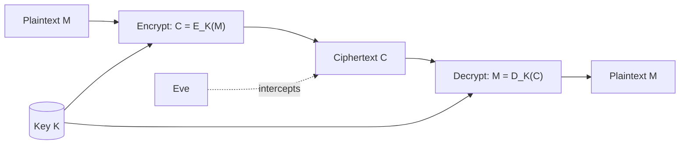
*Fig. 1: Encryption model.*

**Terminology.**
1. **Plaintext (M):** the original message. **Ciphertext (C):** the encrypted message.
2. **Encryption E:** E(M) = C. **Decryption D:** D(C) = M, so D(E(M)) = M.
3. **Cipher:** the mathematical function used. A **restricted algorithm** depends on keeping the algorithm secret — inadequate today.
4. **Key K:** a value from a large set, the **keyspace**; E<sub>K</sub>(M) = C, D<sub>K</sub>(C) = M. Security lies in the key, not the algorithm (Kerckhoffs).
5. **Symmetric algorithm:** the same key encrypts and decrypts (DES, AES); stream or block ciphers.
6. **Public-key algorithm:** a public encryption key and a private decryption key (RSA).
7. **Cryptosystem:** algorithm + all plaintexts, ciphertexts and keys.
8. **Services:** confidentiality, authentication, integrity, non-repudiation.

**Substitution ciphers.** <u>Each plaintext character is replaced by another character.</u> Four types:
- **Simple:** Caesar, C = (P + 3) mod 26: ATTACKATDAWN → **DWWDFNDWGDZQ**.
- **Homophonic:** one letter → several symbols (E → 5, 13, 25), to flatten frequencies.
- **Polygram:** blocks of letters: Playfair (pairs), Hill (matrix).
- **Polyalphabetic:** changing alphabets: Vigenère, key LEMON: ATTACKATDAWN → **LXFOPVEFRNHR**.

**Transposition ciphers.** <u>The letters stay the same but their order is permuted.</u>
- **Rail fence (depth 3):** ATTACKATDAWN → **ACDTAKTANTAW**.
- **Columnar:** write in rows under a keyword, read columns in alphabetical order of the key letters.

| Basis | Substitution | Transposition |
|---|---|---|
| Changes | Letters | Positions |
| Frequencies | Changed | Unchanged |
| Attack | Frequency analysis | Anagramming |
| Modern use | S-boxes (confusion) | Permutations (diffusion) |

**Conclusion.** Every classical cipher is a substitution, a transposition or a combination. Modern ciphers such as DES and AES combine both, round after round, to achieve Shannon's confusion and diffusion.
:::

## Q1 (b) Columnar transposition with CIPHER; why classical ciphers fail

::: ans Answer

**Convention:** key letters ranked alphabetically; padding letter X.

**Step 1: rank the key.** CIPHER: C = 1, E = 2, H = 3, I = 4, P = 5, R = 6.

**Step 2: matrix.** MEETMEAFTERTHEPARTY = 19 letters; 6 columns → 4 rows = 24 cells, so 5 X's.

```text
Key :  C  I  P  H  E  R
Rank:  1  4  5  3  2  6
       M  E  E  T  M  E
       A  F  T  E  R  T
       H  E  P  A  R  T
       Y  X  X  X  X  X
```

**Step 3: read columns in rank order.** 1 (C): MAHY · 2 (E): MRRX · 3 (H): TEAX · 4 (I): EFEX · 5 (P): ETPX · 6 (R): ETTX.

**Ciphertext: MAHYMRRXTEAXEFEXETPXETTX.**

*Check:* writing 4 letters back into each column in rank order and reading the rows gives MEETMEAFTERTHEPARTYXXXXX ✓.

**Why classical ciphers are insufficient today.**
1. **Tiny key spaces:** Caesar has 25 keys; a computer tries them instantly.
2. **Frequency leakage:** substitution keeps letter (or digraph) statistics; transposition keeps frequencies exactly.
3. **Linearity:** Hill is broken by a known-plaintext attack with a few blocks.
4. **Periodicity:** Vigenère repeats with the key length (Kasiski test).
5. **Letters only:** not designed for binary data, files, images or packets.
6. **No integrity or authentication:** they hide but cannot detect tampering or prove the sender.
7. **Key distribution:** a shared secret must be carried by hand; no public-key mechanism.
8. **Modern attack models:** known- and chosen-plaintext attacks are routine on the Internet.

**Conclusion.** Classical ciphers teach the two basic ideas, substitution and transposition, but modern security needs large keys, many rounds and additional services (hash, MAC, signatures).
:::

## Q2 (a) Playfair: INSTRUMENTS with key MONARCHY

::: ans Answer

**Introduction.** Playfair (Wheatstone, 1854) is a digraph substitution cipher that encrypts pairs of letters with a 5×5 key square; I and J share a cell.

**Step 1: key square** (MONARCHY, then the remaining letters):

| | | | | |
|---|---|---|---|---|
| **M** | **O** | **N** | **A** | **R** |
| **C** | **H** | **Y** | B | D |
| E | F | G | I/J | K |
| L | P | Q | S | T |
| U | V | W | X | Z |

**Step 2: pairs.** INSTRUMENTS (11 letters): IN ST RU ME NT S**X**.

**Step 3: rules.** Same row → right; same column → below; rectangle → own row, other letter's column.

| Pair | Position (row, col) | Rule | Cipher |
|---|---|---|---|
| IN | I (3,4), N (1,3) | Rectangle | **GA** |
| ST | S (4,4), T (4,5) | Same row | **TL** |
| RU | R (1,5), U (5,1) | Rectangle | **MZ** |
| ME | M (1,1), E (3,1) | Same column | **CL** |
| NT | N (1,3), T (4,5) | Rectangle | **RQ** |
| SX | S (4,4), X (5,4) | Same column | **XA** |

**Ciphertext: GATLMZCLRQXA.**

**Decryption check** (left, up, rectangle): GA → IN, TL → ST, MZ → RU, CL → ME, RQ → NT, XA → SX → INSTRUMENTS(X) ✓.

**Strengths and weaknesses.** 600 digraphs hide single-letter frequencies; but digraph statistics remain, and it can be broken with a few hundred letters of ciphertext.
:::

## Q2 (b) Hill cipher: PAY MORE MONEY

::: ans Answer

**Convention:** C = K × P (mod 26), P a column vector, A = 0 … Z = 25.

**Step 1: check the key.**
det K = 17(18·19 − 21·2) − 17(21·19 − 21·2) + 5(21·2 − 18·2)
= 17(342 − 42) − 17(399 − 42) + 5(42 − 36) = 17(300) − 17(357) + 5(6) = 5100 − 6069 + 30 = **−939**.
−939 mod 26 = −939 + 37 × 26 = **23**; gcd(23, 26) = 1 → invertible (23<sup>−1</sup> mod 26 = 17).

**Step 2: blocks.** PAYMOREMONEY (12 letters): PAY MOR EMO NEY.

**Step 3: multiply.**

| Block | P | K × P | mod 26 | Cipher |
|---|---|---|---|---|
| PAY | (15, 0, 24) | (255+0+120, 315+0+504, 30+0+456) = (375, 819, 486) | (11, 13, 18) | **LNS** |
| MOR | (12, 14, 17) | (204+238+85, 252+252+357, 24+28+323) = (527, 861, 375) | (7, 3, 11) | **HDL** |
| EMO | (4, 12, 14) | (68+204+70, 84+216+294, 8+24+266) = (342, 594, 298) | (4, 22, 12) | **EWM** |
| NEY | (13, 4, 24) | (221+68+120, 273+72+504, 26+8+456) = (409, 849, 490) | (19, 17, 22) | **TRW** |

**Ciphertext: LNSHDLEWMTRW.**

*Note:* Stallings uses row vectors (C = P × K) and gets RRLMWBKASPDH for the same key; write your convention in the first line and use it throughout.

**Security.** Hides single letters and digraphs, but it is linear: m known plaintext–ciphertext blocks give m equations and reveal K.
:::

## Q3 (a) The key distribution problem

::: ans Answer

**Introduction.** Symmetric ciphers (DES, AES) are fast and strong, but both parties must already share the secret key. Delivering that key securely is the key distribution problem — Schneier calls key management the hardest part of cryptography.

**Definition.** <u>The key distribution problem is the difficulty of getting a secret key to both parties of a symmetric cryptosystem over a channel that an attacker may read or modify, and of managing such keys for many users.</u>

**Why it is a problem (critical analysis).**
1. The key is as valuable as all messages it protects; it cannot be sent in the clear.
2. A compromised key lets Eve read and Mallory forge all traffic.
3. **Scale:** n users need n(n − 1)/2 keys: 1000 users → 499,500 keys.
4. Keys must be changed regularly, so the problem repeats.
5. Physical delivery (courier) is slow, costly and does not scale to the Internet.

**Solution 1: a trusted third party (KDC).**

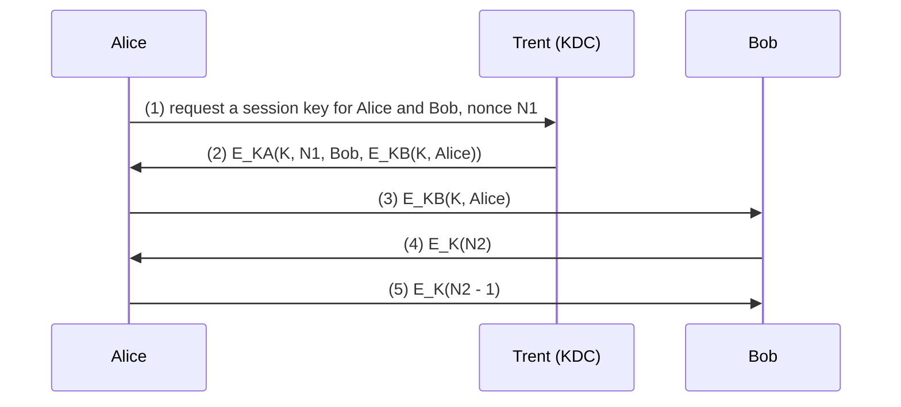
*Fig. 2: KDC-based distribution (Needham–Schroeder).*

*Protocol-level justification:* each user shares only one master key with Trent (n keys total); Trent creates a fresh random session key K for each conversation; E<sub>KA</sub> proves to Alice that the reply came from Trent (only Trent knows K<sub>A</sub>); the nonce N1 proves freshness; steps 4–5 prove Bob holds K. *Weaknesses:* Trent must be trusted completely and is a bottleneck; replay of old compromised keys (fixed with timestamps, as in Kerberos).

**Solution 2: public-key cryptography.**

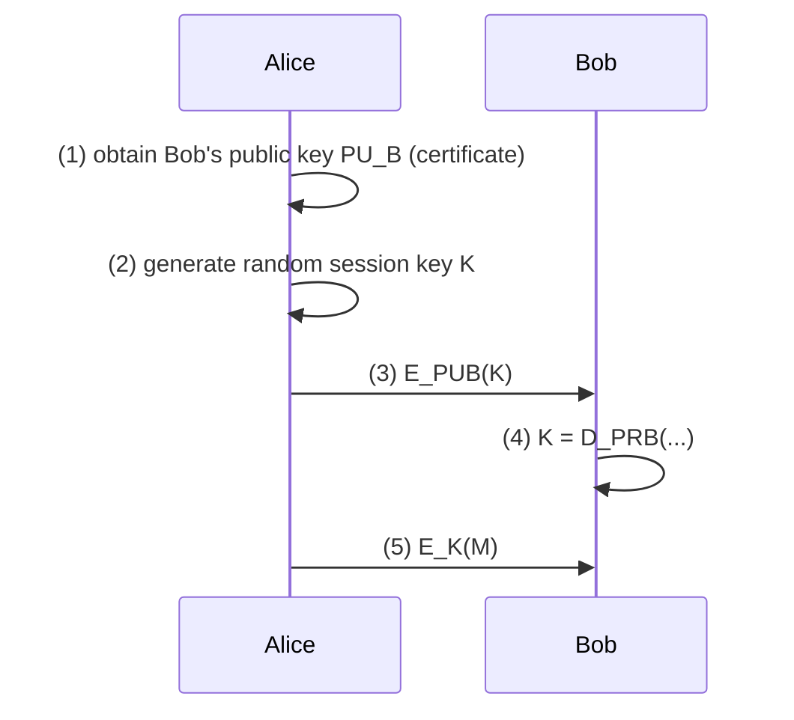
*Fig. 3: Hybrid key distribution.*

*Justification:* no secret is ever transmitted; only Bob's private key can recover K; 2n keys for n users. *Weakness:* man-in-the-middle — Mallory substitutes his public key. **Trusted third parties fix this:** a CA signs Bob's public key (certificate), so Alice can verify it.

**Conclusion.** The KDC reduces the number of keys but needs trust in Trent; public-key cryptography removes the need to share secrets but needs authenticated public keys. Practical systems combine them: TLS (certificates + session keys), Kerberos (KDC + tickets).
:::

## Q3 (b) Hash functions in digital signatures; signatures with encryption

::: ans Answer

**Introduction.** A digital signature proves who sent a document and that it was not changed. Public-key signing is slow, so practical schemes sign a short hash of the document.

**Definitions.** <u>A one-way hash function H maps a message of any length to a fixed-length value h, easy to compute but infeasible to invert or to find collisions for. A digital signature is a value computed from (the hash of) a message with the signer's private key and verifiable with the signer's public key.</u>

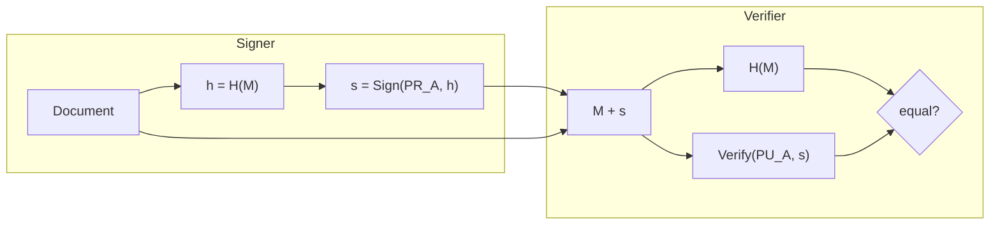
*Fig. 4: Hash-and-sign.*

**Protocol.** (1) Alice hashes the document. (2) She signs the hash with her private key. (3) She sends document + signed hash. (4) Bob hashes the document, verifies the signature with Alice's public key and compares.

**Why sign the hash, not the message.**
1. **Speed:** one slow public-key operation on 256 bits instead of on megabytes.
2. **Short signature** regardless of document length.
3. **Security:** raw RSA signing of messages allows forgery via the multiplicative property (s<sub>1</sub>s<sub>2</sub> is a signature on m<sub>1</sub>m<sub>2</sub>) and block rearrangement; the hash destroys this structure.
4. **Separation:** the signature can be stored apart from the document; the document may stay public.
5. **Collision resistance** of H makes moving a signature to another document infeasible.

**Toy example:** RSA n = 33, e = 3, d = 7; H(M) = 5 → s = 5<sup>7</sup> mod 33 = **14**; verify 14<sup>3</sup> mod 33 = 2744 mod 33 = **5** ✓.

**Digital signatures with encryption.**

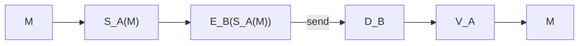
*Fig. 5: Sign, then encrypt.*

1. Alice signs with her private key: S<sub>A</sub>(M).
2. Alice encrypts with Bob's public key: E<sub>B</sub>(S<sub>A</sub>(M)).
3. Bob decrypts with his private key: S<sub>A</sub>(M).
4. Bob verifies with Alice's public key: M.

This gives **confidentiality + authentication + integrity + non-repudiation**. Sign before encrypting so the signature covers the real message. Use **separate key pairs** for signing and encryption to stop Schneier's **resend-the-message-as-receipt attack**.

**Conclusion.** Hashing makes signatures fast, short and secure; adding encryption turns a signed message into a signed, sealed letter.
:::

## Q4 (a) Diffie–Hellman with q = 23, α = 5

::: ans Answer

**Introduction.** Diffie and Hellman (1976) showed two parties can agree on a secret key over a public channel, with no shared secret beforehand.

**Definition.** <u>Diffie–Hellman is a key-agreement protocol whose security rests on the difficulty of computing discrete logarithms modulo a large prime.</u>

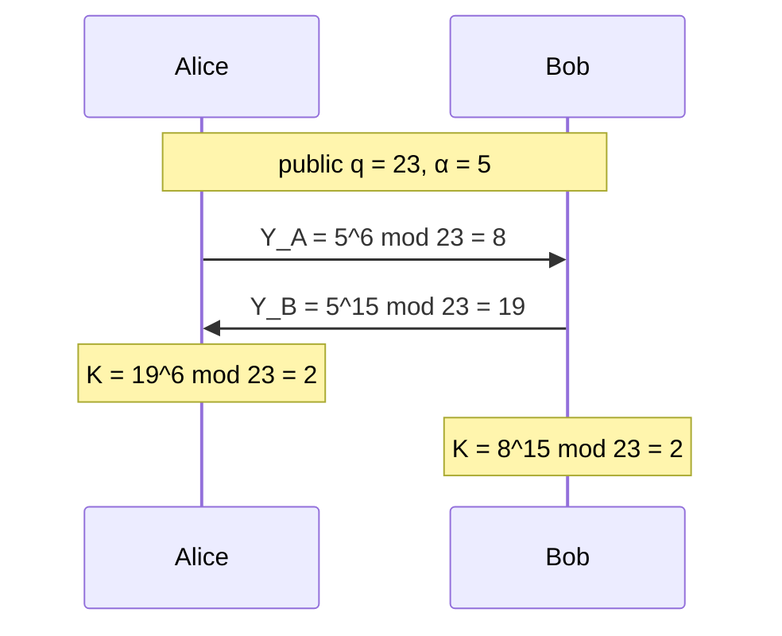
*Fig. 6: Diffie–Hellman exchange.*

**Algorithm.** Public q (prime) and α (primitive root). Alice: private X<sub>A</sub>, public Y<sub>A</sub> = α<sup>X<sub>A</sub></sup> mod q. Bob: private X<sub>B</sub>, public Y<sub>B</sub> = α<sup>X<sub>B</sub></sup> mod q. Shared key K = Y<sub>B</sub><sup>X<sub>A</sub></sup> = Y<sub>A</sub><sup>X<sub>B</sub></sup> = α<sup>X<sub>A</sub>X<sub>B</sub></sup> mod q.

**Verification (q = 23, α = 5, X<sub>A</sub> = 6, X<sub>B</sub> = 15).**
- 5<sup>2</sup> = 25 ≡ 2; 5<sup>4</sup> ≡ 4; 5<sup>6</sup> = 5<sup>4</sup> × 5<sup>2</sup> ≡ 8 → **Y<sub>A</sub> = 8**.
- 5<sup>8</sup> ≡ 16; 5<sup>15</sup> = 5<sup>8</sup> × 5<sup>4</sup> × 5<sup>2</sup> × 5 ≡ 16 × 4 × 2 × 5 = 640 ≡ 640 − 27 × 23 = **19** → **Y<sub>B</sub> = 19**.
- Alice: K = 19<sup>6</sup> mod 23: 19 ≡ −4; (−4)<sup>2</sup> = 16; (−4)<sup>4</sup> = 256 ≡ 3; (−4)<sup>6</sup> ≡ 3 × 16 = 48 ≡ **2**.
- Bob: K = 8<sup>15</sup> mod 23: 8<sup>2</sup> = 64 ≡ 18; 8<sup>4</sup> ≡ 18<sup>2</sup> = 324 ≡ 2; 8<sup>8</sup> ≡ 4; 8<sup>15</sup> = 8<sup>8</sup> × 8<sup>4</sup> × 8<sup>2</sup> × 8 ≡ 4 × 2 × 18 × 8 = 1152 ≡ 1152 − 50 × 23 = **2**.

**Both obtain K = 2** ✓.

**Man-in-the-middle attack.** Mallory intercepts Y<sub>A</sub> and sends Bob his own Y<sub>M</sub>; intercepts Y<sub>B</sub> and sends Alice Y<sub>M</sub>. Alice shares one key with Mallory, Bob another; Mallory decrypts, reads, re-encrypts every message. Diffie–Hellman alone gives **no authentication**. **Defence:** sign the public values (station-to-station protocol), use certificates, or the interlock protocol.

**Conclusion.** Both parties reach the same key K = 2 although only 8 and 19 travelled; an eavesdropper must solve a discrete logarithm. Authentication must be added against man-in-the-middle.
:::

## Q4 (b) Authentication

::: ans Answer

**Introduction.** When Alice logs in to a computer, how does the host know it is Alice? Authentication protocols answer this without letting eavesdroppers or thieves of the host's files impersonate her later.

**Definition.** <u>Authentication is the process by which one party verifies the identity claimed by another.</u>

**1. Authentication using one-way functions.** The host stores f(P), not the password P.
(1) Alice sends P. (2) Host computes f(P). (3) Host compares with the stored f(P).
Stealing the file does not reveal passwords, because f cannot be reversed.

**2. Dictionary attacks and salt.** Mallory hashes a dictionary of likely passwords and compares with the stolen file. **Salt** is a random string stored with each password; the host stores (salt, f(P ‖ salt)). The attacker now needs a separate dictionary per salt value; with a 12-bit salt (UNIX) his work grows 4096 times. Salt does not protect a single weak password but stops mass precomputation.

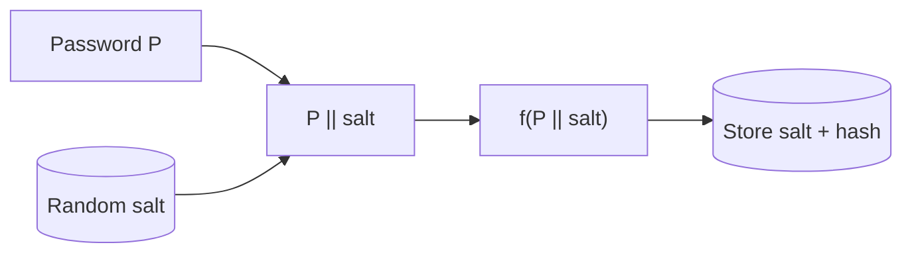
*Fig. 7: Salted password storage.*

**3. SKEY (Lamport one-time passwords).** Alice chooses random R; the host computes x<sub>1</sub> = f(R), x<sub>2</sub> = f(x<sub>1</sub>), … x<sub>101</sub>, stores x<sub>101</sub>; Alice keeps x<sub>1</sub> … x<sub>100</sub>. Login: Alice sends x<sub>100</sub>; host checks f(x<sub>100</sub>) = x<sub>101</sub>, then stores x<sub>100</sub>. Next time she uses x<sub>99</sub>. An eavesdropper's captured password is already used up.

**4. Authentication using public-key cryptography (challenge–response).**
(1) Host sends Alice a random string R. (2) Alice encrypts R with her private key and returns it. (3) Host decrypts with Alice's public key; if it equals R, Alice is authenticated. The private key never leaves Alice; each challenge is new, so replay fails.

**5. Mutual authentication (interlock):** both send half of an encrypted password, then the other half, so a man in the middle cannot relay in time.

**Comparison.**

| Method | Stops | Weakness |
|---|---|---|
| f(P) stored | Theft of password file | Dictionary attack |
| Salt | Precomputed dictionaries | Weak single passwords |
| SKEY | Eavesdropping and replay | Finite list; man-in-the-middle |
| Challenge–response | Eavesdropping, replay, file theft | Needs key management |

**Conclusion.** From hashed passwords to public-key challenge–response, each method removes a weakness of the previous one. Modern systems combine salted hashes, one-time codes (OTP) and public-key authentication (FIDO keys).
:::

## Q5 (a) Secret splitting and secret sharing

::: ans Answer

**Introduction.** Some secrets — a bank vault code, a CA's root key — are too important for one person. Secret splitting and secret sharing divide them among several people.

**Secret splitting.** <u>Divide a message into pieces, none of which alone reveals anything, but all of which together recover it.</u>
1. Trent generates random R of the same length as M.
2. Trent computes S = M ⊕ R.
3. Alice gets R; Bob gets S.
4. Together: M = R ⊕ S.
Each piece alone is random (a one-time pad). For more people, use several random strings. *Limitation:* every piece is needed; losing one loses the secret.

**Secret sharing.** <u>An (m, n)-threshold scheme divides a secret into n shares so that any m shares recover the secret and m − 1 shares reveal nothing.</u> (Shamir 1979.)

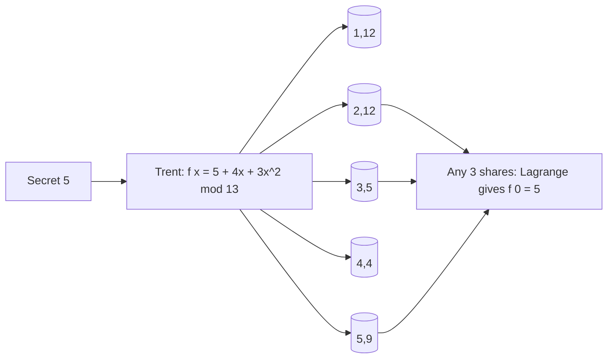
*Fig. 8: A (3, 5) Shamir scheme.*

**Shamir's scheme.** Choose prime p; random polynomial of degree m − 1 with f(0) = secret; share i = (i, f(i)); recover f(0) by Lagrange interpolation.

**Worked (3, 5) example.** p = 13, secret S = 5, f(x) = 5 + 4x + 3x<sup>2</sup> (mod 13).

| x | 5 + 4x + 3x<sup>2</sup> | mod 13 |
|---|---|---|
| 1 | 12 | **12** |
| 2 | 25 | **12** |
| 3 | 44 | **5** |
| 4 | 69 | **4** |
| 5 | 100 | **9** |

**Recover from shares (2, 12), (3, 5), (5, 9):** S = Σ y<sub>i</sub> Π<sub>j≠i</sub> x<sub>j</sub>/(x<sub>j</sub> − x<sub>i</sub>) mod 13.
- (2, 12): 12 × (3 × 5)/((3 − 2)(5 − 2)) = 12 × 15 × 3<sup>−1</sup> = 12 × 2 × 9 = 216 ≡ **8**.
- (3, 5): 5 × (2 × 5)/((2 − 3)(5 − 3)) = 5 × 10 × (−2)<sup>−1</sup> = 5 × 10 × 6 = 300 ≡ **1**.
- (5, 9): 9 × (2 × 3)/((2 − 5)(3 − 5)) = 9 × 6 × 6<sup>−1</sup> = 9 × 6 × 11 = 594 ≡ **9**.
- S = 8 + 1 + 9 = 18 ≡ **5** ✓.

(Inverses mod 13: 3<sup>−1</sup> = 9, 11<sup>−1</sup> = 6, 6<sup>−1</sup> = 11.)

**Security requirements:** threshold secrecy (m − 1 shares give nothing); correct reconstruction; honest dealer or verifiable shares; detection of cheaters who submit false shares; secure distribution; fresh random coefficients.

**Applications:** splitting a CA's or a bank's master key among officers; fault-tolerant key backup (any m of n data centres); threshold signatures and multi-signature wallets; nuclear launch codes; e-voting.

**Conclusion.** Secret splitting needs everyone; secret sharing needs any m of n, giving both security (no small group can cheat) and fault tolerance (some shares may be lost).
:::

## Q5 (b) Zero-knowledge proofs and ZKP of identity

::: ans Answer

**Introduction.** Normally, to prove you know a password you reveal it. A zero-knowledge proof lets Peggy convince Victor she knows a secret while revealing nothing about it.

**Definition.** <u>A zero-knowledge proof is an interactive protocol by which a prover convinces a verifier that a statement is true, or that she knows a secret, without revealing any information beyond that fact.</u>

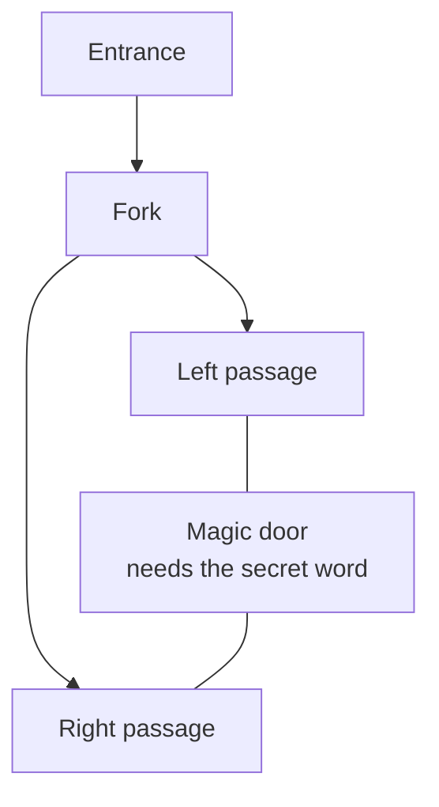
*Fig. 9: The zero-knowledge cave.*

**Cave protocol.** (1) Victor waits outside; Peggy goes to C or D. (2) Victor comes to the fork and calls "left" or "right" at random. (3) Peggy comes out that side, using the door if necessary. (4) Repeat n times. A cheater survives each round with probability 1/2; after 20 rounds, 1 in a million.

**Properties.**
1. **Completeness:** an honest prover always convinces an honest verifier.
2. **Soundness:** a cheating prover succeeds only with negligible probability (1/2<sup>n</sup>).
3. **Zero-knowledge:** the verifier learns nothing he could not simulate; he cannot convince anyone else.

**ZKP of identity: Fiat–Shamir.** Trusted centre publishes n = pq; Peggy's secret s, public v = s<sup>2</sup> mod n.
1. Peggy picks random r, sends x = r<sup>2</sup> mod n.
2. Victor sends a random bit b.
3. Peggy sends y = r × s<sup>b</sup> mod n.
4. Victor checks y<sup>2</sup> ≡ x × v<sup>b</sup> (mod n). Repeat.

*Example:* n = 91, s = 10 → v = 100 mod 91 = **9**. r = 17 → x = 289 mod 91 = **16**. Challenge b = 1 → y = 170 mod 91 = **79**. Check: 79<sup>2</sup> = 6241 ≡ **53** and x × v = 16 × 9 = 144 ≡ **53** ✓.

**Why it is zero-knowledge:** if b = 0, Victor sees only a random square root r; if b = 1, he sees r × s, which looks random. A cheater who guesses b in advance can prepare x, but only for one value of b.

**Problems:** **mafia fraud / chess grandmaster problem** (Mallory relays between Peggy and Victor in real time); defended by tight timing or distance bounding.

**Applications:** smart-card login, password-less authentication, blockchain privacy (zk-SNARKs), anonymous credentials.

**Conclusion.** ZKPs separate "proving" from "revealing": Peggy proves knowledge with overwhelming probability while Victor learns nothing reusable.
:::

## Q6 (a) Blind signatures, oblivious transfer, oblivious signatures

::: ans Answer

**Introduction.** Some applications need a signature without the signer learning what he signs (digital cash, voting), or a transfer in which the sender does not know what the receiver got. These are blind signatures and oblivious transfer.

**1. Blind signatures.** <u>Bob signs a document without seeing its contents: Alice blinds it, Bob signs, Alice unblinds and has Bob's valid signature on the original.</u> (Chaum.)

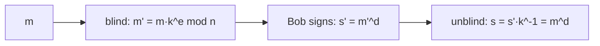
*Fig. 10: RSA blind signature.*

*Example:* n = 77 (7 × 11), e = 7, d = 43; m = 5, blinding factor k = 2.
- k<sup>e</sup> = 2<sup>7</sup> = 128 ≡ 51; m′ = 5 × 51 = 255 ≡ **24**.
- s′ = 24<sup>43</sup> mod 77 = **52**.
- k<sup>−1</sup> = 39 (2 × 39 = 78 ≡ 1); s = 52 × 39 = 2028 ≡ **26**.
- Verify: 26<sup>7</sup> mod 77 = **5** = m ✓.

**Cut-and-choose:** Alice prepares 100 blinded documents; Bob opens 99, checks them, and signs the last blind; cheating is caught with probability 99%. **Uses:** anonymous digital cash, e-voting.

**2. Oblivious transfer.** <u>Alice sends Bob one of several secrets; Bob gets exactly one, and Alice does not know which.</u>
1. Alice sends Bob two public keys.
2. Bob encrypts a random key K with one of them (his choice) and returns it.
3. Alice decrypts it with both private keys (one gives K, one gives garbage; she cannot tell which).
4. Alice encrypts secret 1 with result 1 and secret 2 with result 2, and sends both.
5. Bob can open only the one encrypted with K.

**3. Oblivious signatures.** <u>Bob obtains Alice's signature on one of n messages of his choice; Alice does not learn which, and Bob cannot get more than one.</u> Alice knows the possible messages, unlike a blind signature, where she sees nothing.

**Privacy and anonymity.**

| Primitive | What the signer/sender does not learn | Privacy gain |
|---|---|---|
| Blind signature | The content signed | Unlinkability: signer cannot connect a later signature to the signing event |
| Oblivious transfer | Which secret was received | Receiver's choice is private |
| Oblivious signature | Which of the known messages was signed | Signer cannot tell the user's choice |

**Conclusion.** These primitives let parties co-operate while revealing as little as possible — the basis of anonymous cash, secret ballots and fair exchange.
:::

## Q6 (b) Simultaneous contract signing

::: ans Answer

**Introduction.** On paper, two people sign a contract at the same table. Over a network, whoever signs first takes a risk: the other may take the signature and refuse to sign. Simultaneous contract signing makes the exchange fair.

**Definition.** <u>Simultaneous contract signing is a protocol by which two parties sign a contract so that either both become bound or neither does.</u>

**1. With an arbitrator.**
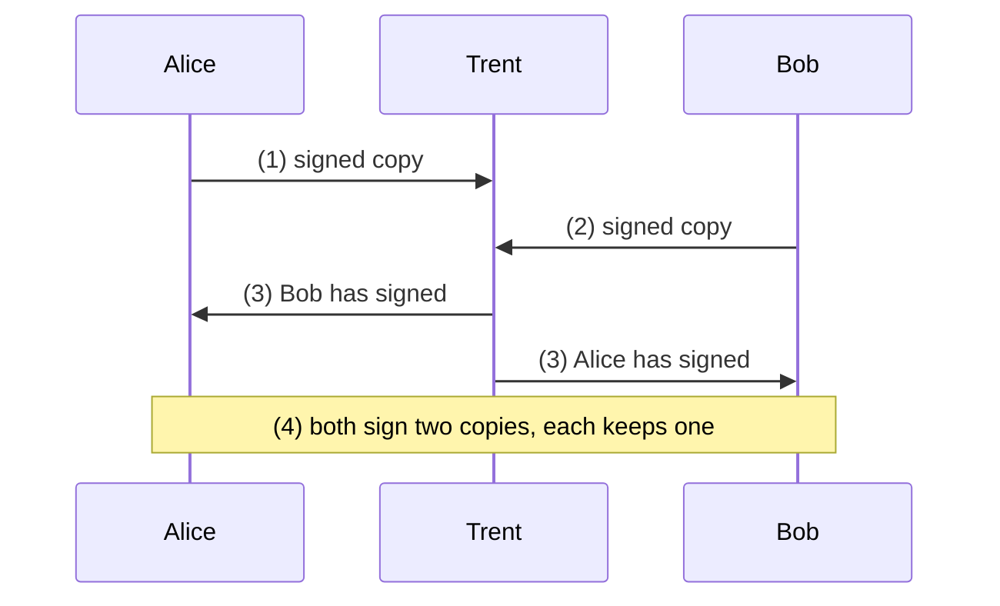
*Fig. 11: Contract signing with an arbitrator.* Fair but needs a trusted, online third party.

**2. Face to face, without an arbitrator:** sign alternately one letter at a time; neither is ever more than one letter ahead.

**3. Not face to face (probabilistic):** exchange signed statements "I agree to be bound with probability p", increasing p in steps of 1% to 100%; a judge decides an interrupted contract with the last stated probability.

**4. Cryptographic (Even–Goldreich–Lempel):**
1. Each party generates n pairs of symmetric keys and n pairs of messages L<sub>i</sub>, R<sub>i</sub> ("left/right half of my i-th signature"), each encrypted with one key of the pair.
2. They exchange the encrypted pairs.
3. By **oblivious transfer**, each receives one key of every pair of the other's keys, without the sender knowing which.
4. Each checks the halves it can decrypt are valid.
5. Both release all keys **bit by bit**, alternately. Once a party has both keys of any pair, it holds a complete signature.

**Fairness and non-repudiation.**
- **Oblivious transfer** hides which halves each side has, so neither knows when to stop.
- **Bit-by-bit release** keeps them within one bit of each other.
- **Zero-knowledge proofs** let a party prove its shares are genuine without revealing the signature early.
- **Blind/oblivious signatures** let an arbitrator certify without learning content.
- **Digital signatures** make the final contract non-repudiable.

**Weakness:** a party with much more computing power can stop early and brute-force the remaining bits.

**Conclusion.** Contract signing shows how protocols build fairness from primitives: an arbitrator if one is available, or oblivious transfer and gradual release if not.
:::

## Q7 (a) Key space; linear vs nonlinear; key selection

::: ans Answer

**Introduction.** A cipher's strength against brute force depends on how many keys an attacker must try — the key space — and on whether real keys use all of it.

**Definition.** <u>The key space is the set of all possible keys of an algorithm; an n-bit key gives 2<sup>n</sup> keys, and a brute-force attack needs on average 2<sup>n−1</sup> trials.</u>

**Linear key space:** <u>all keys are equally strong; a random key gives full security.</u>
**Nonlinear key space (Schneier):** <u>only some keys are strong; keys must be built by a secret rule, and other keys give weak encryption.</u> Used in military equipment so that a captured device is useless to the enemy, who cannot generate strong keys.

| Basis | Linear | Nonlinear |
|---|---|---|
| Key strength | Uniform | Only "correct" keys strong |
| Key generation | Any random key | Secret rule needed |
| Purpose | General cryptography | Equipment that may be captured |
| Effective strength | log<sub>2</sub>(key space) | Full for insiders, reduced for outsiders |
| Risk | — | Rule may leak; accidental weak keys |

**Strategies for key selection.**
1. True random generation (hardware RNG, CSPRNG).
2. Use the full key space (all byte values, not just typed characters).
3. Adequate length (≥ 128-bit symmetric, ≥ 2048-bit RSA).
4. Pass phrases with key crunching / KDFs (PBKDF2, bcrypt) with salt.
5. Standard generators (ANSI X9.17).
6. Avoid algorithm weak keys (DES weak and semi-weak keys).
7. Separate keys per purpose and per session; limited lifetime.

**Improper selection.** An 8-lowercase-letter key has only 26<sup>8</sup> ≈ 2.1 × 10<sup>11</sup> values (37.6 bits): about 2.4 days at a million keys per second, against 585,000 years for 8 random bytes. Dictionary attacks find about 40% of user-chosen passwords (Klein). Predictable generators (Netscape 1995; Debian 2008: 32,768 keys) and key reuse (one-time pad, DSA's k) give attackers the key directly.

**Conclusion.** Strength comes from a large linear key space actually used by random keys; nonlinear key spaces are a deliberate military tool, and accidental nonlinearity or poor selection is a weakness.
:::

## Q7 (b) Key management and public-key distribution

::: ans Answer

**Introduction.** Schneier: "Key management is the hardest part of cryptography." Algorithms are public and strong; the attacker goes after the keys.

**Definition.** <u>Key management is the generation, distribution, verification, storage, use, updating, backup, revocation and destruction of cryptographic keys over their life cycle.</u>

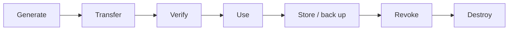
*Fig. 12: Key life cycle.*

**Key management activities.** Random generation; transfer with key-encryption keys or split keys; verification (signed by Trent, fingerprints); use with control vectors; periodic updating; secure storage (HSM); backup and escrow; revocation of compromised keys; secure destruction.

**Public-key distribution (Stallings).**
1. **Public announcement:** users broadcast their keys. *Problem:* anyone can forge an announcement.
2. **Publicly available directory:** a trusted organisation maintains {name, key}; registration in person. *Problem:* the directory itself can be attacked or impersonated.
3. **Public-key authority:** answers requests with signed, timestamped replies: A → Auth: request ‖ T<sub>1</sub>; Auth → A: E(PR<sub>auth</sub>, PU<sub>B</sub> ‖ request ‖ T<sub>1</sub>); then A and B exchange nonces under each other's keys. *Problem:* the authority must be online and is a bottleneck.
4. **Public-key certificates:** a CA issues C<sub>A</sub> = E(PR<sub>CA</sub>, [T ‖ ID<sub>A</sub> ‖ PU<sub>A</sub>]); users exchange certificates directly and verify them offline with the CA's public key (X.509, PKI).

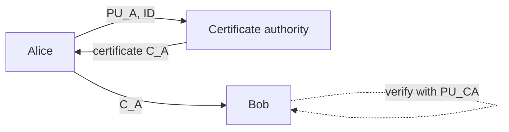
*Fig. 13: Distribution with certificates.*

**Challenges.** Trust in CAs (a compromised CA issues false certificates); revocation (CRLs, OCSP) is slow; scale and hierarchy of CAs; verifying identities before issue; expiry and clock synchronisation; protecting private keys; users ignoring warnings; web of trust (PGP) is decentralised but hard to judge.

**Conclusion.** Public keys need authenticity, not secrecy. Certificates from a trusted CA are the practical answer, but they move the trust problem to the CA and add revocation and scale problems.
:::

## Q8 Short notes (write any four)

::: ans (a) DES
**DES** (FIPS 46, 1977; IBM with NSA) is a symmetric **Feistel** block cipher: **64-bit block, 56-bit key (64 with parity), 16 rounds**. Structure: initial permutation → 16 rounds (L<sub>i</sub> = R<sub>i−1</sub>, R<sub>i</sub> = L<sub>i−1</sub> ⊕ f(R<sub>i−1</sub>, K<sub>i</sub>)) → swap → final permutation. **f-function:** expansion 32 → 48 bits, XOR with 48-bit subkey, eight **S-boxes** (6 → 4 bits; the only non-linear part), P-box permutation. **Key schedule:** PC-1 (56 bits), left shifts by 1 or 2 per round, PC-2 (48-bit subkey). Decryption uses subkeys in reverse. **Security:** the 56-bit key was brute-forced in 56 hours (1998); weak keys; replaced by 3DES and AES.
:::

::: ans (b) RSA
**RSA** (Rivest, Shamir, Adleman, 1978) is a public-key algorithm for encryption and signatures based on the difficulty of factoring. **Keys:** primes p, q; n = pq; φ(n) = (p − 1)(q − 1); e with gcd(e, φ) = 1; d = e<sup>−1</sup> mod φ. **Encrypt:** c = m<sup>e</sup> mod n; **decrypt:** m = c<sup>d</sup> mod n. **Example:** p = 7, q = 13 → n = 91, φ = 72, e = 5, d = 29 (5 × 29 = 145 ≡ 1); m = 10 → c = 10<sup>5</sup> mod 91 = **82** → 82<sup>29</sup> mod 91 = **10** ✓. **Security:** use ≥ 2048-bit n; beware chosen-ciphertext, common-modulus, low-exponent and timing attacks; about 1000× slower than DES, so used for keys and signatures.
:::

::: ans (c) Public key vs symmetric cryptography
| Symmetric | Public key |
|---|---|
| One shared key | Public + private keys |
| Fast | About 1000× slower |
| Key distribution hard | Easy (public key published) |
| n(n − 1)/2 keys | 2n keys |
| Confidentiality, MAC | Confidentiality, signatures, key exchange |
| DES, AES | RSA, DH, DSA, ECC |

Public-key cryptography is not a replacement for symmetric: **hybrid systems** use public key to exchange a session key and symmetric ciphers for the data (TLS, PGP).
:::

::: ans (d) One-time pad
A **one-time pad** (Vernam and Mauborgne, 1917) encrypts with a **truly random key as long as the message, used once**: C = P ⊕ K (or mod 26 for letters). It is the only **unconditionally secure** cipher: every plaintext of that length is equally likely, so the ciphertext reveals nothing (perfect secrecy). *Example:* HELLO + XMCKL = EQNVZ. **Conditions:** random, as long as the message, never reused, destroyed after use. **Problems:** generating, distributing and storing huge random keys; synchronisation. **Use:** the Moscow–Washington hotline, diplomatic traffic.
:::

::: ans (e) Link-by-link vs end-to-end encryption
**Link-by-link:** each communication link is encrypted at the physical/data-link layer; every node decrypts and re-encrypts. All traffic including headers is encrypted (**traffic-flow security**), transparent to users, one key per link — but data is plaintext inside every node, so nodes must be trusted.
**End-to-end:** data is encrypted at the source and decrypted only at the destination (application/transport layer); intermediate nodes see only ciphertext, but headers stay in clear (traffic analysis possible) and each pair of users needs keys.
**Combining both** gives the best security: end-to-end for content, link encryption for headers.
:::

::: ans (f) Cryptographic protocols
A **protocol** is a series of steps, involving two or more parties, designed to accomplish a task; a cryptographic protocol uses cryptography. Requirements: known in advance, agreed by all, unambiguous, complete. **Types:** **arbitrated** (Trent takes part in every run; bottleneck), **adjudicated** (adjudicator only in disputes; detects cheating), **self-enforcing** (protocol itself guarantees fairness). **Attacks:** passive (eavesdropping), active (insert, delete, replay, change messages), cheaters (passive or active). *Examples:* key exchange, authentication, digital signatures, contract signing.
:::
