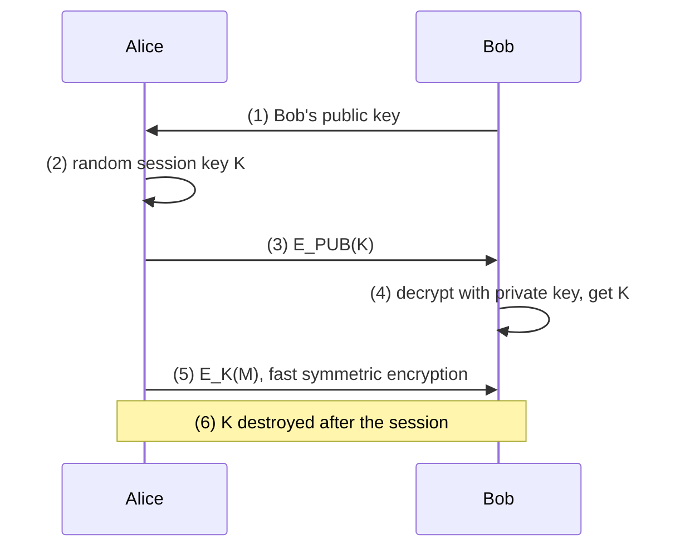
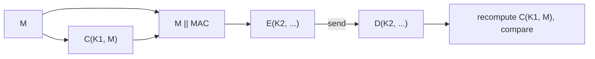
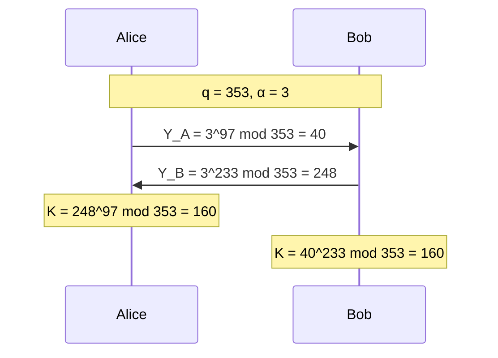
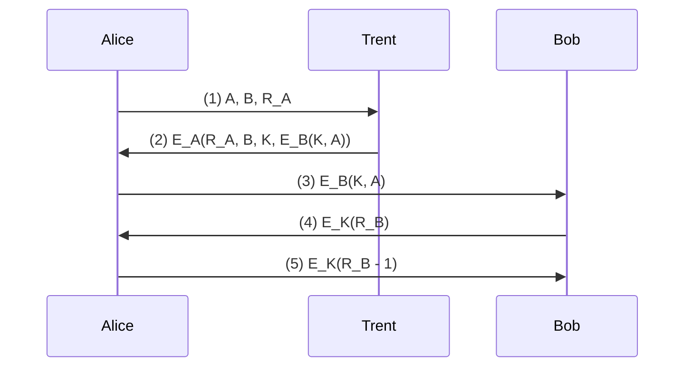
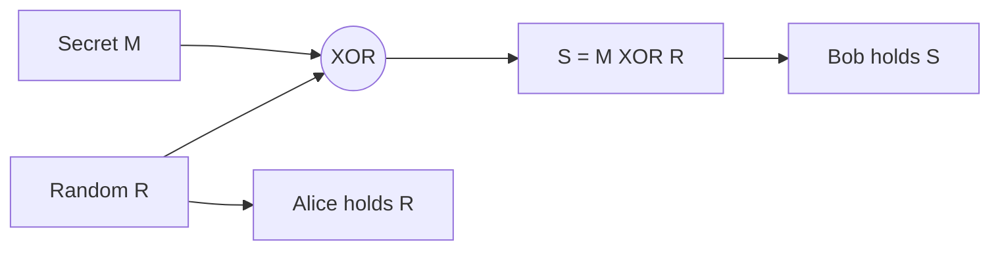
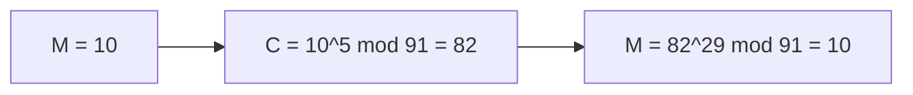
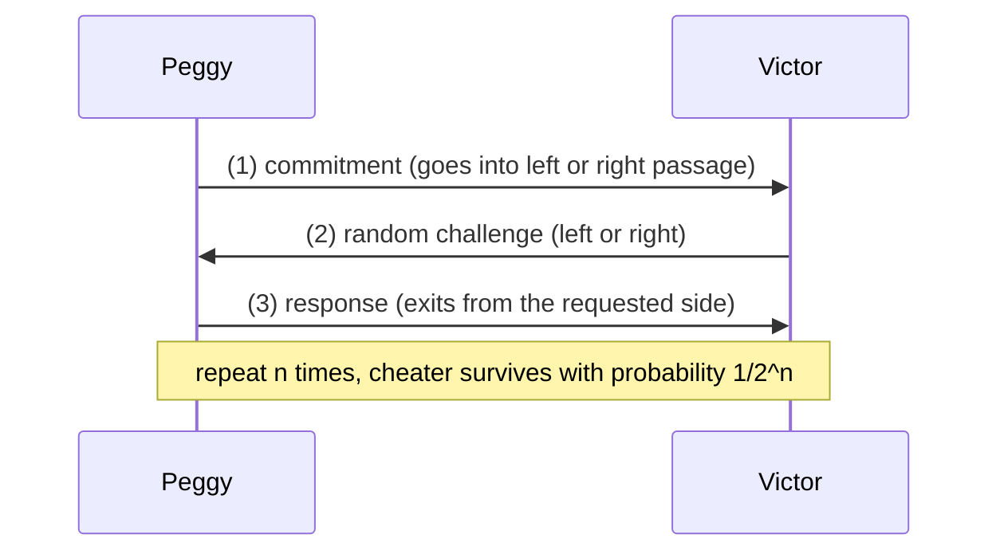
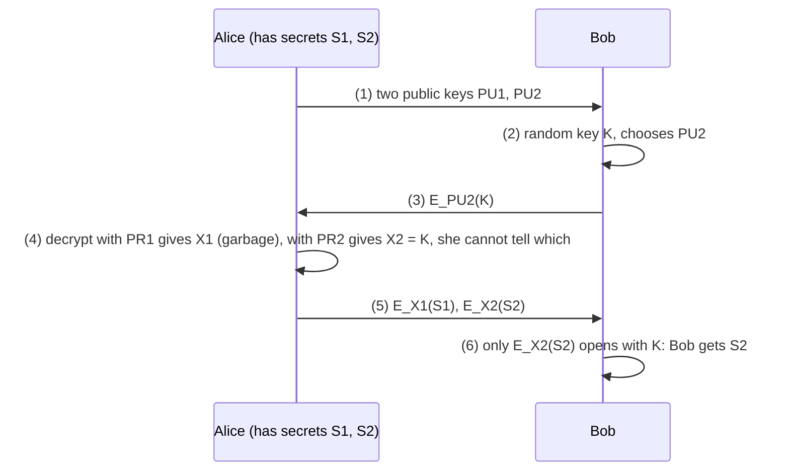
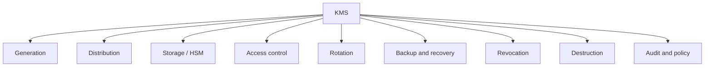
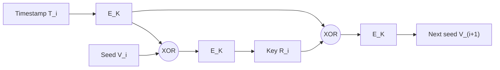

# Mock Paper 2

**B.Tech (Seventh Semester) Examination 2026-27 · CS-443T · Network Security and Cryptography** 
**Time: Three Hours · Maximum Marks: 70** 
**Note:** Attempt any **five** questions. All questions carry equal marks (14 each).

The same question types with new numbers, plus syllabus lines not yet asked: cryptanalysis, Vigenère, one-way and trapdoor functions, authentication functions, interlock and Needham–Schroeder, multiple-key public key, oblivious transfer, the key management system, reduced keyspaces. Every numerical was checked by computer.

## Question paper

| Q | (a) 7 marks | (b) 7 marks |
|---|---|---|
| 1 | Explain the types of cryptanalytic attacks and the security of algorithms. | Encrypt "CRYPTOGRAPHY" with the Vigenère cipher, key "KEY". Explain why polyalphabetic ciphers were stronger than monoalphabetic ones. |
| 2 | Using the Playfair cipher with the key "PLAYFAIR EXAMPLE", encrypt "HIDE THE GOLD IN THE TREE STUMP". | Encrypt "HELP" with the Hill cipher, key [[3, 3], [2, 5]], and decrypt it back. |
| 3 | Explain communication using symmetric and public-key cryptography. What is a hybrid cryptosystem? | What is an authentication function? Discuss MAC for authentication tied to plaintext. Explain one-way and trapdoor one-way functions. |
| 4 | Explain Diffie–Hellman. Verify the shared key for q = 353, α = 3, XA = 97, XB = 233. | Explain key-exchange protocols: interlock protocol, key exchange with signatures, Needham–Schroeder and Kerberos. |
| 5 | Explain multiple-key public-key cryptography and secret splitting. | Explain RSA. With p = 7, q = 13, e = 5, find d and encrypt and decrypt M = 10. |
| 6 | Explain the zero-knowledge cave, the three properties of ZKP, and non-interactive ZKP. | What is oblivious transfer? Explain the 1-out-of-2 protocol and its uses. |
| 7 | Identify and explain the components of a cryptographic key management system. Explain how keys are used (control vectors). | Explain reduced keyspaces, poor key choices, pass phrases and X9.17 key generation. |
| 8 | Write short notes on any four: (a) Nonlinear key space (b) Digital signatures with encryption (c) Simultaneous contract signing (d) Secret sharing (e) Simple XOR (f) Steganography | |

---

## Q1 (a) Cryptanalytic attacks and security of algorithms

::: ans Answer

**Introduction.** A cipher is only as good as its resistance to cryptanalysis. Schneier classifies attacks by what the attacker has, and algorithms by how much work breaking them takes.

**Definition.** <u>Cryptanalysis is the science of recovering the plaintext of a message without access to the key; a successful cryptanalysis may recover the plaintext or the key.</u> Kerckhoffs: assume the cryptanalyst knows the algorithm.

*Fig. 1: Attacks ordered by the attacker's power.*

**Types of attack.**
1. **Ciphertext-only:** ciphertexts of several messages; deduce plaintexts or the key. Hardest for the attacker.
2. **Known-plaintext:** some plaintext–ciphertext pairs (e.g., standard letter headers).
3. **Chosen-plaintext:** the attacker chooses plaintexts to be encrypted (e.g., inserts text into a server's messages).
4. **Adaptive chosen-plaintext:** chooses later plaintexts based on earlier results.
5. **Chosen-ciphertext:** chooses ciphertexts to be decrypted (common against public-key systems).
6. **Chosen-key:** knows relationships between different keys.
7. **Rubber-hose cryptanalysis:** threats, blackmail or torture; **purchase-key** attack: bribery. Often the most effective.

**Security of algorithms.**
- **Unconditionally secure:** not breakable however much ciphertext is available — only the one-time pad.
- **Computationally secure:** cannot be broken with available (current or future) resources.
- If the cost of breaking exceeds the value of the data, or the time needed exceeds the data's lifetime, the algorithm is probably safe.
- **Knudsen's categories of breaking:** total break (key found), global deduction (equivalent algorithm found), instance deduction (one plaintext found), information deduction (some bits found).
- **Complexity of an attack:** data complexity, processing complexity (work factor), storage requirements. *Example:* brute force on a 56-bit key: 255 trials on average.

**Conclusion.** A good algorithm is computationally secure even against chosen-plaintext and chosen-ciphertext attacks, and its whole strength lies in the key.
:::

## Q1 (b) Vigenère: CRYPTOGRAPHY with key KEY

::: ans Answer

**Definition.** <u>The Vigenère cipher is a polyalphabetic substitution cipher: a keyword is repeated over the plaintext and each key letter gives a Caesar shift: Ci = (Pi + Ki) mod 26.</u>

| Plain | C | R | Y | P | T | O | G | R | A | P | H | Y |
|---|---|---|---|---|---|---|---|---|---|---|---|---|
| P value | 2 | 17 | 24 | 15 | 19 | 14 | 6 | 17 | 0 | 15 | 7 | 24 |
| Key | K | E | Y | K | E | Y | K | E | Y | K | E | Y |
| K value | 10 | 4 | 24 | 10 | 4 | 24 | 10 | 4 | 24 | 10 | 4 | 24 |
| Sum mod 26 | 12 | 21 | 22 | 25 | 23 | 12 | 16 | 21 | 24 | 25 | 11 | 22 |
| Cipher | M | V | W | Z | X | M | Q | V | Y | Z | L | W |

**Ciphertext: MVWZXMQVYZLW.** Decryption: Pi = (Ci − Ki) mod 26 gives CRYPTOGRAPHY ✓.

**Why polyalphabetic ciphers are stronger.**
1. One ciphertext letter can come from different plaintext letters (C and O both became M), and one plaintext letter becomes different ciphertext letters whenever it meets a different key letter (A would become K, E or Y). (Here the repeated letters R, P and Y happen to fall on the same key letter each time, because they are 6 or 9 positions apart and the key length is 3: exactly the repetition the Kasiski test exploits.)
2. Single-letter frequencies are flattened, so simple frequency analysis fails.
3. The key space is 26m for an m-letter key.

**Weakness.** The key repeats: the **Kasiski test** finds repeated fragments, whose spacing reveals the key length; then each column is a Caesar cipher solved by frequency analysis. A key as long as the message and random would be a one-time pad.
:::

## Q2 (a) Playfair: key PLAYFAIR EXAMPLE

::: ans Answer

**Key square** (PLAYFIREXM, then the rest):

| | | | | |
|---|---|---|---|---|
| **P** | **L** | **A** | **Y** | **F** |
| **I/J** | **R** | **E** | **X** | **M** |
| B | C | D | G | H |
| K | N | O | Q | S |
| T | U | V | W | Z |

**Pairs.** HIDETHEGOLDINTHETREESTUMP → HI DE TH EG OL DI NT HE TR E**X** ES TU MP (the double E in "TREE" is split with X).

| Pair | Position (row, col) | Rule | Cipher |
|---|---|---|---|
| HI | H (3,5), I (2,1) | Rectangle | **BM** |
| DE | D (3,3), E (2,3) | Same column | **OD** |
| TH | T (5,1), H (3,5) | Rectangle | **ZB** |
| EG | E (2,3), G (3,4) | Rectangle | **XD** |
| OL | O (4,3), L (1,2) | Rectangle | **NA** |
| DI | D (3,3), I (2,1) | Rectangle | **BE** |
| NT | N (4,2), T (5,1) | Rectangle | **KU** |
| HE | H (3,5), E (2,3) | Rectangle | **DM** |
| TR | T (5,1), R (2,2) | Rectangle | **UI** |
| EX | E (2,3), X (2,4) | Same row | **XM** |
| ES | E (2,3), S (4,5) | Rectangle | **MO** |
| TU | T (5,1), U (5,2) | Same row | **UV** |
| MP | M (2,5), P (1,1) | Rectangle | **IF** |

**Ciphertext: BMODZBXDNABEKUDMUIXMMOUVIF.** Decryption gives HIDETHEGOLDINTHETREXESTUMP ✓ (remove the filler X).
:::

## Q2 (b) Hill cipher: HELP with K = [[3, 3], [2, 5]]

::: ans Answer

**Convention:** C = K × P mod 26, column vectors, A = 0.

**Key check:** det K = 3 × 5 − 3 × 2 = 9; gcd(9, 26) = 1 ✓. 9−1 mod 26 = 3 (27 ≡ 1).

**Encrypt.** Blocks HE = (7, 4), LP = (11, 15).
- HE: (3·7 + 3·4, 2·7 + 5·4) = (33, 34) ≡ (7, 8) = **HI**.
- LP: (3·11 + 3·15, 2·11 + 5·15) = (78, 97) ≡ (0, 19) = **AT**.

**Ciphertext: HIAT.**

**Inverse key.** K−1 = 9−1 × adj(K) = 3 × [[5, −3], [−2, 3]] = [[15, −9], [−6, 9]] ≡ **[[15, 17], [20, 9]]** (mod 26).

**Decrypt.**
- HI = (7, 8): (15·7 + 17·8, 20·7 + 9·8) = (241, 212) ≡ (7, 4) = **HE** ✓.
- AT = (0, 19): (17·19, 9·19) = (323, 171) ≡ (11, 15) = **LP** ✓.

**Security:** a known-plaintext attack with two blocks solves K, because the cipher is linear.
:::

## Q3 (a) Symmetric and public-key communication; hybrid cryptosystems

::: ans Answer

**Introduction.** The two families of cryptography solve different problems; real systems use both.

**Communication using symmetric cryptography (Schneier).**
1. Alice and Bob agree on a cryptosystem. 2. They agree on a key. 3. Alice encrypts. 4. Alice sends the ciphertext. 5. Bob decrypts with the same key.

*Problems:* keys must be distributed secretly; a compromised key exposes all messages and allows forgery; n users need n(n − 1)/2 keys.

**Communication using public-key cryptography.**
1. Alice and Bob agree on a public-key cryptosystem. 2. Bob sends Alice his public key (or it is in a database). 3. Alice encrypts with Bob's public key and sends. 4. Bob decrypts with his private key.

*Problems:* about 1000 times slower; vulnerable to chosen-plaintext attacks when the set of possible messages is small; public keys must be authenticated (man-in-the-middle).

**Hybrid cryptosystem.**

*Fig. 2: Hybrid cryptosystem.*

Public-key cryptography encrypts only the short session key; symmetric cryptography (AES) encrypts the bulk data. The session key is used once and destroyed, which limits damage. Used in TLS, PGP, S/MIME, SSH.

| | Symmetric | Public key | Hybrid |
|---|---|---|---|
| Speed | Fast | Slow | Fast for data |
| Key distribution | Hard | Easy | Easy |

**Conclusion.** Public-key cryptography solves key distribution, symmetric cryptography solves speed; the hybrid system gets both.
:::

## Q3 (b) Authentication function, MAC tied to plaintext; one-way and trapdoor functions

::: ans Answer

**Authentication function.** <u>Message authentication verifies that a message came from its claimed source and was not altered; an authentication function produces the authenticator used for this.</u> Three classes (Stallings): **message encryption** (the ciphertext authenticates), **MAC** (a keyed function of the message), **hash function** (a fixed-length hash serves as authenticator).

**MAC.** MAC = C(K, M), K shared by A and B. B recomputes and compares; equality proves integrity and that the sender knows K. No non-repudiation (both know K).

**MAC tied to plaintext:** A → B: **E(K2, [M ‖ C(K1, M)])**.

*Fig. 3: MAC on the plaintext, then encryption.*

1. A computes the MAC on M with K1. 2. Appends it to M. 3. Encrypts the whole with K2. 4. B decrypts with K2. 5. B recomputes the MAC on M and compares. Gives authentication, integrity and confidentiality; the MAC is hidden; B can store M with its MAC.

**One-way function.** <u>Easy to compute f(x) from x, hard to compute x from f(x).</u> *Analogy:* smashing a plate. *Example:* gx mod p (discrete logarithm). Used in password storage, hashing, Diffie–Hellman.

**Trapdoor one-way function.** <u>A one-way function that becomes easy to invert with a secret piece of information (the trapdoor).</u> *Analogy:* a watch is hard to reassemble without the instructions. *Example:* RSA: Me mod n is easy; inverting it is easy only with d (from p and q). Trapdoor functions make public-key encryption possible.

**Conclusion.** MACs give keyed integrity; one-way functions give irreversibility; trapdoor one-way functions give public-key cryptography.
:::

## Q4 (a) Diffie–Hellman with q = 353, α = 3

::: ans Answer

**Algorithm.** Public prime q, primitive root α. YA = αXA mod q, YB = αXB mod q; K = YBXA = YAXB mod q.

*Fig. 4: Diffie–Hellman, Stallings' example.*

**Working (repeated squaring is used for each power):**
- YA = 397 mod 353 = **40**.
- YB = 3233 mod 353 = **248**.
- Alice: K = 24897 mod 353 = **160**.
- Bob: K = 40233 mod 353 = **160**. ✓

*How to show the powers in the exam:* write 97 = 64 + 32 + 1 and compute 32, 34, 38, … 364 mod 353 by squaring, then multiply 364 × 332 × 3 mod 353.

**Why it works:** both equal 397 × 233 mod 353. **Security:** Eve sees 353, 3, 40 and 248; finding 97 from 40 is a discrete logarithm, easy for 353 but infeasible for a 2048-bit prime. **Weakness:** no authentication → man-in-the-middle; fixed by signing YA and YB.
:::

## Q4 (b) Key-exchange protocols

::: ans Answer

**Introduction.** Plain public-key key exchange falls to a man-in-the-middle; Schneier presents several protocols that fix this or use a trusted server.

**1. Interlock protocol (Rivest–Shamir).**
1. Alice and Bob exchange public keys.
2. Alice sends **half** of her encrypted message.
3. Bob sends half of his.
4. Alice sends the second half; Bob combines and decrypts.
5. Bob sends his second half; Alice decrypts.
Mallory cannot decrypt half a block, so he cannot read and re-encrypt in time; he must invent new messages and is caught.

**2. Key exchange with digital signatures.** Trent signs Alice's and Bob's public keys; each verifies Trent's signature before use, so Mallory cannot substitute keys.

**3. Needham–Schroeder (symmetric, with Trent).**

*Fig. 5: Needham–Schroeder.*

RA proves freshness to Alice; steps 4–5 prove both hold K. *Weakness:* if an old K is compromised, Mallory can replay step 3 (Denning–Sacco attack); fixed with timestamps.

**4. Kerberos.** Based on Needham–Schroeder with **timestamps and lifetimes**. Alice gets a **ticket-granting ticket** from the authentication server, then **tickets** for each service from the ticket-granting server; each ticket contains the session key encrypted for the server. Used in Windows domains and MIT networks.

**5. Wide-Mouth Frog** (simplest): Alice → Trent: A, EA(TA, B, K); Trent → Bob: EB(TB, A, K). Relies on synchronised clocks.

**Conclusion.** Interlock and signatures defend public-key exchange against man-in-the-middle; Needham–Schroeder and Kerberos use a trusted server, with nonces and timestamps against replay.
:::

## Q5 (a) Multiple-key public-key cryptography; secret splitting

::: ans Answer

**Multiple-key public-key cryptography.** <u>A generalisation of public-key cryptography with more than two keys, in which a message encrypted with some keys can be decrypted only with the remaining keys.</u> With three keys KA, KB, KC (whose product is 1 in the RSA exponent group): encrypt with KA → decrypt with KB and KC; encrypt with KA and KB → decrypt with KC.

| Encrypted with | Decrypted with |
|---|---|
| KA | KB and KC |
| KB | KA and KC |
| KC | KA and KB |
| KA and KB | KC |

*Uses:* **broadcasting** to selected subgroups (encrypt once so that only chosen members, who hold the complementary keys, can read); documents requiring **several signers** (only the combination of keys produces a valid result).

**Secret splitting.** <u>Dividing a message into pieces such that each piece alone means nothing but all together reconstruct it.</u>
1. Trent generates random R (as long as M).
2. Trent computes S = M ⊕ R.
3. Alice gets R, Bob gets S.
4. Together: M = R ⊕ S.

*Fig. 6: Secret splitting.*

*Example (bits):* M = 1011, R = 0110 → S = 1101; R ⊕ S = 1011 = M ✓.

For n people: Trent generates n − 1 random strings and gives the last person M ⊕ R1 ⊕ … ⊕ Rn−1. Each piece alone is a one-time pad, so it is perfectly secure. *Limitation:* all pieces are needed; one lost piece loses the secret — secret sharing (m of n) fixes this.

**Conclusion.** Multiple-key public key controls who can read; secret splitting controls who must co-operate to recover a secret.
:::

## Q5 (b) RSA with p = 7, q = 13, e = 5

::: ans Answer

**Key generation.**
1. p = 7, q = 13.
2. n = 7 × 13 = **91**.
3. φ(n) = 6 × 12 = **72**.
4. e = 5: gcd(5, 72) = 1 ✓.
5. d: 5d ≡ 1 (mod 72). 5 × 29 = 145 = 2 × 72 + 1 → **d = 29**.
6. Public key {5, 91}; private key {29, 91}.

**Encrypt M = 10:** C = 105 mod 91.
102 = 100 ≡ 9; 104 ≡ 81; 105 ≡ 81 × 10 = 810 ≡ 810 − 8 × 91 = **82**. **C = 82.**

**Decrypt:** M = 8229 mod 91. 82 ≡ −9. (−9)2 = 81 ≡ −10; (−9)4 ≡ 100 ≡ 9; (−9)8 ≡ 81 ≡ −10; (−9)16 ≡ 100 ≡ 9. 29 = 16 + 8 + 4 + 1 → 9 × (−10) × 9 × (−9) = 7290 ≡ 7290 − 80 × 91 = **10** ✓.

*Fig. 7: RSA encryption and decryption.*

**Security:** knowing e = 5 and n = 91, an attacker needs φ(n), hence p and q; factoring 91 is trivial, factoring a 2048-bit n is infeasible.
:::

## Q6 (a) Zero-knowledge: the cave, properties, non-interactive ZKP

::: ans Answer

**Definition.** <u>A zero-knowledge proof convinces a verifier that a prover knows a secret without revealing anything about the secret.</u>

*Fig. 8: The cave protocol as commitment, challenge, response.*

**Cave:** Victor waits outside; Peggy enters one passage; Victor calls a side at random; Peggy must come out that side, which she can always do only if she can open the magic door. After 20 rounds, a cheater's chance is 1/220.

**Properties.** **Completeness** (an honest Peggy always succeeds); **soundness** (a cheater fails with overwhelming probability); **zero-knowledge** (Victor learns nothing he could not simulate — a recording of the run could be faked by choosing the challenges in advance, so it convinces nobody else).

**Basic ZKP structure (Schneier):** Peggy turns her information into a related hard problem; Victor asks her either to reveal the transformation or to solve the new problem; repeat.

**Parallel ZKP:** many rounds at once (Peggy sends n commitments, Victor n challenges) — fewer messages.

**Non-interactive ZKP:** Peggy computes the challenges herself as a **one-way hash of her commitments**; since she cannot predict the hash, she cannot cheat; anyone can verify the proof later without interaction (basis of zk-SNARKs).

**Uses:** identification (Fiat–Shamir, Schnorr), passwords without revealing them, anonymous credentials, blockchain privacy.

**Conclusion.** ZKPs give proof without disclosure; the three properties make them both reliable and private.
:::

## Q6 (b) Oblivious transfer

::: ans Answer

**Definition.** <u>Oblivious transfer is a protocol in which a sender transfers one of several pieces of information to a receiver, but remains oblivious as to which piece was transferred.</u> (Rabin 1981: Bob receives the secret with probability 1/2.)

**1-out-of-2 oblivious transfer:**

*Fig. 9: 1-out-of-2 oblivious transfer.*

**Properties.** Bob gets exactly one secret (the other is encrypted under garbage he cannot know); Alice does not know which one (both her decryptions look random). For safety, Alice can later reveal her private keys so Bob can check she did not cheat.

**Uses.** Fair exchange and **simultaneous contract signing**; **oblivious signatures**; secure multiparty computation (Yao's garbled circuits use OT); private information retrieval; selling information so the seller does not learn what was bought.

**Conclusion.** Oblivious transfer is a basic building block of fair and private protocols: the sender gives, but does not learn what was taken.
:::

## Q7 (a) Components of a key management system; using keys

::: ans Answer

**Definition.** <u>A key management system (KMS) is the set of hardware, software, policies and procedures that handles cryptographic keys throughout their life cycle.</u>

*Fig. 10: Components of a KMS.*

**Components.**
1. **Key generation:** random, inside a hardware security module.
2. **Key distribution:** KDC, KEK-wrapped keys, PKI certificates.
3. **Secure storage:** HSMs, encrypted key stores; never plaintext on disk.
4. **Access control:** authenticated users and applications, roles, dual control for master keys.
5. **Rotation / updating:** scheduled replacement; new keys from old by one-way functions.
6. **Backup, escrow and recovery** (secret sharing for master keys).
7. **Revocation:** CRLs, OCSP for compromised keys.
8. **Destruction:** secure erasure at end of life.
9. **Audit logging and policy:** every operation logged; compliance (NIST SP 800-57).

**Using keys (Schneier).**
- Keys should never appear in plaintext outside secure hardware.
- **Key-use control:** a key may be used only for its purpose. **Control vectors (IBM):** a field attached to each key describing its allowed uses; the key is encrypted under KEK ⊕ control vector, so it decrypts correctly only for the declared use.
- Separate keys for encryption, signing and key encryption; limited lifetimes; keys destroyed after use.

**Conclusion.** A KMS turns key management from ad-hoc practice into a controlled, audited life cycle, and control vectors stop keys being misused for the wrong purpose.
:::

## Q7 (b) Reduced keyspaces, poor keys, pass phrases, X9.17

::: ans Answer

**Reduced keyspaces.** When software restricts keys to typed characters, the real keyspace shrinks:

| 8-character key from | Keys | At 106 keys/s |
|---|---|---|
| Lowercase letters | 2.1 × 1011 | about 2.4 days |
| Alphanumeric | 2.2 × 1014 | about 7 years |
| Printable characters | 6.6 × 1015 | about 210 years |
| Any 8-bit byte | 1.8 × 1019 | about 585,000 years |

**Poor key choices.** People choose names, dates and words. Klein's dictionary attack guessed about 40% of passwords: user name and initials; dictionary words (names, places, films); permutations (capitals, reversals, "passw0rd"); foreign words; word pairs.

**Random keys.** The best keys are random bit strings from a hardware source or a cryptographically secure pseudo-random generator.

**Pass phrases.** A long sentence, hashed to a key (**key crunching**). English carries about 1.3 bits per character, so a 64-bit key needs about 49 characters; modern KDFs add salt and many iterations.

**X9.17 key generation (ANSI).**

*Fig. 11: ANSI X9.17 generator (E_K = triple-DES with a generation key K).*

Ri = EK(EK(Ti) ⊕ Vi); Vi+1 = EK(EK(Ti) ⊕ Ri).

**Conclusion.** Long, random, full-keyspace keys from a standard generator; humans should use pass phrases, never short words.
:::

## Q8 Short notes (write any four)

::: ans (a) Nonlinear key space
The **key space** is the set of all keys; in a **linear** (flat) key space all keys are equally strong. In a **nonlinear key space** (Schneier) only certain keys are strong; the rest give weak encryption, and only someone who knows a **secret rule** can generate strong keys. *Purpose:* military equipment that, if captured, is useless to the enemy, who cannot make strong keys. *Implementation idea:* the key includes a check value derived by a secret function; if the check fails, the algorithm runs a weakened version. *Impact:* full strength for insiders, reduced effective key space for outsiders; but the secret rule can leak, and an accidental nonlinear key space (weak keys) is a flaw.
:::

::: ans (b) Digital signatures with encryption
Signature gives authentication, integrity and non-repudiation; encryption gives confidentiality. **Protocol:** (1) Alice signs M with her private key: SA(M). (2) She encrypts with Bob's public key: EB(SA(M)). (3) Bob decrypts with his private key. (4) Bob verifies with Alice's public key and gets M. **Sign first**, so the signature covers the real message. Use **separate keys** for signing and encryption (or sign hashes with timestamps) to stop the **resend-as-receipt attack**. In practice: sign H(M), encrypt M with a session key, encrypt the session key with Bob's public key (PGP).
:::

::: ans (c) Simultaneous contract signing
Two parties sign a contract so that both or neither are bound. **With an arbitrator:** both send signed copies to Trent, who confirms to each that the other has signed. **Face to face:** sign alternately one letter at a time. **Not face to face:** exchange "bound with probability p" statements, raising p by 1% each step. **Cryptographic (Even–Goldreich–Lempel):** each party encrypts n pairs of signature halves, exchanges keys by **oblivious transfer**, then releases all keys **bit by bit**; neither is more than one bit ahead. Signatures give non-repudiation; OT and gradual release give fairness.
:::

::: ans (d) Secret sharing
A **(m, n)-threshold scheme** splits a secret into n shares; any m recover it, m − 1 reveal nothing. **Shamir:** random polynomial of degree m − 1 with f(0) = S mod p; shares (i, f(i)); recover by Lagrange interpolation. *Example:* p = 13, f(x) = 5 + 4x + 3x2: shares (1,12), (2,12), (3,5), (4,4), (5,9); any three give S = 5. **Uses:** master keys of banks and CAs, fault-tolerant backups, threshold signatures, launch codes. **Requirements:** perfect secrecy below the threshold, verifiable shares, cheater detection.
:::

::: ans (e) Simple XOR
**Simple XOR:** C = P ⊕ K, P = C ⊕ K, since (P ⊕ K) ⊕ K = P. With a short repeating key it is trivial to break: (1) find the key length by XORing the ciphertext with itself shifted and counting coincidences (about 6% for English text at the right shift); (2) XOR the ciphertext with itself shifted by the key length, cancelling the key, then solve the plaintext-XOR-plaintext. Schneier calls it "an embarrassment". With a random, message-length, never-reused key, the same XOR becomes the unbreakable **one-time pad**.
:::

::: ans (f) Steganography
**Steganography** hides the **existence** of a message inside another message, unlike cryptography, which hides its meaning. *Historical:* invisible ink, pinpricks over letters, microdots, wax tablets. *Digital:* replacing the **least significant bit** of image pixels or audio samples with message bits — invisible to the eye; a 640 × 480 image can hide about 38 KB. **Combined use:** encrypt first, then hide, so even a detected message cannot be read. **Detection (steganalysis):** statistical analysis of LSBs. **Watermarking** uses similar techniques to mark ownership.
:::
