# Mock Paper 3

**B.Tech (Seventh Semester) Examination 2026-27 · CS-443T · Network Security and Cryptography**<br>
**Time: Three Hours · Maximum Marks: 70**<br>
**Note:** Attempt any **five** questions. All questions carry equal marks (14 each).

The rest of the syllabus: rail fence and columnar numericals, XOR and computer algorithms, protocol types and attacks, signature protocols, DES and AES, choosing algorithms, channel and storage encryption, blind signature and Fiat–Shamir numericals, a small Diffie–Hellman, certificates, and the remaining key-management steps. Every numerical was checked by computer.

## Question paper

| Q | (a) 7 marks | (b) 7 marks |
|---|---|---|
| 1 | Encrypt "CRYPTOGRAPHY" with a rail fence of depth 3, and "WE ARE DISCOVERED FLEE AT ONCE" with a columnar transposition using the keyword ZEBRAS. | Explain simple XOR, the one-time pad, and the main computer algorithms. |
| 2 | What is a cryptographic protocol? Explain arbitrated, adjudicated and self-enforcing protocols and the attacks against protocols. | What are the requirements of a digital signature? Explain signing with an arbitrator, with public-key cryptography, and the role of timestamps. |
| 3 | Describe DES: its internal architecture and operational phases, with a block diagram. | Describe AES with a block diagram. Why is AES more secure and efficient than DES? |
| 4 | How should a cryptographic algorithm be chosen? Compare public-key and symmetric cryptography. | Explain encryption of communication channels and of data for storage. |
| 5 | Explain the RSA blind signature with n = 77, e = 7, d = 43, message m = 8 and blinding factor k = 3. | Explain the Fiat–Shamir zero-knowledge proof of identity with n = 77, s = 9, r = 20. What is the mafia fraud? |
| 6 | Verify Diffie–Hellman for q = 11, α = 2, X<sub>A</sub> = 3, X<sub>B</sub> = 4, checking that α is a primitive root. | Explain how simultaneous contract signing achieves fairness using oblivious transfer and gradual release. |
| 7 | Explain public-key distribution with certificates. What does an X.509 certificate contain? | Explain transferring, verifying, updating, storing, backing up and destroying keys; key lifetime and compromised keys. |
| 8 | Write short notes on any four: (a) Kerberos (b) Salt and SKEY (c) Trapdoor one-way function (d) Key escrow (e) Hybrid cryptosystem (f) Cryptographic protection of databases | |

---

## Q1 (a) Rail fence and columnar transposition

::: ans Answer

**Transposition ciphers** keep the letters and change their order.

**1. Rail fence, depth 3: CRYPTOGRAPHY.** Write the letters in a zig-zag over three rails:

```text
Rail 1:  C . . . T . . . A . . .
Rail 2:  . R . P . O . R . P . Y
Rail 3:  . . Y . . . G . . . H .
```
Read rail by rail: CTA + RPORPY + YGH → **CTARPORPYYGH**.

*Decrypt:* 12 letters, depth 3 → rail lengths 3, 6, 3; write them back on the rails and read the zig-zag → CRYPTOGRAPHY ✓.

**2. Columnar, keyword ZEBRAS: WE ARE DISCOVERED FLEE AT ONCE.**

*Rank the key alphabetically:* A = 1, B = 2, E = 3, R = 4, S = 5, Z = 6 → Z E B R A S = 6 3 2 4 1 5.

```text
Key :  Z  E  B  R  A  S
Rank:  6  3  2  4  1  5
       W  E  A  R  E  D
       I  S  C  O  V  E
       R  E  D  F  L  E
       E  A  T  O  N  C
       E  X  X  X  X  X       (25 letters + 5 padding X)
```

Read columns in rank order: 1 (A): EVLNX · 2 (B): ACDTX · 3 (E): ESEAX · 4 (R): ROFOX · 5 (S): DEECX · 6 (Z): WIREE.

**Ciphertext: EVLNXACDTXESEAXROFOXDEECXWIREE.**

*Note:* Wikipedia's version pads with other letters (QKJEU) and gets EVLNACDTESEAROFODEECWIREE once the padding is dropped; the letters other than padding are identical.

**Strength:** letter frequencies stay English, so a cryptanalyst recognises transposition and attacks by anagramming; **double transposition** is far stronger.
:::

## Q1 (b) XOR, one-time pad, computer algorithms

::: ans Answer

**Simple XOR.** <u>Each plaintext bit is XORed with a key bit: C = P ⊕ K; P = C ⊕ K.</u>

| P | K | C = P ⊕ K | C ⊕ K |
|---|---|---|---|
| 0 | 0 | 0 | 0 |
| 0 | 1 | 1 | 0 |
| 1 | 0 | 1 | 1 |
| 1 | 1 | 0 | 1 |

*Example:* "H" = 01001000, key 10110011 → 11111011.

*Breaking a repeating-key XOR:* (1) find the key length: XOR the ciphertext with itself at various shifts; at a multiple of the key length about 6% of bytes match (English redundancy). (2) XOR the ciphertext with itself shifted by the key length: the key cancels, leaving P ⊕ P′, easily solved. Schneier: "an embarrassment".

**One-time pad.** <u>A truly random key as long as the message, used once and destroyed.</u>

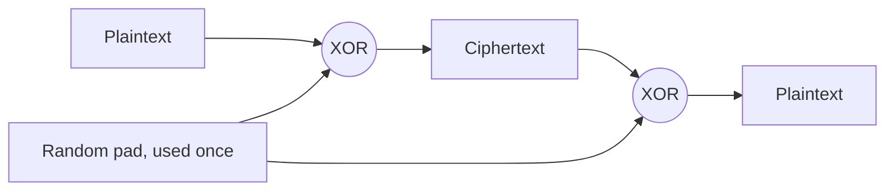
*Fig. 1: One-time pad.*

- **Perfect secrecy:** every plaintext of the same length is an equally likely decryption, so the ciphertext gives no information (Shannon). It is the only unconditionally secure cipher.
- **Conditions:** random, as long as the message, never reused (reuse lets C<sub>1</sub> ⊕ C<sub>2</sub> = P<sub>1</sub> ⊕ P<sub>2</sub>).
- **Problems:** generating, distributing and storing pads; synchronisation.

**Computer algorithms (Schneier).**
1. **DES:** the most popular computer encryption algorithm; symmetric; 64-bit blocks, 56-bit key; replaced by AES.
2. **RSA:** the most popular public-key algorithm; encryption and signatures.
3. **DSA:** digital signatures only (DSS).
4. Others: **AES** (Rijndael), 3DES, IDEA, Blowfish; hash functions MD5, SHA-1, SHA-256; Diffie–Hellman for key exchange.

**Conclusion.** XOR is the basic operation of computer ciphers; with a random one-time key it is perfect, with a short key it is worthless. Real systems use well-studied algorithms such as AES and RSA.
:::

## Q2 (a) Cryptographic protocols: types and attacks

::: ans Answer

**Definition.** <u>A protocol is a series of steps, involving two or more parties, designed to accomplish a task; a cryptographic protocol is a protocol that uses cryptography.</u>

**Characteristics.** Known in advance by all parties; agreed to by all; unambiguous; complete (an action for every situation). Purpose: let mutually distrustful parties co-operate without cheating.

**Cast (Schneier):** Alice, Bob; Eve (eavesdropper); Mallory (active attacker); Trent (trusted arbitrator); Peggy and Victor (prover and verifier).

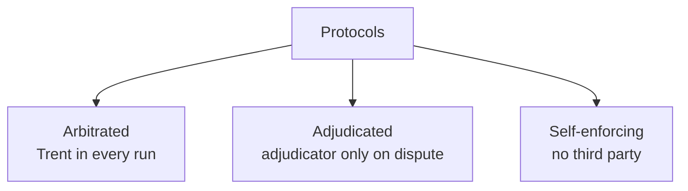
*Fig. 2: Types of protocols.*

**1. Arbitrated.** A disinterested arbitrator (Trent), trusted by all, takes part in every run, like a lawyer or escrow agent. *Problems on computers:* hard to find a trusted neutral party; delay; bottleneck; single target; cost.

**2. Adjudicated.** A non-arbitrated sub-protocol runs every time; an arbitrated sub-protocol runs only when there is a dispute, using evidence the parties keep. The adjudicator (like a judge) **detects** cheating after the fact, which deters it. Cheaper and faster.

**3. Self-enforcing.** The protocol itself guarantees fairness; if one party cheats, the other detects it at once and stops. The best kind; not always possible.

**Attacks against protocols.**
1. **Passive attacks:** an outsider eavesdrops (like ciphertext-only cryptanalysis); goal: information.
2. **Active attacks:** the attacker inserts, deletes, substitutes or replays messages, impersonates parties, or disrupts the protocol.
3. **Cheaters:** a party to the protocol. **Passive cheaters** follow the protocol but try to learn more than allowed; **active cheaters** deviate to deceive or disrupt.

**Conclusion.** Well-designed protocols minimise the need for trusted third parties and stay secure against eavesdroppers, active attackers and cheating participants.
:::

## Q2 (b) Signature requirements and signing protocols

::: ans Answer

**Requirements (Schneier).** A signature must be **authentic** (convinces the recipient), **unforgeable**, **not reusable** (cannot be moved to another document), on an **unalterable** document, and **not repudiable**.

**1. Signing with symmetric cryptography and an arbitrator.** Alice shares K<sub>A</sub> with Trent, Bob shares K<sub>B</sub>.

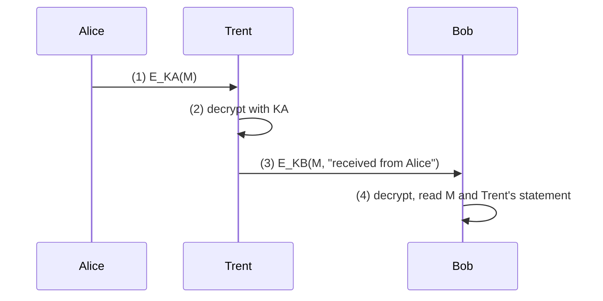
*Fig. 3: Arbitrated signature.*

Bob trusts Trent's statement; in a dispute Trent can show what Alice sent. *Problems:* Trent is a bottleneck, must store everything and be trusted.

**2. Signing with public-key cryptography.**
1. Alice encrypts (signs) the document with her private key.
2. She sends it to Bob.
3. Bob decrypts with Alice's public key: success verifies the signature.

Authentic (only Alice has her private key), unforgeable, not reusable (it depends on the document), unalterable (a change breaks verification), not repudiable. No arbitrator needed.

**3. Timestamps.** Without them, Bob could present a signed cheque twice. Alice includes the date and time in the signed message; a second presentation with the same timestamp is rejected.

**4. With one-way hash functions** (in practice): sign H(M), not M — faster, shorter, safer.

**Conclusion.** Public-key signatures meet all five requirements without an arbitrator; timestamps stop reuse; hashing makes them practical.
:::

## Q3 (a) DES

::: ans Answer

**Definition.** <u>DES is a symmetric block cipher (FIPS 46, 1977) that encrypts 64-bit blocks with a 56-bit key through 16 rounds of a Feistel structure.</u>

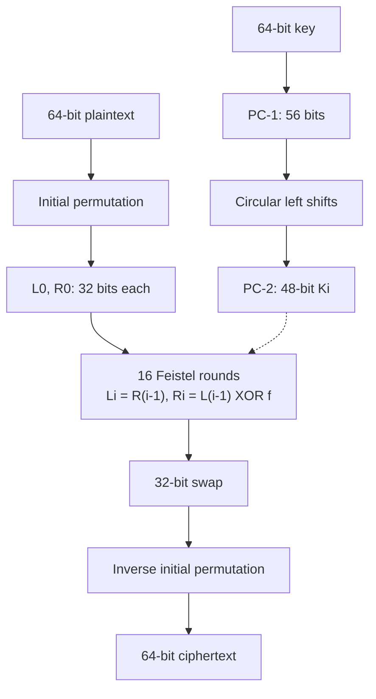
*Fig. 4: DES structure.*

**Operational phases.**
1. **Initial permutation** of the 64 input bits.
2. **Split** into left L<sub>0</sub> and right R<sub>0</sub> halves of 32 bits.
3. **16 rounds:** L<sub>i</sub> = R<sub>i−1</sub>; R<sub>i</sub> = L<sub>i−1</sub> ⊕ f(R<sub>i−1</sub>, K<sub>i</sub>).
4. **Swap** the halves after round 16.
5. **Final permutation** IP<sup>−1</sup>.

**Round function f.** Expansion permutation 32 → 48 bits; XOR with the 48-bit subkey; eight **S-boxes** (each 6 bits in → 4 bits out; outer bits pick the row, inner four the column) → 32 bits; **P-box** permutation. S-boxes are the only non-linear step.

**Key schedule.** PC-1 removes the 8 parity bits (56 bits), splits into two 28-bit halves; each round both halves rotate left by 1 bit (rounds 1, 2, 9, 16) or 2 bits (others); PC-2 selects 48 bits as K<sub>i</sub>.

**Decryption:** same algorithm, subkeys in reverse order (Feistel property).

**Strength and weaknesses.** Strong avalanche effect; resists differential cryptanalysis well (S-boxes designed for it). But the **56-bit key** fell to brute force in 1998 (EFF, 56 hours); 4 weak and 12 semi-weak keys; 64-bit block. **3DES** (EDE with 2 or 3 keys) extended its life; AES replaced it.
:::

## Q3 (b) AES and AES vs DES

::: ans Answer

**Definition.** <u>AES (FIPS 197, 2001) is the Rijndael block cipher: 128-bit blocks, 128/192/256-bit keys, 10/12/14 rounds, built as a substitution–permutation network on a 4 × 4 byte state.</u>

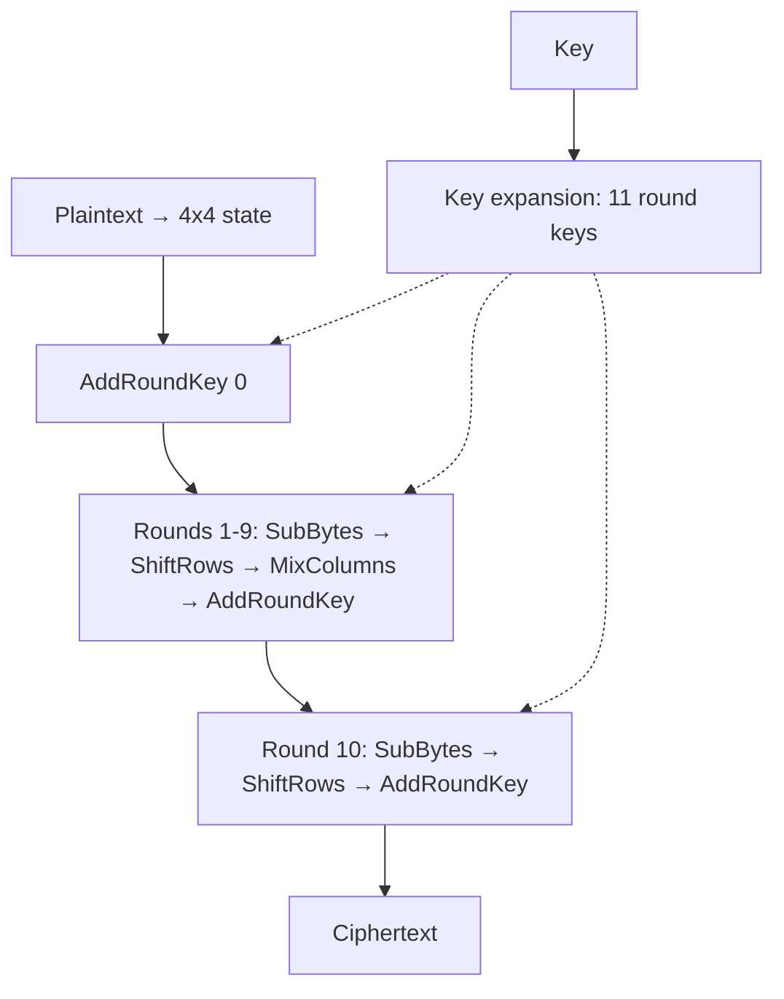
*Fig. 5: AES-128 encryption.*

**Round operations.**
1. **SubBytes:** each byte replaced through the S-box (inverse in GF(2<sup>8</sup>) + affine map): non-linearity.
2. **ShiftRows:** row r rotated left by r bytes: spreads bytes across columns.
3. **MixColumns:** each column multiplied by a fixed matrix in GF(2<sup>8</sup>): diffusion (skipped in the last round).
4. **AddRoundKey:** XOR with the round key.

**Key expansion** produces 44 words (AES-128) with RotWord, SubWord and round constants.

**Why AES beats DES.**

| | DES | AES |
|---|---|---|
| Key | 56 bits (broken) | 128–256 bits |
| Block | 64 bits | 128 bits |
| Structure | Feistel, half block per round | SPN, whole block per round |
| Design | S-box criteria secret | Open competition |
| Attacks | Brute force, differential, linear | No practical attack |
| Software speed | Slow bit permutations; 3DES 3× slower | Fast byte operations; AES-NI hardware |
| Use today | Withdrawn | TLS, Wi-Fi, disk encryption |

**Conclusion.** AES offers far larger keys and blocks, a faster and fully analysed design, and efficiency on every platform, which is why it replaced DES.
:::

## Q4 (a) Choosing an algorithm; public key vs symmetric

::: ans Answer

**Choosing an algorithm (Schneier).** Options:
1. **A published, well-analysed algorithm** — the best: many experts have tried to break it.
2. **Trust a manufacturer** with a reputation to protect.
3. **Trust a private consultant** who evaluated it.
4. **Trust the government** (possibly with its own agenda).
5. **Write your own** — almost always weak.

**Criteria:** security (public cryptanalysis, key length for the data's lifetime), speed, implementation availability, standards (FIPS, ISO), cost and patents, export rules, resistance to side-channel attacks.

**Public key vs symmetric.**

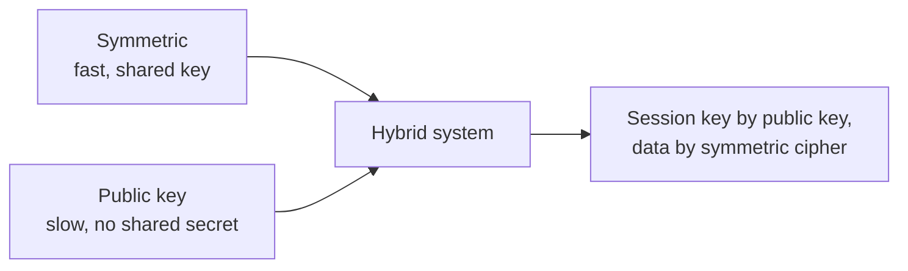
*Fig. 6: Why both are used.*

| | Symmetric | Public key |
|---|---|---|
| Keys | One shared | Public/private pair |
| Speed | Fast | About 1000× slower |
| Distribution | Hard | Easy |
| Keys for n users | n(n − 1)/2 | 2n |
| Services | Confidentiality | Confidentiality, signatures, key exchange |
| Examples | DES, AES | RSA, DH, DSA |

**Schneier's conclusion:** public-key cryptography does not replace symmetric cryptography; it is used to encrypt keys and sign, while symmetric ciphers encrypt data.
:::

## Q4 (b) Encrypting channels and storage

::: ans Answer

**Encrypting communication channels.**

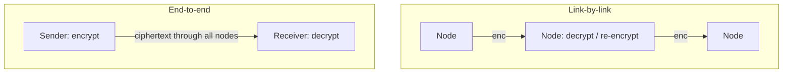
*Fig. 7: Link-by-link and end-to-end encryption.*

| | Link-by-link | End-to-end |
|---|---|---|
| Layer | Physical / data link | Application / transport |
| Nodes | See plaintext | See only ciphertext |
| Headers | Encrypted (traffic-flow security) | In clear (traffic analysis) |
| Keys | One per link | One per user pair |
| Transparent to users | Yes | No |

Combining both protects content end to end and hides traffic patterns on each link.

**Encrypting data for storage.**
1. **Long lifetime:** keys must be kept as long as the data; key loss = data loss → key backup and escrow.
2. **Dereferencing keys:** each file has its own random key, stored encrypted under a master key; re-keying changes only the small file keys.
3. **Driver-level (full-disk) vs file-level encryption:** driver level is transparent and also covers temporary and swap files; file level protects selected files wherever they go.
4. **Random access:** modes that let any block be decrypted independently (CTR, XTS) for databases.
5. **Compress before encrypting;** securely delete plaintext originals.

**Conclusion.** Data in transit and data at rest need different designs: link and end-to-end encryption for channels, key hierarchies and random-access modes for storage.
:::

## Q5 (a) RSA blind signature: n = 77

::: ans Answer

**Definition.** <u>A blind signature lets Bob sign a message without seeing it; the user removes the blinding and holds Bob's valid signature.</u>

**Keys:** n = 77 (7 × 11), φ = 60, e = 7, d = 43 (7 × 43 = 301 = 5 × 60 + 1 ✓). Message m = 8, blinding factor k = 3 (gcd(3, 77) = 1).

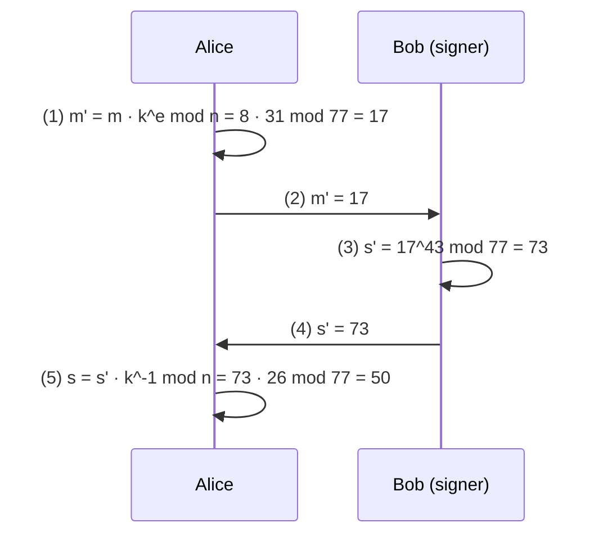
*Fig. 8: Blind signature protocol.*

**Working.**
1. k<sup>e</sup> = 3<sup>7</sup> = 2187 ≡ 2187 − 28 × 77 = **31**.
2. **Blind:** m′ = 8 × 31 = 248 ≡ 248 − 3 × 77 = **17**.
3. **Sign:** s′ = 17<sup>43</sup> mod 77 = **73**.
4. k<sup>−1</sup> mod 77 = **26** (3 × 26 = 78 ≡ 1).
5. **Unblind:** s = 73 × 26 = 1898 ≡ 1898 − 24 × 77 = **50**.
6. **Verify:** 50<sup>7</sup> mod 77 = **8** = m ✓ (and 8<sup>43</sup> mod 77 = 50 directly).

**Why it works:** s′ = (m k<sup>e</sup>)<sup>d</sup> = m<sup>d</sup> k<sup>ed</sup> = m<sup>d</sup> k (mod n), so dividing by k leaves m<sup>d</sup>.

**Uses:** digital cash (bank signs coins without linking them to the customer), anonymous voting. **Cut-and-choose** stops Alice getting a signature on a fraudulent message.
:::

## Q5 (b) Fiat–Shamir with n = 77; mafia fraud

::: ans Answer

**Definition.** <u>Fiat–Shamir is a zero-knowledge identification protocol in which Peggy proves knowledge of a square root s of her public key v modulo n = pq, without revealing s.</u>

**Set-up:** n = 77; Peggy's secret s = 9; public key v = s<sup>2</sup> mod 77 = 81 mod 77 = **4**.

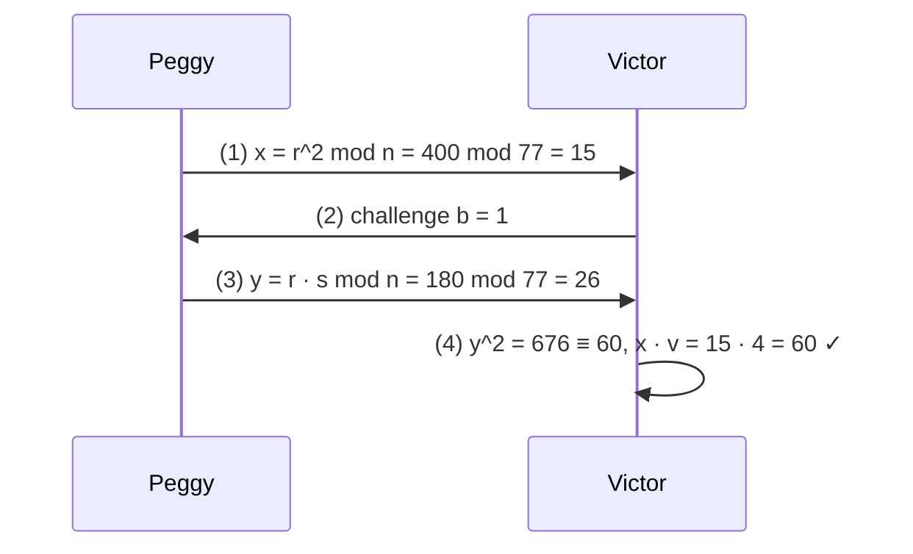
*Fig. 9: One round of Fiat–Shamir.*

**One round with r = 20:**
1. Commitment x = 20<sup>2</sup> = 400 ≡ 400 − 5 × 77 = **15**.
2. Challenge b ∈ {0, 1}.
3. If b = 1: y = 20 × 9 = 180 ≡ **26**; check y<sup>2</sup> = 676 ≡ 676 − 8 × 77 = **60** and x × v = 15 × 4 = **60** ✓.
   If b = 0: y = r = 20; check y<sup>2</sup> = 400 ≡ 15 = x ✓.
4. Repeat t times; a cheater succeeds with probability 1/2<sup>t</sup>.

**Properties:** complete, sound and zero-knowledge (Victor sees either r or r × s, both random-looking).

**Mafia fraud (chess grandmaster problem).** Peggy (customer) proves her identity to Dave's shop, which is run by a fraudster; at the same moment Dave's partner Carol is at a jeweller (Victor) pretending to be Peggy. Dave relays Victor's challenges to Peggy and her answers back to Carol in real time, so Carol is authenticated as Peggy. **Defences:** tight timing limits; distance-bounding protocols; trusted terminals (Faraday cages).
:::

## Q6 (a) Diffie–Hellman: q = 11, α = 2

::: ans Answer

**Primitive root check.** The powers of 2 mod 11: 2, 4, 8, 5, 10, 9, 7, 3, 6, 1 — all ten values 1…10 appear, so 2 is a primitive root of 11 ✓.

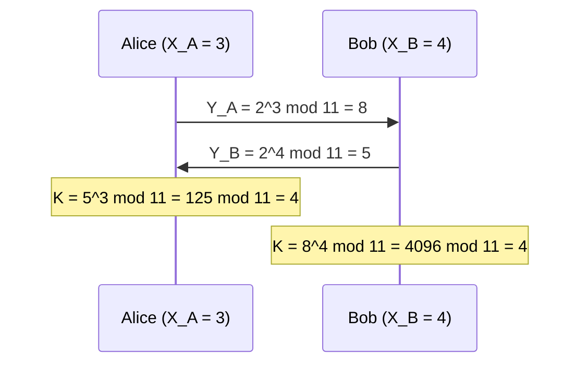
*Fig. 10: Diffie–Hellman with q = 11.*

**Working.**
- Y<sub>A</sub> = 2<sup>3</sup> mod 11 = **8**; Y<sub>B</sub> = 2<sup>4</sup> mod 11 = 16 mod 11 = **5**.
- Alice: K = 5<sup>3</sup> mod 11 = 125 − 11 × 11 = **4**.
- Bob: K = 8<sup>4</sup> mod 11: 8<sup>2</sup> = 64 ≡ 9; 9<sup>2</sup> = 81 ≡ **4**.
- Both: K = 2<sup>3 × 4</sup> = 2<sup>12</sup> = 2<sup>10</sup> × 2<sup>2</sup> ≡ 1 × 4 = **4** ✓.

**Security:** from 8 and 5 Eve must find a discrete logarithm (trivial for 11, infeasible for 2048-bit primes). **Man-in-the-middle** remains possible without authentication; fix with signed values or certificates.
:::

## Q6 (b) Fairness in simultaneous contract signing

::: ans Answer

**Problem.** Over a network, the first to sign risks giving a signature without getting one. The goal: both bound or neither.

**Cryptographic protocol (Even–Goldreich–Lempel).**

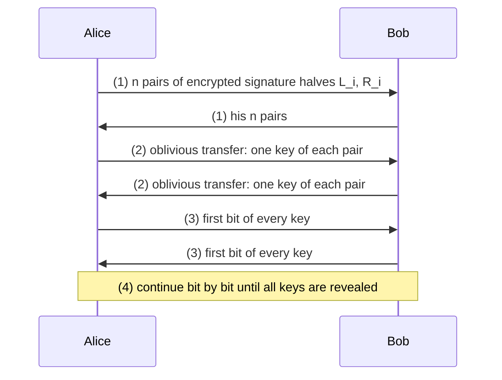
*Fig. 11: Contract signing by oblivious transfer and gradual release.*

1. Each party generates 2n symmetric keys in n pairs and encrypts n pairs of messages: "left/right half of my i-th signature".
2. They exchange the encrypted halves.
3. By **oblivious transfer**, each receives one key of each pair of the other's keys — the sender does not know which.
4. Each decrypts and checks the halves it can open.
5. Both release all keys **bit by bit**, alternately. Once a party has both keys of any one pair, it has a full signature.

**Why it is fair.** Because of the oblivious transfer, neither knows which halves the other already holds, so neither can stop at a moment when only it has a signature; gradual release keeps them within one bit of each other.

**Role of other primitives.** **Zero-knowledge proofs** let each party prove the halves it sends are genuine without revealing the signature early; **blind/oblivious signatures** let an arbitrator certify without seeing the content; **digital signatures** make the final contract non-repudiable.

**Other versions.** With an arbitrator (Trent collects both signatures); face to face (letter by letter); probabilistic ("bound with probability p", p increasing by 1%). **Weakness of the cryptographic version:** the party with more computing power can stop early and brute-force the remaining key bits.
:::

## Q7 (a) Public-key certificates and X.509

::: ans Answer

**Problem.** Public keys need no secrecy but need authenticity: if Mallory substitutes his key, he can read everything (man-in-the-middle).

**Stallings' four methods:** public announcement (forgeable), publicly available directory (target for attack), public-key authority (online bottleneck), **public-key certificates** (best).

**Certificate.** <u>A certificate is a data structure binding a user's identity to a public key, signed by a trusted certificate authority: C<sub>A</sub> = E(PR<sub>CA</sub>, [T ‖ ID<sub>A</sub> ‖ PU<sub>A</sub>]).</u>

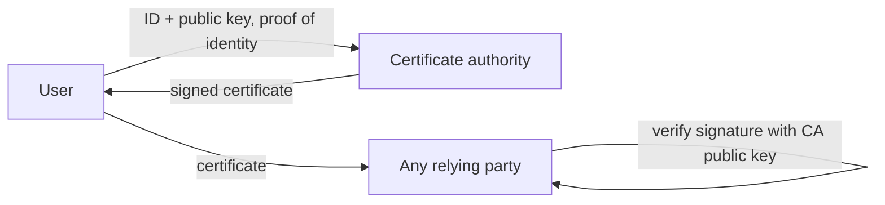
*Fig. 12: Certificate issuance and use.*

**Requirements:** any participant can read a certificate; any participant can verify it came from the CA and is not forged; only the CA can create and update certificates; anyone can check it is current.

**X.509 certificate contents:** version; serial number; signature algorithm identifier; **issuer name**; **validity period** (not before / not after); **subject name**; **subject's public key** and algorithm; issuer and subject unique identifiers; extensions (key usage, subject alternative names, CRL distribution points); **CA's signature** over all of the above.

**Revocation:** certificate revocation lists (CRLs) or OCSP queries for keys that were compromised before expiry.

**Challenges:** trusting CAs (rogue or hacked CAs), revocation checking, CA hierarchies and cross-certification, identity checks before issuing, expiry management.

**Conclusion.** Certificates let anyone verify a public key offline using only the CA's public key; X.509 is the format behind HTTPS and most PKIs.
:::

## Q7 (b) Transferring, verifying, updating, storing, backing up, destroying keys

::: ans Answer

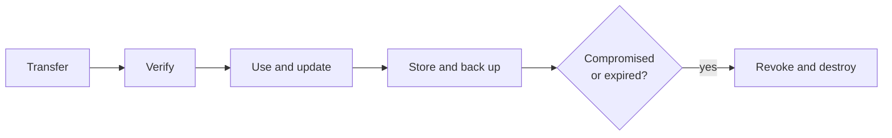
*Fig. 13: Key life cycle after generation.*

1. **Transferring keys.** Use **key-encryption keys** (KEKs, distributed manually) to protect session keys; or **split the key** and send the pieces by different channels (phone, post, courier); or use a KDC or public-key encryption.
2. **Verifying keys.** Was the key really sent by Alice? Keys signed by Trent (certificates); comparing a **key fingerprint** (hash) by phone; verification values (encrypt a constant with the key) to detect transmission errors.
3. **Updating keys.** Derive the next key from the current one with a one-way function: both sides can do it without communication, and an attacker who learns a new key cannot compute older ones.
4. **Storing keys.** Memorised, on smart cards or HSMs, or encrypted with a KEK; split among several people; never stored in plaintext.
5. **Backing up keys.** **Key escrow** (a trusted party holds a copy) or secret sharing among officers, so a lost key or departed employee does not lose the data.
6. **Compromised keys.** Revoke at once, inform all parties, publish on a revocation list; investigate exposure; with a private signing key, signatures after the compromise time are invalid (timestamps help).
7. **Lifetime of keys.** Shorter for session and data keys, longer for KEKs and signature keys; depends on the value of the data, the volume of traffic and the risk of exposure.
8. **Destroying keys.** Overwrite securely several times; destroy paper and media copies; clear temporary files, memory and swap.

**Conclusion.** Every stage after generation needs its own controls; a key protected well at creation but stored carelessly or never destroyed is still a weak link.
:::

## Q8 Short notes (write any four)

::: ans (a) Kerberos
**Kerberos** (MIT) is a trusted-third-party authentication and key-distribution protocol based on Needham–Schroeder with **timestamps and lifetimes**. Parties: client, **authentication server (AS)**, **ticket-granting server (TGS)**, service server. (1) The client authenticates to the AS and receives a **ticket-granting ticket** and a session key. (2) It presents the TGT to the TGS to get a **service ticket** containing a session key encrypted for the server. (3) It presents the service ticket and an **authenticator** (timestamp encrypted with the session key) to the server. Passwords never cross the network; tickets expire. Used in Windows Active Directory. Weaknesses: needs synchronised clocks; the KDC is a single point of failure.
:::

::: ans (b) Salt and SKEY
**Salt:** a random string stored with each password; the host stores (salt, f(P ‖ salt)). Dictionary attackers must hash each word with each salt: a 12-bit salt multiplies their work by 4096 and defeats precomputed tables. **SKEY (Lamport):** Alice picks R; the host stores x<sub>101</sub> = f<sup>101</sup>(R) after Alice has computed x<sub>1</sub> … x<sub>100</sub>; each login uses the next lower x and the host checks f(x<sub>i</sub>) = stored value, then stores x<sub>i</sub>. Every password is used once, so eavesdropping gives nothing reusable.
:::

::: ans (c) Trapdoor one-way function
A **one-way function** is easy to compute and hard to invert. A **trapdoor one-way function** is one-way **unless you know a secret (the trapdoor)**, with which inversion is easy. *Analogy:* a watch is easy to take apart and hard to reassemble, unless you have the instructions. *Example:* RSA: f(m) = m<sup>e</sup> mod n is easy; inverting it needs d, which is easy to compute only if you know the factors p and q of n. Trapdoor functions are the basis of **public-key encryption**: the public key computes f, the private trapdoor inverts it.
:::

::: ans (d) Key escrow
**Key escrow** means depositing a copy of a key (or shares of it) with one or more trusted third parties, so that the key can be recovered when needed: an employee leaves or forgets a key, a court orders access, or data must be recovered after a disaster. **Methods:** a copy encrypted under an escrow agent's key; **secret sharing** among several agents so that no single agent can misuse it. **Debate:** government escrow schemes (the US Clipper chip, 1993) were criticised for creating a back door and a single high-value target. Corporate escrow for data recovery is widely accepted.
:::

::: ans (e) Hybrid cryptosystem
A **hybrid cryptosystem** combines public-key and symmetric cryptography: (1) the sender generates a random **session key** K; (2) encrypts the data with a fast symmetric cipher (AES) under K; (3) encrypts K with the receiver's **public key**; (4) sends both. The receiver decrypts K with the private key, then the data with K. It gets the **speed** of symmetric ciphers and the **easy key distribution** of public key; K is destroyed after the session. Used in TLS, PGP, S/MIME, SSH.
:::

::: ans (f) Cryptographic protection of databases
Schneier's example: a membership database must let anyone check whether a person is a member, but must not let anyone list the members. Store **H(name)** for each member using a one-way hash; to check, hash the name and look it up. More generally: encrypt sensitive fields (field-level encryption), store hashes instead of secrets (passwords), split the decryption key among administrators (secret sharing), and keep audit logs. A stolen database then reveals little, and insiders need co-operation to decrypt.
:::
