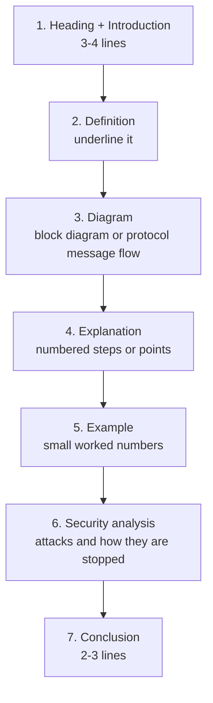
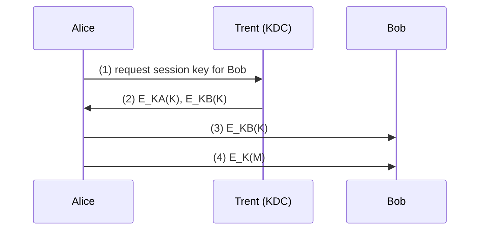

# How to write an MJPRU answer

MJPRU examiners mark long answers by **length, structure and a diagram**. A 14-mark question (two 7-mark parts) is expected to fill **4–5 pages**, with **at least one diagram**. In this subject a diagram is easy to find: a sender–receiver block diagram, a protocol message flow between Alice, Bob and Trent, a 5×5 Playfair square, or the DES/AES round structure. Numericals are judged by method as much as by the final answer.

## The template for a long answer (7-mark part ≈ 2–2.5 pages)

1. **Introduction (3–4 lines):** where the topic fits and what problem it solves.
2. **Definition:** one crisp sentence, underlined.
3. **Diagram:** for a protocol, draw the parties (Alice, Bob, Trent) as boxes with numbered arrows for each message.
4. **Steps in numbers:** "(1) Alice generates a random session key K. (2) …". Schneier writes every protocol this way; copy the style.
5. **Small example:** toy numbers (p = 23, g = 5) make the answer concrete and earn marks.
6. **Security analysis:** which attack the protocol stops (eavesdropping, man-in-the-middle, replay, cheating), and its weaknesses. "Critically analyse" questions need this part.
7. **Conclusion (2–3 lines).**

## Protocol answers: the message-flow diagram

*Fig.: Draw protocols as numbered arrows between the parties.*

## For numericals

- **Write the convention in the first line.** Hill: "C = K × P (mod 26), P a column vector, A = 0 … Z = 25." Columnar: "key letters ranked alphabetically; padding letter X." Playfair: "I and J share a cell; X is the filler."
- **Then the working in a table:** the key square or matrix, the pairs or blocks, the rule or multiplication for each, the result.
- **Box the final answer.**
- **Check by decrypting** (one line). It proves the answer and catches slips.
- **Hill:** show det K mod 26 and gcd(det, 26) = 1 before encrypting; it earns a mark even if an arithmetic slip follows.
- **Diffie–Hellman:** if the question gives no private keys, choose small ones, say so, and verify that both sides get the same K.

## Short notes (Q8: any four)

Each is worth 3.5 marks: **about one page**. Definition, 4–6 points, one small diagram or example, one line on importance.

## Time plan (3 hours, 5 questions)

| Activity | Time |
|---|---|
| Reading the paper and choosing 5 questions | 5 min |
| Each 14-mark question (2 parts) | 33 min |
| Checking numericals and underlining | 10 min |

::: tip Choosing questions
Do the numericals first (Playfair, Hill, Diffie–Hellman): they are the fastest full marks. Then the key-management questions, which repeat word for word, then a Unit 3 protocol question you have rehearsed.
:::

::: warn Common ways students lose marks
- Hill: not checking the determinant, or mixing row and column vectors halfway.
- Playfair: forgetting the filler X between double letters, or treating I and J as different.
- Columnar: reading the columns in written order instead of key order.
- Diffie–Hellman: not stating the private keys, or not showing both sides compute the same K.
- Protocol answers as one paragraph instead of numbered steps with a message diagram.
- No security analysis in a "critically analyse" question.
:::
