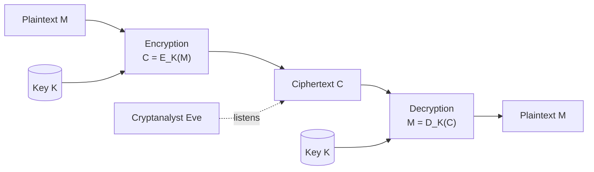
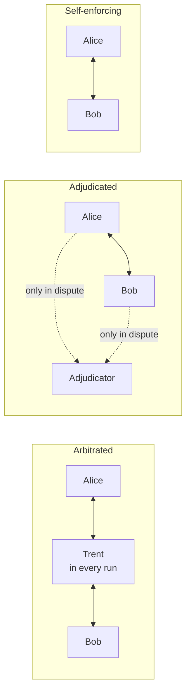

# Unit 1 · Introduction: Ciphers, XOR, One-Time Pads and Protocols

> **Exam weight:** 4 parts of the 2025-26 end-sem (28 marks) and 3 of the 5 Mid-1 questions. Every numerical asked so far (Playfair twice, Hill twice, columnar once) is from this unit, and all of them are solved below.

**Prefer to watch first?** [Video lectures for Unit 1 →](#videos/unit1)

Follows Schneier, *Applied Cryptography*, chapters 1–2, and your Mid-1 notes. Every worked example was checked by computer.

## 1.1 Terminology  ⭐⭐ (End Q1a)

**Definition.** <u>Cryptography is the art and science of keeping messages secure. Cryptanalysis is the art and science of breaking ciphertext. Cryptology is the branch of mathematics that includes both.</u>

| Term | Meaning |
|---|---|
| Plaintext (M or P) | The original message |
| Ciphertext (C) | The encrypted message |
| Encryption | E(M) = C: disguising a message to hide its substance |
| Decryption | D(C) = M, so D(E(M)) = M |
| Cipher (algorithm) | Mathematical function used for encryption and decryption |
| Restricted algorithm | Security depends on keeping the algorithm secret (bad: no quality control, breaks when someone leaves) |
| Key (K) | Value that controls the algorithm; the range of possible keys is the **keyspace** |
| Symmetric algorithm | Same key (or one easily derived) for encryption and decryption: E<sub>K</sub>(M) = C, D<sub>K</sub>(C) = M |
| Public-key algorithm | Different keys: a public encryption key and a private decryption key |
| Cryptosystem | Algorithm + all possible plaintexts, ciphertexts and keys |
| Steganography | Hiding the existence of a message inside another (invisible ink, bits in an image) |


*Fig. 1.1: Encryption and decryption with a key (symmetric).*

**Symmetric algorithms** are of two kinds: **stream ciphers** (work on one bit or byte at a time) and **block ciphers** (work on groups of bits, typically 64 or 128).

**Cryptographic services:** confidentiality, **authentication** (receiver can confirm the origin), **integrity** (receiver can confirm the message was not changed), **non-repudiation** (sender cannot deny sending).

## 1.2 Cryptanalysis and security of algorithms

**Kerckhoffs's assumption:** the cryptanalyst knows the algorithm; all security lies in the key.

**General types of cryptanalytic attacks (Schneier):**
1. **Ciphertext-only:** several ciphertexts, same algorithm. Goal: plaintexts or the key.
2. **Known-plaintext:** ciphertexts and their plaintexts.
3. **Chosen-plaintext:** can choose plaintexts to be encrypted.
4. **Adaptive chosen-plaintext:** chooses later plaintexts based on earlier results.
5. **Chosen-ciphertext:** can choose ciphertexts to be decrypted.
6. **Chosen-key:** knows relations between keys.
7. **Rubber-hose:** threatens, blackmails or tortures someone to get the key; **purchase-key** is bribery.

**Security of algorithms.** An algorithm is **unconditionally secure** if, however much ciphertext the attacker has, there is not enough information to recover the plaintext (only the one-time pad). It is **computationally secure** if it cannot be broken with available resources. **Knudsen's categories of breaking:** total break (key found), global deduction (equivalent algorithm), instance (local) deduction (one plaintext), information deduction (partial information). Complexity of an attack: **data**, **processing** (time) and **storage** requirements.

**Brute force with fast computers:** a 56-bit key has 2<sup>56</sup> ≈ 7.2 × 10<sup>16</sup> keys; a 128-bit key has 2<sup>128</sup> ≈ 3.4 × 10<sup>38</sup>.

## 1.3 Substitution ciphers  ⭐⭐ (End Q1a, Q1b)

**Definition.** <u>A substitution cipher replaces each character of the plaintext with another character; the receiver inverts the substitution.</u> Schneier's four types:

1. **Simple (monoalphabetic):** each plaintext character → one fixed ciphertext character. *Caesar cipher:* C = (P + 3) mod 26: ATTACKATDAWN → **DWWDFNDWGDZQ**. ROT13 shifts by 13. Monoalphabetic with a random alphabet has 26! ≈ 4 × 10<sup>26</sup> keys but falls to **letter-frequency analysis** (E, T, A, O, I, N…).
2. **Homophonic:** one plaintext letter → one of several ciphertext symbols (E → 5, 13, 25 or 56), to flatten frequencies.
3. **Polygram:** blocks of letters are encrypted together: **Playfair** (pairs), **Hill** (m letters with a matrix).
4. **Polyalphabetic:** multiple simple substitution alphabets used in turn: **Vigenère**, rotor machines (Enigma).

### Vigenère cipher
C<sub>i</sub> = (P<sub>i</sub> + K<sub>i mod m</sub>) mod 26, with a repeating keyword.

| Plain | A T T A C K A T D A W N |
|---|---|
| Key | L E M O N L E M O N L E |
| Cipher | **L X F O P V E F R N H R** |

Broken by finding the key length (Kasiski test, index of coincidence) and then solving each column as a Caesar cipher.

## 1.4 Playfair cipher  ⭐⭐⭐ (Mid-1 Q1, End Q2a)

**Definition.** <u>Playfair is a digraph (polygram) substitution cipher that encrypts pairs of letters using a 5×5 key square built from a keyword; I and J share a cell.</u> Invented by Charles Wheatstone (1854), used by the British in World War I.

**Rules.**
1. **Key square:** keyword letters (no repeats), then the rest of the alphabet.
2. **Pairs:** split the plaintext into pairs; put **X** between double letters in a pair; add **X** if one letter is left.
3. **Same row:** each letter → letter on its **right** (wrap around).
4. **Same column:** each letter → letter **below** (wrap around).
5. **Rectangle:** each letter → letter in **its own row** and the **other letter's column**.

Decryption: left for same row, up for same column, the same rectangle rule.

### Worked example 1 (End-sem 2025-26 Q2a): key NETWORK, plaintext INFORMATION SECURITY

**Key square** (N E T W O R K, then A B C D F G H I L M P Q S U V X Y Z):

| | | | | |
|---|---|---|---|---|
| **N** | **E** | **T** | **W** | **O** |
| **R** | **K** | A | B | C |
| D | F | G | H | I/J |
| L | M | P | Q | S |
| U | V | X | Y | Z |

**Pairs:** INFORMATIONSECURITY has 19 letters and no double-letter pair, so add X at the end: **IN FO RM AT IO NS EC UR IT YX**.

| Pair | Position (row, col) | Rule | Cipher |
|---|---|---|---|
| IN | I (3,5), N (1,1) | Rectangle | **DO** |
| FO | F (3,2), O (1,5) | Rectangle | **IE** |
| RM | R (2,1), M (4,2) | Rectangle | **KL** |
| AT | A (2,3), T (1,3) | Same column → below | **GA** |
| IO | I (3,5), O (1,5) | Same column → below | **SC** |
| NS | N (1,1), S (4,5) | Rectangle | **OL** |
| EC | E (1,2), C (2,5) | Rectangle | **OK** |
| UR | U (5,1), R (2,1) | Same column → below (U wraps to N) | **ND** |
| IT | I (3,5), T (1,3) | Rectangle | **GO** |
| YX | Y (5,4), X (5,3) | Same row → right (Y wraps to Z) | **ZY** |

**Ciphertext: DOIEKLGASCOLOKNDGOZY.** Decryption gives INFORMATIONSECURITYX. ✓

### Worked example 2 (Mid-1 2025 Q1): key SECURE, plaintext HIDE GOLD

| | | | | |
|---|---|---|---|---|
| **S** | **E** | **C** | **U** | **R** |
| A | B | D | F | G |
| H | I/J | K | L | M |
| N | O | P | Q | T |
| V | W | X | Y | Z |

Pairs: **HI DE GO LD** (8 letters, no doubles, no filler).

| Pair | Position | Rule | Cipher |
|---|---|---|---|
| HI | H (3,1), I (3,2) | Same row → right | **IK** |
| DE | D (2,3), E (1,2) | Rectangle | **BC** |
| GO | G (2,5), O (4,2) | Rectangle | **BT** |
| LD | L (3,4), D (2,3) | Rectangle | **KF** |

**Ciphertext: IKBCBTKF.** ✓

### Worked example 3 (practice): key MONARCHY, BALLOON
Pairs BA LX LO ON (X separates the double L) → **IBSUPMNA**.

**Strengths:** 600 digraphs; single-letter frequency analysis fails. **Weaknesses:** digraph frequencies still show; a few hundred letters of ciphertext are enough to break it.

## 1.5 Hill cipher  ⭐⭐⭐ (Mid-1 Q5, End Q4a)

**Definition.** <u>The Hill cipher (Lester Hill, 1929) is a polygram substitution cipher that encrypts m letters at a time by multiplying them by an m×m key matrix modulo 26: C = K × P (mod 26), P = K<sup>−1</sup> × C (mod 26).</u>

**Convention (write it in the exam):** letters A = 0, B = 1, …, Z = 25; P is a column vector; C = K × P mod 26. **Key condition:** K is invertible mod 26 only if gcd(det K, 26) = 1.

### Worked example 1 (End-sem 2025-26 Q4a): SECURE DATA TRANSFER, K = [[3, 3, 2], [2, 5, 1], [1, 2, 4]]

**Step 1: check the key.**
det K = 3(5·4 − 1·2) − 3(2·4 − 1·1) + 2(2·2 − 5·1) = 3(18) − 3(7) + 2(−1) = 54 − 21 − 2 = **31**; 31 mod 26 = **5**; gcd(5, 26) = 1 → invertible. (5<sup>−1</sup> mod 26 = 21, since 5 × 21 = 105 = 4 × 26 + 1.)

**Step 2: blocks of 3.** SECUREDATATRANSFER (18 letters, no padding): SEC URE DAT ATR ANS FER.

**Step 3: multiply and reduce mod 26.**

| Block | P | K × P | mod 26 | Cipher |
|---|---|---|---|---|
| SEC | (18, 4, 2) | (54+12+4, 36+20+2, 18+8+8) = (70, 58, 34) | (18, 6, 8) | **SGI** |
| URE | (20, 17, 4) | (60+51+8, 40+85+4, 20+34+16) = (119, 129, 70) | (15, 25, 18) | **PZS** |
| DAT | (3, 0, 19) | (9+0+38, 6+0+19, 3+0+76) = (47, 25, 79) | (21, 25, 1) | **VZB** |
| ATR | (0, 19, 17) | (0+57+34, 0+95+17, 0+38+68) = (91, 112, 106) | (13, 8, 2) | **NIC** |
| ANS | (0, 13, 18) | (0+39+36, 0+65+18, 0+26+72) = (75, 83, 98) | (23, 5, 20) | **XFU** |
| FER | (5, 4, 17) | (15+12+34, 10+20+17, 5+8+68) = (61, 47, 81) | (9, 21, 3) | **JVD** |

**Ciphertext: SGIPZSVZBNICXFUJVD.**

**Check:** K<sup>−1</sup> = 21 × adj(K) mod 26 = [[14, 14, 9], [9, 2, 21], [5, 15, 7]]; K<sup>−1</sup> × (18, 6, 8) = (18, 4, 2) = SEC ✓, and the full ciphertext decrypts to SECUREDATATRANSFER.

### Worked example 2 (Mid-1 2025 Q5): TOP GUN, K = [[2, 4, 5], [9, 2, 1], [3, 17, 7]]

det K = 2(14 − 17) − 4(63 − 3) + 5(153 − 6) = −6 − 240 + 735 = 489; 489 mod 26 = **21**; gcd(21, 26) = 1 ✓.

| Block | P | K × P | mod 26 | Cipher |
|---|---|---|---|---|
| TOP | (19, 14, 15) | (38+56+75, 171+28+15, 57+238+105) = (169, 214, 400) | (13, 6, 10) | **NGK** |
| GUN | (6, 20, 13) | (12+80+65, 54+40+13, 18+340+91) = (157, 107, 449) | (1, 3, 7) | **BDH** |

**Ciphertext: NGKBDH.** (If your teacher uses row vectors, C = P × K, the answer is BVGXZL; say which convention you use.)

**Strength:** hides single-letter and digraph frequencies. **Weakness:** linear, so a **known-plaintext attack** with m plaintext–ciphertext blocks recovers K by solving linear equations.

## 1.6 Transposition ciphers  ⭐⭐ (Mid-1 Q2, End Q1a)

**Definition.** <u>In a transposition cipher the plaintext characters stay the same but their order is shuffled.</u> Letter frequencies are unchanged.

### Rail fence (depth 2)
MEETMEAFTERTHEPARTY written in a zig-zag on two rails and read row by row → **MEMATRHPRYETEFETEAT**.

### Columnar transposition (Mid-1 2025 Q2): INFORMATIONSECURITY, keyword NETWORK

**Rank the key letters alphabetically:** E = 1, K = 2, N = 3, O = 4, R = 5, T = 6, W = 7.

```text
Key :  N  E  T  W  O  R  K
Rank:  3  1  6  7  4  5  2
       I  N  F  O  R  M  A
       T  I  O  N  S  E  C
       U  R  I  T  Y  X  X      (19 letters + 2 padding X)
```

Read the columns in rank order 1 → 7: E: NIR, K: ACX, N: ITU, O: RSY, R: MEX, T: FOI, W: ONT.

**Ciphertext: NIRACXITURSYMEXFOIONT.** (Without padding: NIRACITURSYMEFOIONT; say which you use.)

**Double transposition** (apply twice) is much stronger; used in both World Wars.

### Substitution vs transposition

| Basis | Substitution | Transposition |
|---|---|---|
| Changes | Letters | Order of letters |
| Frequencies | Changed | Unchanged |
| Examples | Caesar, Playfair, Hill, Vigenère | Rail fence, columnar, double transposition |
| Attack | Frequency analysis | Anagramming |
| In modern ciphers | S-boxes (confusion) | Permutations (diffusion) |

**Rotor machines** (Enigma, Hebern): a series of rotating substitution wheels, a polyalphabetic cipher with a very long period; broken in World War II.

## 1.7 Simple XOR

C = P ⊕ K and P = C ⊕ K, because (P ⊕ K) ⊕ K = P. With a short repeating key:

| | H | I |
|---|---|---|
| Plaintext | 01001000 | 01001001 |
| Key | 10110011 | 01101100 |
| Ciphertext | 11111011 | 00100101 |

**Breaking it (Schneier):** (1) find the key length by counting coincidences when the ciphertext is XORed with itself shifted; (2) XOR the ciphertext with itself shifted by the key length: the key cancels, leaving plaintext ⊕ plaintext, which is easy to solve. Schneier: "an algorithm like this is an embarrassment" — it is used in commercial products that claim to be "almost as secure as DES".

## 1.8 One-time pad  ⭐ (End Q8e)

**Definition.** <u>A one-time pad is a large non-repeating set of truly random key letters; each pad letter is used to encrypt exactly one plaintext letter, and the pad is never reused.</u> Invented by Gilbert Vernam and Joseph Mauborgne (1917).

- Encryption: C<sub>i</sub> = (P<sub>i</sub> + K<sub>i</sub>) mod 26, or bitwise C = P ⊕ K.
- *Example:* ONETIMEPAD + pad TBFRGFARFM → **HOJKOREGFP** (with A = 0; Schneier numbers A = 1 and gets IPKLPSFHGQ for the same pad).
- **Perfect secrecy:** every plaintext of that length is equally likely for a given ciphertext; the only **unconditionally secure** cipher.
- **Conditions:** truly random, as long as the message, used once, destroyed after use.
- **Problems:** generating random keys; distributing and storing pads as long as all the traffic; synchronisation (one lost bit garbles the rest).
- **Use:** ultra-secure low-bandwidth channels (the Moscow–Washington hotline).

## 1.9 Computer algorithms

Schneier lists the algorithms that dominate practice:
- **DES (Data Encryption Standard):** most popular computer encryption algorithm; US/international standard; symmetric, same key for encryption and decryption.
- **RSA:** most popular public-key algorithm; for both encryption and digital signatures.
- **DSA (Digital Signature Algorithm):** part of the Digital Signature Standard; public-key, signatures only.
- Others: AES (Rijndael, 2001), IDEA, 3DES, Blowfish, MD5 and SHA (hash functions), Diffie–Hellman (key exchange).

## 1.10 Why classical ciphers are insufficient today  ⭐ (End Q1b)

1. **Tiny key spaces:** Caesar has 25 keys; brute force takes microseconds on a computer.
2. **Statistical leakage:** monoalphabetic ciphers keep letter frequencies; Playfair keeps digraph frequencies; Vigenère repeats with the key length.
3. **Linearity:** Hill is linear, so a known-plaintext attack recovers the key.
4. **Transposition keeps frequencies**, so it is recognised immediately.
5. **Designed for letters, not binary data:** cannot directly protect files, images or network packets.
6. **No integrity or authentication:** they hide content but do not detect modification or prove the sender.
7. **Key distribution:** the shared secret must travel securely; there is no public-key mechanism.
8. **Known-plaintext and chosen-plaintext attacks** are routine today (protocol headers, file formats).

**Modern ciphers** (DES, AES) fix these with large keys (56–256 bits), many rounds of substitution and permutation (**confusion and diffusion**, Shannon), and are combined with hashes, MACs, signatures and public-key key exchange.

## 1.11 Cryptographic protocols  ⭐ (End Q8a)

**Definition.** <u>A protocol is a series of steps, involving two or more parties, designed to accomplish a task. A cryptographic protocol is a protocol that uses cryptography.</u>

**Characteristics:** everyone must know the protocol and all its steps in advance; everyone must agree to follow it; it must be **unambiguous**; it must be **complete** (an action for every possible situation). Each step must be completed before the next.

**Purpose:** to let parties who may not trust each other accomplish something (share a secret, sign a contract, vote, prove identity) without cheating.

**Dramatis personae (Schneier):** Alice, Bob (main parties), Carol, Dave, **Eve** (eavesdropper), **Mallory** (malicious active attacker), **Trent** (trusted arbitrator), Walter (warden), Peggy (prover), Victor (verifier).

### Types of protocols


*Fig. 1.2: Arbitrated, adjudicated and self-enforcing protocols.*

1. **Arbitrated protocols:** an **arbitrator** — disinterested, trusted by all — takes part in every run (like a lawyer in a property sale). Problems on computers: hard to find a neutral trusted party; delay; the arbitrator is a **bottleneck** and a single target; it costs money.
2. **Adjudicated protocols:** a non-arbitrated sub-protocol runs every time; an arbitrated sub-protocol runs **only if there is a dispute**. The arbitrator is called an **adjudicator** (like a judge). It **detects** cheating after the fact, which also deters it.
3. **Self-enforcing protocols:** the protocol itself guarantees fairness; cheating is detected immediately and the protocol stops. The best kind, but not available for every problem.

### Attacks against protocols
- **Passive attacks:** an outsider eavesdrops on the protocol (equivalent to a ciphertext-only attack).
- **Active attacks:** the attacker introduces new messages, deletes, substitutes or replays messages, or impersonates someone.
- **Cheaters:** a party to the protocol who lies or does not follow it. **Passive cheaters** follow the protocol but try to learn more; **active cheaters** disrupt it.

## Exam checklist for Unit 1
- [ ] Terminology table and the encryption diagram
- [ ] Seven types of cryptanalytic attack; unconditional vs computational security
- [ ] Four types of substitution cipher with one example each
- [ ] Playfair: NETWORK and SECURE examples by hand
- [ ] Hill: det check, then SECURE DATA TRANSFER and TOP GUN by hand
- [ ] Columnar with NETWORK; rail fence
- [ ] XOR table and how it is broken; one-time pad conditions
- [ ] Why classical ciphers fail (8 points)
- [ ] Protocol definition, characteristics, the three types, attacks
