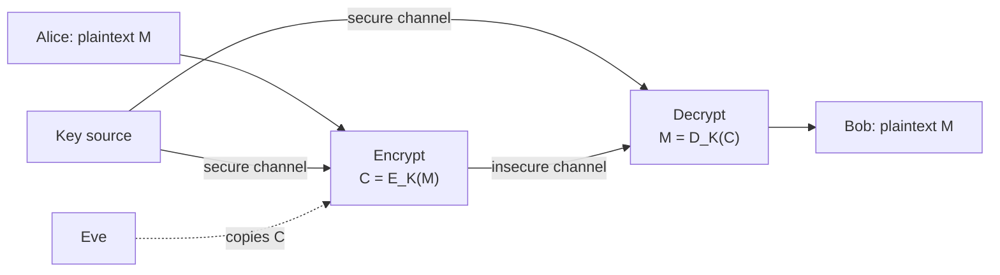
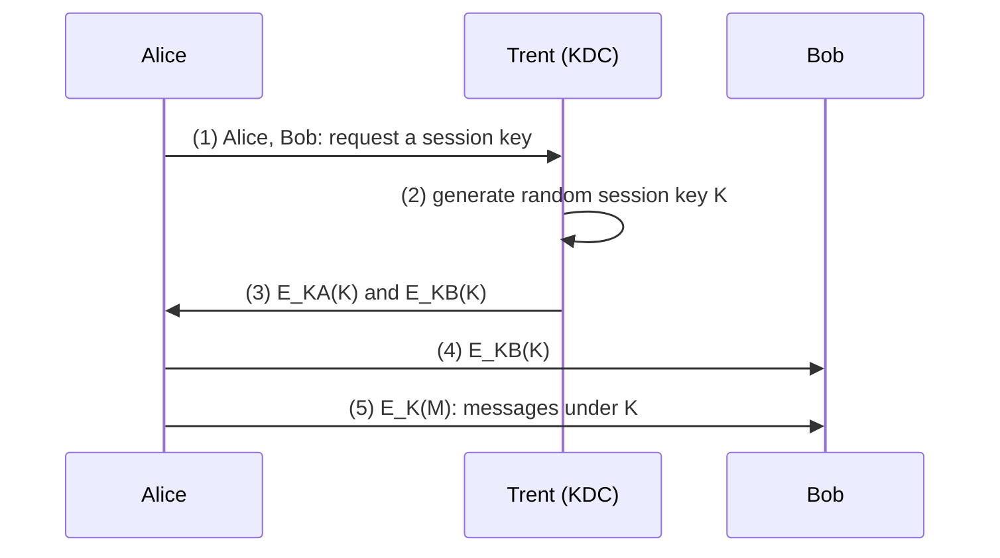
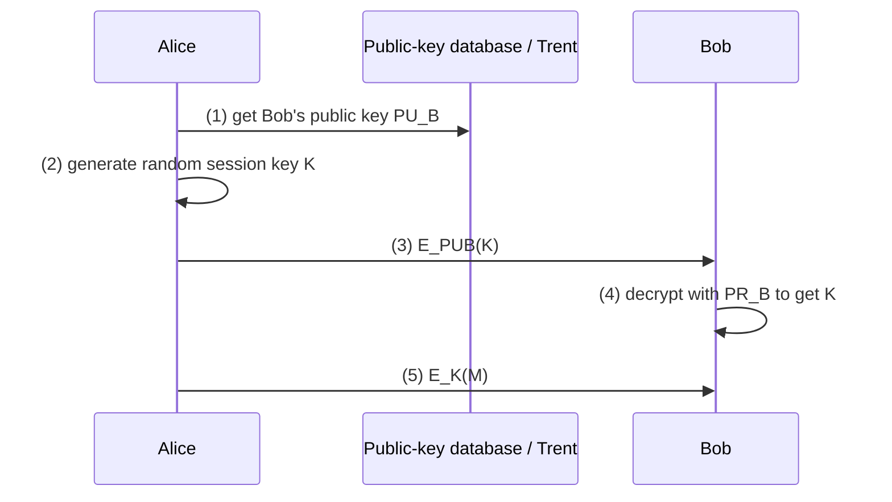
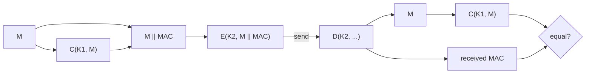
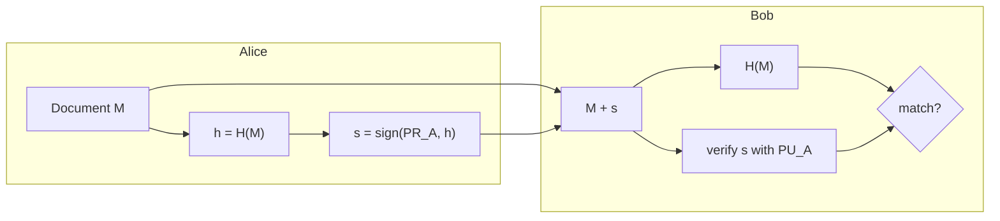
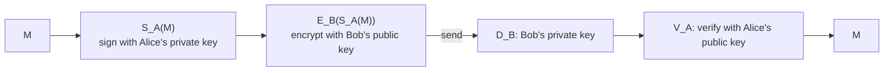

# Unit 2 · Protocol Building Blocks

> **Exam weight:** 2 parts of the 2025-26 end-sem (the key distribution problem; why sign the hash) plus a short note (digital signatures with encryption), and 2 of the 5 Mid-1 questions (symmetric cryptosystem with signatures; MAC). Pure theory: learn the protocol steps and the diagrams.

**Prefer to watch first?** [Video lectures for Unit 2 →](#videos/unit2)

Follows Schneier, *Applied Cryptography*, chapter 2, with Stallings for MACs.

## 2.1 Introduction

Protocols are built from a small set of **building blocks**: symmetric encryption, one-way functions, one-way hash functions, public-key encryption and digital signatures. Each block provides one service; real protocols (Unit 3) combine them.

| Building block | Main service |
|---|---|
| Symmetric cryptography | Confidentiality (fast) |
| One-way hash function | Integrity, short fingerprint |
| MAC | Integrity + authentication with a shared key |
| Public-key cryptography | Confidentiality without a shared secret; key exchange |
| Digital signature | Authentication, integrity, non-repudiation |

## 2.2 Communication using symmetric cryptography  ⭐ (Mid-1 Q3)

**Definition.** <u>A symmetric cryptosystem uses the same secret key for encryption and decryption; the key must be shared by sender and receiver in advance and kept secret.</u>

*Fig. 2.1: Model of a symmetric cryptosystem.*

**Schneier's protocol:**
1. Alice and Bob agree on a cryptosystem.
2. Alice and Bob agree on a key.
3. Alice encrypts her plaintext with the algorithm and key, producing ciphertext.
4. Alice sends the ciphertext to Bob.
5. Bob decrypts the ciphertext with the same algorithm and key and reads it.

**Problems with symmetric cryptosystems:**
1. **Keys must be distributed in secret.** They are as valuable as all the messages they protect.
2. **If a key is compromised** (stolen, guessed, bribed), Eve can decrypt all traffic, and Mallory can pretend to be Alice or Bob and insert false messages.
3. **Number of keys grows fast:** a separate key for each pair means **n(n − 1)/2** keys for n users (1000 users → 499,500 keys).

## 2.3 The key distribution problem and its solutions  ⭐⭐ (End Q2b)

**Problem.** <u>Before two parties can communicate with a symmetric cipher, they must share a secret key, delivered over a secure channel that, by assumption, they do not have.</u> Eve may copy the key in transit; Mallory may substitute his own key; with n users the number of keys explodes.

**Options for delivering a key (Stallings):**
1. A selects the key and **physically delivers** it to B (courier, in person).
2. A **third party** selects the key and physically delivers it to A and B.
3. If A and B already share a key, A sends the new key **encrypted with the old key** (but one compromised key exposes all later keys).
4. If A and B each share a key with a third party C (a **Key Distribution Centre**), C delivers the new key encrypted to each.
5. **Public-key cryptography:** no shared secret needed.

### Solution 1: a trusted third party (KDC)

*Fig. 2.2: Key exchange with a trusted KDC (Schneier §3.1).*

**Protocol-level justification:**
- Each user shares only **one** long-term key with Trent: n keys instead of n(n − 1)/2.
- Session keys are fresh for every conversation, so a compromised session key exposes only one session.
- Only Trent can encrypt K under KA and KB, so Alice and Bob know K came from Trent (authentication).
- **Weaknesses:** Trent must be completely trusted and is a single point of failure and a bottleneck; replay of old session keys must be stopped with nonces and timestamps (Needham–Schroeder, Kerberos; see Unit 3).

### Solution 2: public-key cryptography

*Fig. 2.3: Hybrid cryptosystem: public-key encryption of a session key.*

**Justification:** no secret ever travels; anyone can encrypt to Bob; only Bob can decrypt. Keys needed: 2n. **Weakness:** Alice must be sure PUB really is Bob's (**man-in-the-middle**: Mallory substitutes his key). Fix: a trusted third party signs public keys (**certificates**, a CA), or Trent maintains an authenticated key database.

**Conclusion line:** public-key cryptography solves the secrecy part of key distribution; trusted third parties solve the authenticity part. Real systems (TLS, Kerberos, PGP) combine both.

## 2.4 One-way functions

**Definition.** <u>A one-way function is a function that is relatively easy to compute but significantly harder to reverse: given x it is easy to compute f(x), but given f(x) it is hard to compute x.</u> *Analogy:* breaking a plate is easy; gluing the pieces back is hard. *Example:* modular exponentiation gx mod p (reversing it is the discrete logarithm problem).

**Trapdoor one-way function:** easy to compute one way, hard the other way, **unless you know a secret (the trapdoor)**, with which it is easy. *Analogy:* a watch is easy to take apart, hard to reassemble, unless you have the instructions. *Example:* RSA: computing Me mod n is easy; reversing it needs d, which is easy to get only if you know p and q.

## 2.5 One-way hash functions  ⭐⭐ (End Q3b)

**Definition.** <u>A one-way hash function H(M) takes a variable-length pre-image M and returns a fixed-length hash value h; given M it is easy to compute h, given h it is hard to find M, and it is hard to find two messages with the same hash.</u> Also called compression function, message digest, fingerprint, cryptographic checksum, MIC.

**Properties:** fixed output length; easy to compute; **pre-image resistant**; **second pre-image resistant** (given M, hard to find M′ with H(M′) = H(M)); **collision resistant** (hard to find any M ≠ M′ with the same hash); a one-bit change in M changes about half the output bits.

**Examples:** MD5 (128 bits), SHA-1 (160 bits), SHA-256 (256 bits).

**Uses:** fingerprinting files (detect change); storing passwords; digital signatures; MACs.

**MAC (keyed hash):** a hash that also depends on a secret key: only someone with the key can compute or verify it.

## 2.6 Communication using public-key cryptography

**Idea (Diffie and Hellman, 1976):** two different keys, one public and one private; it is computationally hard to derive the private key from the public key. Anyone can encrypt with the public key; only the holder of the private key can decrypt.

**Schneier's protocol:**
1. Alice and Bob agree on a public-key cryptosystem.
2. Bob sends Alice his public key (or Alice gets it from a public database).
3. Alice encrypts her message with Bob's public key and sends it.
4. Bob decrypts it with his private key.

**Problems:** public-key algorithms are about **1000 times slower** than symmetric ones; vulnerable to **chosen-plaintext attacks** when the set of possible messages is small (Eve encrypts all candidates and compares).

**Hybrid cryptosystems:** use public-key cryptography to send a random **session key**, and the session key with a symmetric algorithm to encrypt the data. The session key is destroyed after use, which also reduces exposure.

**Merkle's puzzles:** an early key-exchange idea: Bob sends many puzzles, each taking some work to solve; Alice solves one at random; Eve has to solve on average half of them.

## 2.7 Authentication functions and MAC  ⭐ (Mid-1 Q4)

**Message authentication** verifies that a received message came from the alleged source and was not altered. An **authentication function** produces an **authenticator**. Three classes (Stallings):
1. **Message encryption:** the ciphertext of the whole message serves as its authenticator.
2. **Message authentication code (MAC):** a public function of the message and a secret key produces a fixed-length value.
3. **Hash function:** maps a message of any length to a fixed-length hash value that serves as the authenticator.

**MAC.** MAC = C(K, M), K shared by A and B. B recomputes the MAC and compares; a match proves the message was not altered and came from someone with K. A MAC gives **no non-repudiation** (B could have made it too).

### MAC tied to plaintext

*Fig. 2.4: MAC computed on the plaintext, then the whole block encrypted.*

A → B: **E(K2, [M ‖ C(K1, M)])** — the MAC is computed on the plaintext with K1, appended, and the whole block encrypted with K2. B decrypts, recomputes the MAC on the recovered plaintext and compares. Gives **authentication, integrity and confidentiality**; B can keep M with its MAC and re-check later. (The other form, MAC on ciphertext: E(K2, M) ‖ C(K1, E(K2, M)), lets B reject forgeries before decrypting.)

## 2.8 Digital signatures  ⭐⭐

**Requirements of a signature (Schneier):** the signature is **authentic** (convinces the recipient the signer signed), **unforgeable**, **not reusable** (part of this document only), the signed document is **unalterable**, and the signature **cannot be repudiated**.

### Signing with symmetric cryptography and an arbitrator
Alice and Trent share KA; Bob and Trent share KB.
1. Alice encrypts her message to Bob with KA and sends it to Trent.
2. Trent decrypts it with KA.
3. Trent bundles the message with a statement that he received it from Alice, encrypts the bundle with KB.
4. Trent sends the bundle to Bob; Bob decrypts it and reads the message and Trent's certification.

Works because Trent is trusted, but Trent is a bottleneck and must store everything.

### Signing with public-key cryptography
1. Alice encrypts (signs) the document with her **private key**.
2. Alice sends the signed document to Bob.
3. Bob decrypts it with Alice's **public key**, verifying the signature.

No arbitrator needed. **Timestamps** stop Bob from reusing (replaying) a signed cheque.

### Signing with public-key cryptography and one-way hash functions  ⭐⭐ (End Q3b)

*Fig. 2.5: Hash-and-sign.*

1. Alice produces a one-way hash of the document.
2. Alice encrypts the hash with her private key, thereby signing the document.
3. Alice sends the document and the signed hash to Bob.
4. Bob produces a hash of the document, decrypts the signed hash with Alice's public key, and compares.

**Why sign the hash rather than the message (End Q3b):**
1. **Speed:** public-key operations are slow; hashing is fast and the hash is short (160–256 bits), so one signing operation covers any length of document.
2. **Size:** the signature is short; signing a long message block by block would give a huge signature.
3. **Security:** signing the message directly with raw RSA allows forgeries from the multiplicative property (sig(M1) × sig(M2) = sig(M1 × M2)) and block reordering; a hash breaks this structure.
4. **Separation:** the signature can be kept separately from the document; the document can be stored or sent in the clear.
5. **Many signers:** several people can sign the same hash.
6. The hash must be **collision resistant**, otherwise Mallory finds two documents with the same hash and moves the signature.

**Toy RSA signature:** n = 33, e = 3, d = 7, H(M) = 5. s = 57 mod 33 = **14**. Verify: 143 = 2744; 2744 mod 33 = **5** = H(M) ✓.

## 2.9 Digital signatures with encryption  ⭐⭐ (Mid-1 Q3, End Q8b)

Signature gives authentication, integrity, non-repudiation; encryption gives confidentiality. Combined, they give all four — like signing a letter and sealing it in an envelope.

*Fig. 2.6: Sign first, then encrypt.*

1. Alice signs the message with her private key: SA(M).
2. Alice encrypts the signed message with Bob's public key and sends it: EB(SA(M)).
3. Bob decrypts with his private key: DB(EB(SA(M))) = SA(M).
4. Bob verifies with Alice's public key and recovers the message: VA(SA(M)) = M.

**Sign before encrypting:** so the signature is on the actual message (a signature on ciphertext could have been added by anyone who copied it), and for legal reasons a signature should cover what the signer saw.

**Resend-the-message-as-a-receipt attack (Schneier):** if Bob automatically returns a signed receipt and the same key pair is used for signing and encryption, Mallory can record Alice's message, send it to Bob as his own, and use Bob's receipt to decrypt Alice's message. **Fixes:** use **separate keys** for signing and encryption, sign **hashes** with timestamps, never sign arbitrary data automatically.

**In practice:** Alice signs H(M), encrypts M with a random session key K (AES), and encrypts K with Bob's public key (PGP, S/MIME).

## 2.10 Random and pseudo-random sequences

Keys, session keys, nonces and pads must be unpredictable. Schneier's classes:
1. **Pseudo-random:** looks random, passes statistical tests (good for simulation, not for keys).
2. **Cryptographically secure pseudo-random:** also **unpredictable** even if you know the algorithm and earlier outputs.
3. **Real random:** **cannot be reliably reproduced** (from physical noise, keystroke timing, radioactive decay).

## Exam checklist for Unit 2
- [ ] Symmetric cryptosystem diagram + Schneier's 5 steps + 3 problems
- [ ] Key distribution problem; KDC sequence diagram; public-key hybrid diagram; justification and weaknesses
- [ ] One-way and trapdoor one-way functions with analogies
- [ ] Hash properties and uses
- [ ] Three classes of authentication function; MAC tied to plaintext formula and diagram
- [ ] Five requirements of a signature; signing with an arbitrator; hash-and-sign; six reasons to sign the hash
- [ ] Sign-then-encrypt in four steps; the resend attack and its fix
