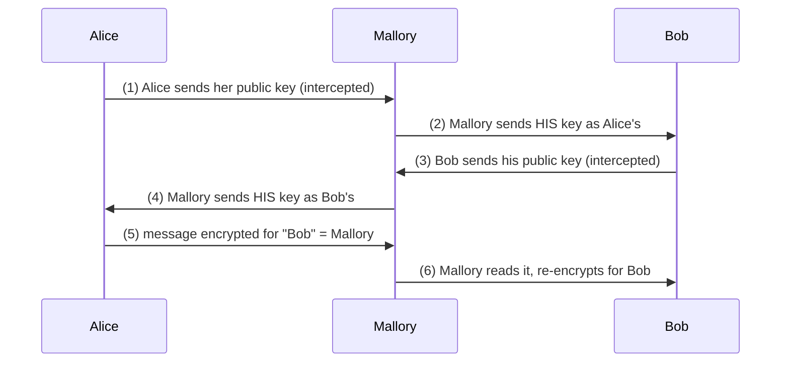
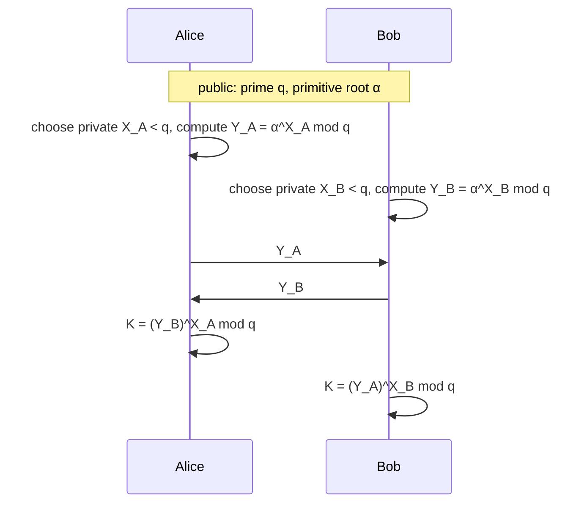
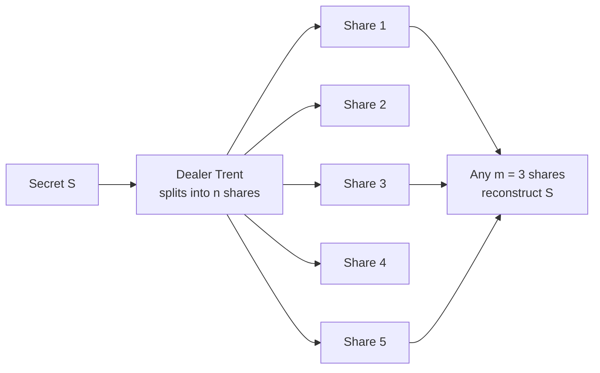
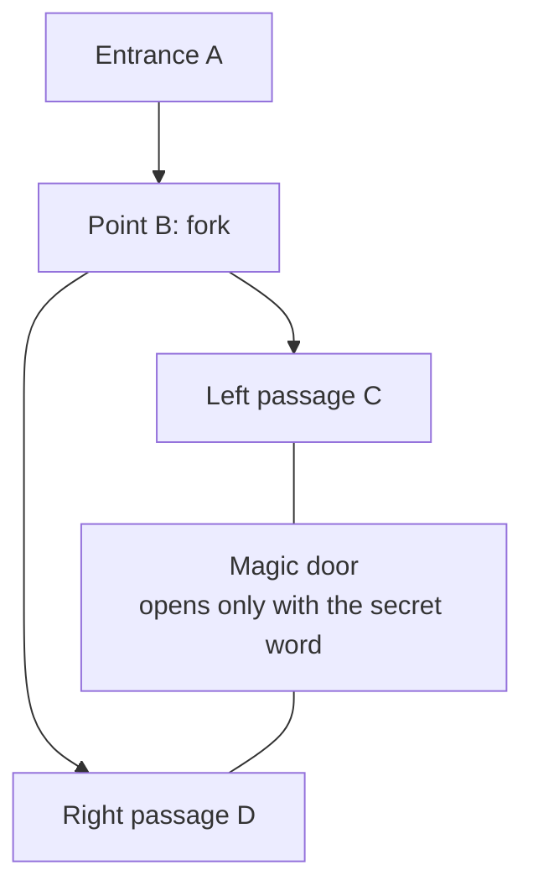
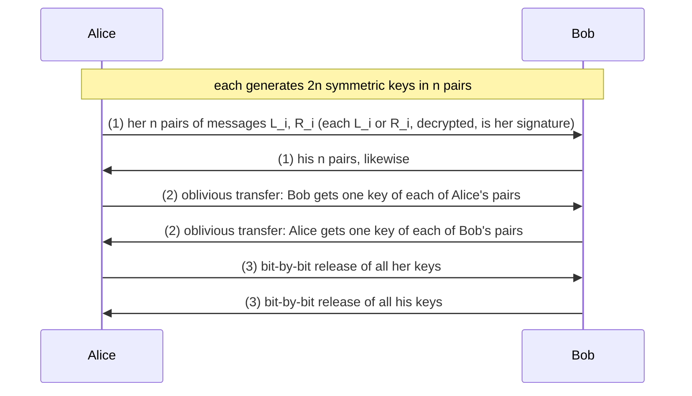

# Unit 3 · Protocols: Key Exchange, Authentication, Secret Sharing, ZKP, Blind Signatures

> **Exam weight:** 4 parts of the 2025-26 end-sem (28 marks): secret sharing, ZKP with blind and oblivious signatures, simultaneous contract signing, and the Diffie–Hellman numerical (also asked in Mid-2). Contract signing was asked twice in the same paper (Q5b and short note Q8d).

**Prefer to watch first?** [Video lectures for Unit 3 →](#videos/unit3)

Follows Schneier, *Applied Cryptography*, chapters 3–5. Every number on this page was checked by computer.

## 3.1 Authentication and key exchange

These protocols solve a common problem: Alice and Bob are on opposite ends of a network and want to talk securely. How can they **share a secret key** and each be sure they are talking to the other, not to Mallory? Key-exchange protocols give them a session key; authentication protocols prove identity; many protocols do both.

## 3.2 Key exchange

### With symmetric cryptography (via Trent, a KDC)
1. Alice asks Trent for a session key to talk to Bob.
2. Trent generates a random session key K, encrypts one copy with Alice's key and one with Bob's key: EA(K), EB(K), and sends both to Alice.
3. Alice decrypts her copy.
4. Alice sends Bob his copy.
5. Bob decrypts his copy. Both now share K.

*Weakness:* Trent must be trusted and can read all traffic; Trent is a bottleneck.

### With public-key cryptography
1. Alice gets Bob's public key from the KDC (or from Bob).
2. Alice generates a random session key K, encrypts it with Bob's public key and sends it.
3. Bob decrypts it with his private key.
4. Both encrypt their communication with K.

### Man-in-the-middle attack

*Fig. 3.1: Man-in-the-middle attack on public-key key exchange.*

Mallory reads and can change everything, and neither side notices. **Defences:** the **interlock protocol**, or public keys **signed by a trusted party** (certificates).

### Interlock protocol (Rivest and Shamir)
1. Alice sends Bob her public key; Bob sends Alice his.
2. Alice encrypts her message with Bob's key and sends **half** of the ciphertext.
3. Bob encrypts his message with Alice's key and sends half of his.
4. Alice sends the other half; Bob puts the halves together and decrypts.
5. Bob sends the other half; Alice decrypts.

Mallory cannot decrypt half a ciphertext, so he cannot read and re-encrypt in time; he would have to invent a completely new message.

### Key exchange with digital signatures
Trent signs Alice's and Bob's public keys. When they receive keys, they verify Trent's signature, so Mallory cannot substitute his own key (he can still record traffic, but cannot read it).

### Diffie–Hellman key exchange  ⭐⭐⭐ (Mid-2 Q5, End Q6a)

**Definition.** <u>Diffie–Hellman (1976) is a key-agreement protocol by which two parties, with no prior shared secret, compute a common secret key over an insecure channel; its security depends on the difficulty of computing discrete logarithms modulo a large prime.</u>

**Global public values:** a prime **q** and **α**, a **primitive root** of q (the powers α, α2, …, αq−1 mod q give every number 1 … q − 1).

*Fig. 3.2: Diffie–Hellman key exchange.*

**Why both get the same key:** (YB)XA = αXBXA = (YA)XB (mod q).

**Numerical 1 (End-sem 2025-26 Q6a): q = 41, α = 6.**
The private keys are not given, so choose them: **XA = 5, XB = 7**.

*Check α = 6 is a primitive root of 41:* q − 1 = 40 = 23 × 5. 640/2 = 620 ≡ 40 ≢ 1 and 640/5 = 68 ≡ 10 ≢ 1 (mod 41), so 6 has order 40 ✓.

*Powers of 6 (repeated squaring):* 62 = 36; 64 = 362 = 1296 ≡ 1296 − 31 × 41 = **25**.

| Step | Alice | Bob |
|---|---|---|
| Private key | XA = 5 | XB = 7 |
| Public key | YA = 65 = 64 × 6 = 25 × 6 = 150 ≡ **27** | YB = 67 = 64 × 62 × 6 = 25 × 36 × 6 = 5400 ≡ **29** |
| Exchange | sends 27, receives 29 | sends 29, receives 27 |
| Shared key | K = 295 mod 41: 292 = 841 ≡ 21; 294 = 212 = 441 ≡ 31; 295 = 31 × 29 = 899 ≡ **38** | K = 277 mod 41: 272 = 729 ≡ 32; 274 = 322 = 1024 ≡ 40; 277 = 40 × 32 × 27 = 34560 ≡ **38** |

**Both compute K = 38** ✓. Eve sees q = 41, α = 6, 27 and 29, but must solve a discrete logarithm to find 5 or 7.

**Numerical 2 (Mid-2 2025 Q5): q = 7, X1 = 2, X2 = 3.**
α was not given; the primitive roots of 7 are 3 and 5. Take **α = 3**.
- Y1 = 32 mod 7 = 9 mod 7 = **2**; Y2 = 33 mod 7 = 27 mod 7 = **6**.
- User 1: K = 62 mod 7 = 36 mod 7 = **1**. User 2: K = 23 mod 7 = 8 mod 7 = **1**. Both get **K = 1** ✓.
- *Observation:* K = αX1·X2 = α6 ≡ 1 by Fermat's little theorem (αq−1 ≡ 1), whatever primitive root is used. This shows why real Diffie–Hellman uses a large prime and private keys that are not chosen so that their product is a multiple of q − 1.

**Security:** strong against eavesdropping; **vulnerable to man-in-the-middle** because the public values are not authenticated (fix: sign them, as in the station-to-station protocol, or use certificates).

## 3.3 Authentication

### Authentication using one-way functions (passwords)
Instead of storing passwords, the host stores **f(password)** for a one-way function f.
1. Alice sends the host her password P.
2. The host computes f(P) and compares it with the stored value.

Someone who steals the password file cannot reverse f.

### Dictionary attacks and salt
Mallory hashes a dictionary of common passwords and compares the results with the stolen file. **Salt:** a random string stored with each password; the host stores (salt, f(P ‖ salt)). Mallory must now hash every dictionary word with every salt value, which multiplies his work (12-bit salt in UNIX = 4096 variants per word).

### SKEY (one-time passwords, Lamport)
Alice picks a random R; the host computes f(R), f(f(R)), … 100 times and stores x101; Alice keeps the list. To log in, Alice gives x100; the host checks f(x100) = x101, then stores x100. Each password is used once, so a stolen password is useless.

### Authentication using public-key cryptography (challenge–response)
1. The host sends Alice a random string (challenge).
2. Alice encrypts it with her **private key** and sends it back.
3. The host decrypts it with Alice's public key; if it matches the challenge, Alice is authenticated.

The private key never travels; an eavesdropper learns nothing reusable.

### Mutual authentication with the interlock protocol
Alice and Bob each send half of an encrypted password, then the other half, so a man in the middle cannot pass them on in time.

### Authentication and key-exchange protocols (Schneier §3.3)

| Protocol | Idea in one line |
|---|---|
| **Wide-Mouth Frog** | Alice → Trent: A, EA(TA, B, K); Trent → Bob: EB(TB, A, K). Simple; relies on timestamps and synchronised clocks |
| **Yahalom** | Bob contacts Trent; nonces from both sides prove freshness |
| **Needham–Schroeder** | A, B, RA to Trent; Trent returns EA(RA, B, K, EB(K, A)); Alice forwards EB(K, A); nonce handshake RB, RB − 1. Weakness: old compromised keys can be replayed (fixed by timestamps) |
| **Otway–Rees** | Bob forwards Alice's request to Trent; one index number ties all messages together |
| **Kerberos** | Needham–Schroeder with timestamps and lifetimes; tickets from a ticket-granting server; used in Windows and MIT networks |
| Neuman–Stubblebine, DASS, Denning–Sacco, Woo–Lam | Variations fixing replay and clock problems |

## 3.4 Multiple-key public-key cryptography

A generalisation of public-key cryptography with **more than two keys**, where a message encrypted with some of the keys can be decrypted with the remaining ones. With three keys KA, KB, KC (KA × KB × KC ≡ 1 in the RSA exponent group): what is encrypted with KA can be decrypted with KB and KC together, and so on.

**Use: broadcasting to subgroups.** Each member of a group holds some keys; Alice can encrypt a message so that only a chosen subset of members can decrypt it, without separate encryption for each. Also used to require **several signers** (a document is valid only if signed with keys that combine correctly).

## 3.5 Secret splitting

**Problem:** a secret (Coca-Cola formula, a launch code, a master key) must not be held by any one person.

**Protocol (two people):**
1. Trent generates a random bit string R as long as the message M.
2. Trent computes S = M ⊕ R.
3. Trent gives R to Alice and S to Bob.
4. To reconstruct: M = R ⊕ S.

Alice alone has random bits; Bob alone has a one-time-pad ciphertext; **neither learns anything**. For more people, Trent generates several random strings R, S, … and gives the last person M ⊕ R ⊕ S ⊕ …. *Disadvantage:* if any one piece is lost, the secret is lost (all pieces are needed).

## 3.6 Secret sharing  ⭐⭐ (End Q4b)

**Definition.** <u>A (m, n)-threshold scheme divides a secret into n pieces (shadows or shares) such that any m of them can reconstruct the secret, while any m − 1 or fewer reveal nothing about it.</u> (Shamir 1979, Blakley 1979.)

*Fig. 3.3: A (3, 5) threshold scheme.*

### Shamir's scheme (Lagrange interpolating polynomial)
1. Choose a prime p larger than the secret S and the number of shares.
2. Choose a random polynomial of degree m − 1 with constant term S: f(x) = S + a1x + … + am−1xm−1 (mod p).
3. The shares are the points (xi, f(xi)) for xi = 1, 2, …, n.
4. Any m points determine the polynomial (and so S = f(0)) by **Lagrange interpolation**; m − 1 points are consistent with every possible S.

**Worked example: (3, 5) scheme, p = 17, S = 13, f(x) = 13 + 10x + 2x2 (mod 17).**

| x | f(x) mod 17 | Share |
|---|---|---|
| 1 | 13 + 10 + 2 = 25 ≡ 8 | (1, 8) |
| 2 | 13 + 20 + 8 = 41 ≡ 7 | (2, 7) |
| 3 | 13 + 30 + 18 = 61 ≡ 10 | (3, 10) |
| 4 | 13 + 40 + 32 = 85 ≡ 0 | (4, 0) |
| 5 | 13 + 50 + 50 = 113 ≡ 11 | (5, 11) |

**Reconstruct from shares 1, 3, 5:** S = Σ yi Πj≠i xj/(xj − xi) (mod 17).
- Term for (1, 8): 8 × (3 × 5)/((3 − 1)(5 − 1)) = 8 × 15 × 8−1 = 15 (8 × 8−1 = 1).
- Term for (3, 10): 10 × (1 × 5)/((1 − 3)(5 − 3)) = 50 × (−4)−1 = 50 × 13−1 = 50 × 4 = 200 ≡ 13.
- Term for (5, 11): 11 × (1 × 3)/((1 − 5)(3 − 5)) = 33 × 8−1 = 33 × 15 = 495 ≡ 2.
- S = 15 + 13 + 2 = 30 ≡ **13** ✓.

**Security requirements:**
1. **Threshold property:** any m shares reconstruct; m − 1 shares give **no information** (perfect, information-theoretic security).
2. **Correctness:** reconstruction always gives the true secret.
3. **Honest dealer:** shares must be consistent; **verifiable secret sharing** lets participants check their shares.
4. **Cheating detection:** a participant who submits a false share must be detected (Tompa–Woll).
5. **Secure distribution and storage** of shares; random coefficients never reused.
6. **Proactive refresh:** shares can be re-randomised without changing S, so stolen old shares become useless.

**Variants:** weighted schemes (the president holds 3 shares, vice-presidents 2, so "president alone" or "two VPs + one more" works); schemes with prefixes (a secret shared among two groups, each needing its own threshold); **secret sharing with disenrollment** (removing a member).

**Applications in distributed and fault-tolerant systems:** threshold key management (a CA's root key split among servers, so one compromised server reveals nothing); **fault tolerance** (any m of n backup sites can restore a key even if n − m are destroyed); cloud storage spread across providers; **threshold signatures** (a transaction needs m of n signers: banks, cryptocurrency wallets with multi-signature); nuclear launch codes; secure multiparty computation and e-voting.

## 3.7 Cryptographic protection of databases

Schneier's example: a membership database must allow anyone to check whether a person is a member, but must not let anyone list the members. Store **f(name)** for a one-way hash f; to check a name, hash it and look it up. Field-level encryption, hashes of sensitive fields, and secret splitting of decryption keys protect databases even when the server is stolen.

## 3.8 Zero-knowledge proofs  ⭐⭐ (End Q5a)

**Definition.** <u>A zero-knowledge proof is an interactive protocol in which a prover (Peggy) convinces a verifier (Victor) that she knows a secret, or that a statement is true, without revealing the secret or any other information about it.</u>

### The cave (Quisquater et al.)

*Fig. 3.4: The zero-knowledge cave.*

1. Victor stands at A. Peggy goes into the cave to C or D.
2. Victor goes to B and shouts which side Peggy must come out of (left or right), at random.
3. Peggy comes out of that side, using the secret word to open the door if needed.
4. Repeat n times.

Without the secret, Peggy succeeds each round only with probability 1/2; after 20 rounds a cheater survives with probability 1/220 (about one in a million). Victor learns nothing about the word, and he cannot convince anyone else (a video of the run could be faked).

### Fundamental properties
1. **Completeness:** if the statement is true and both follow the protocol, an honest Peggy always convinces Victor.
2. **Soundness:** if the statement is false, a cheating Peggy can convince Victor only with negligible probability (1/2n).
3. **Zero-knowledge:** Victor learns nothing beyond the fact that the statement is true; everything he sees he could have simulated himself.

**Other forms:** ZKP of graph isomorphism, of Hamiltonian cycles; **parallel ZKP** (many rounds at once); **non-interactive ZKP** (the challenges are derived from a one-way hash of Peggy's commitments, so anyone can verify later).

## 3.9 Zero-knowledge proofs of identity

Peggy proves she is Peggy (knows her private key) without revealing anything that would let Victor impersonate her later.

**Fiat–Shamir protocol (simplified):** a trusted centre publishes n = pq (p, q secret). Peggy's private key s; public key v = s2 mod n.
1. Peggy picks random r, sends x = r2 mod n (commitment).
2. Victor sends a random bit b (challenge).
3. Peggy sends y = r × sb mod n (response).
4. Victor checks y2 ≡ x × vb (mod n). Repeat t times.

*Toy example:* n = 77, s = 10 → v = 100 mod 77 = 23. r = 13 → x = 169 mod 77 = 15. If b = 1: y = 13 × 10 = 130 mod 77 = 53; check 532 = 2809 ≡ 37 and x × v = 15 × 23 = 345 ≡ 37 ✓. If b = 0: y = 13, y2 = 169 ≡ 15 = x ✓.

**Feige–Fiat–Shamir** uses several secrets per round for efficiency; **Guillou–Quisquater** and **Schnorr** are other ZK identification schemes (smart cards).

**Problems:** the **chess grandmaster problem / mafia fraud**: Mallory relays challenges between Peggy and Victor in real time and gets authenticated as Peggy. Defences: timing limits, distance bounding.

## 3.10 Blind signatures  ⭐⭐ (End Q5a)

**Definition.** <u>A blind signature lets Bob sign a document without seeing its contents: Alice "blinds" the message, Bob signs the blinded message, and Alice "unblinds" it to obtain Bob's valid signature on the original.</u> (David Chaum.) *Analogy:* signing through carbon paper on a sealed envelope.

### RSA blind signature
Bob's public key (e, n), private key d.
1. **Blind:** Alice picks a random k (gcd(k, n) = 1) and sends m′ = m × ke mod n.
2. **Sign:** Bob computes s′ = (m′)d = md × k mod n.
3. **Unblind:** Alice computes s = s′ × k−1 mod n = md mod n, Bob's signature on m.

**Toy example:** n = 55, e = 3, d = 27; m = 9, k = 2.
- m′ = 9 × 23 = 72 mod 55 = **17**.
- s′ = 1727 mod 55 = **8**.
- s = 8 × 2−1 mod 55 = 8 × 28 = 224 mod 55 = **4**.
- Verify: 43 = 64 mod 55 = **9** = m ✓ (and indeed 927 mod 55 = 4).

**Cut-and-choose (to stop Alice cheating):** Alice prepares 100 blinded versions (for example, 100 money orders for Rs 1000); Bob opens 99 at random, checks they are correct, and signs the last one blind. A cheater is caught with probability 99/100.

**Properties:** the signature is valid; Bob cannot link the signature he later sees to the act of signing (**unlinkability**). **Applications:** **digital cash** (the bank signs coins without knowing who spends them), **anonymous e-voting**, anonymous credentials.

## 3.11 Oblivious transfer  ⭐

**Definition.** <u>In an oblivious transfer, Alice sends Bob a set of secrets so that Bob receives one of them (with known probability or of his choice), and Alice does not know which one he received.</u> (Rabin 1981.)

**1-out-of-2 oblivious transfer (Even–Goldreich–Lempel idea):**
1. Alice generates two public/private key pairs and sends Bob both public keys.
2. Bob generates a random symmetric key K, encrypts it with **one** of Alice's public keys (his choice), and sends it to Alice without saying which.
3. Alice decrypts what she received with **both** private keys; one result is K, the other is garbage, but she cannot tell which.
4. Alice encrypts her two secret messages, one with each of the two results, and sends both to Bob.
5. Bob can decrypt only the message encrypted with K: he gets exactly one secret; Alice does not know which.

**Uses:** building block for contract signing, secure multiparty computation, private information retrieval.

## 3.12 Oblivious signatures  ⭐

**Definition.** <u>In an oblivious signature, Bob gets Alice's signature on one of n messages of his choice, and Alice does not learn which message she signed; Bob cannot obtain signatures on more than one.</u> (Chen.)

*Example:* Bob wants Alice to sign one of several contract versions or one of several documents, without revealing his choice. Unlike a blind signature (Alice does not see the message at all), here Alice knows the set of possible messages but not which one was signed.

**Privacy role:** both blind and oblivious signatures **separate the signer from the information signed**: the signer authenticates without learning content or choice, which protects the user's privacy and anonymity (no link between the signing and later use), while the signature stays verifiable and non-repudiable.

## 3.13 Simultaneous contract signing  ⭐⭐ (End Q5b, Q8d)

**Problem.** <u>Alice and Bob want to sign a contract so that each is bound only if the other is bound too; neither should be able to get the other's signature without giving their own.</u> Face to face this is easy; over a network, whoever signs first is at a disadvantage.

### 1. With an arbitrator
1. Alice signs a copy and sends it to Trent.
2. Bob signs a copy and sends it to Trent.
3. Trent sends a message to both indicating that the other has signed.
4. Both sign two copies; each keeps one.

Fair, but needs a trusted arbitrator who takes part every time.

### 2. Face to face, without an arbitrator
Alice and Bob sit at a table. Alice signs the first letter of her name, passes the pen; Bob signs the first letter of his; and so on, letter by letter, until both have signed fully. At every moment neither is more than one letter ahead.

### 3. Not face to face (probabilistic, Even–Goldreich–Lempel)
1. Alice and Bob each sign: "I agree to be bound by this contract with probability p."
2. They exchange these statements, increasing p in small steps: 1%, 2%, 3% … 100%.
3. If either stops, the other can take the partial contract to a judge, who decides with the stated probability.

At each step neither is ahead by more than a small amount.

### 4. Using cryptography (Even–Goldreich–Lempel)

*Fig. 3.5: Contract signing with oblivious transfer and gradual key release.*

1. Each party generates 2n keys, grouped in n pairs, and n pairs of messages Li and Ri: "This is the left (right) half of my i-th signature." Each message is encrypted with one key of the pair.
2. Using **oblivious transfer**, each party receives one key of every pair of the other's keys, without the sender knowing which.
3. Each party checks that the halves they can decrypt are correct.
4. Both then reveal all their keys **bit by bit**, alternately. Once a party has both keys of any pair, he has a valid signature.

Neither can cheat by more than one bit, because the oblivious transfer stops the other from knowing which half was already received.

**How the primitives give fairness and non-repudiation:**
- **Oblivious transfer** hides which half each side already has, so neither knows when to stop.
- **Zero-knowledge proofs** let each side prove that what it sends is a correct share of its signature **without revealing it early** (no premature signature leakage).
- **Blind and oblivious signatures** let an arbitrator or the other party sign or certify without learning content, protecting privacy while keeping signatures verifiable.
- **Digital signatures** on every message give **non-repudiation**: neither party can later deny having agreed.
- **Gradual (bit-by-bit) release** keeps the two parties within one bit of each other: fairness without a trusted third party.

**Weakness:** if the parties have unequal computing power, the stronger one can stop early and brute-force the remaining bits.

## Exam checklist for Unit 3
- [ ] KDC and public-key key exchange; man-in-the-middle diagram; interlock protocol
- [ ] Diffie–Hellman: q = 41 (K = 38) and q = 7 (K = 1) by hand, with the primitive-root check
- [ ] Passwords with one-way functions, salt, SKEY, challenge–response; the protocols table
- [ ] Multiple-key public key; secret splitting with XOR
- [ ] Shamir (3, 5) example and reconstruction; security requirements; applications
- [ ] ZKP cave + three properties; Fiat–Shamir toy example
- [ ] RSA blind signature toy example; cut-and-choose; digital cash
- [ ] Oblivious transfer 1-of-2; oblivious signatures
- [ ] Contract signing: with arbitrator, face to face, probabilistic, cryptographic; role of the primitives
