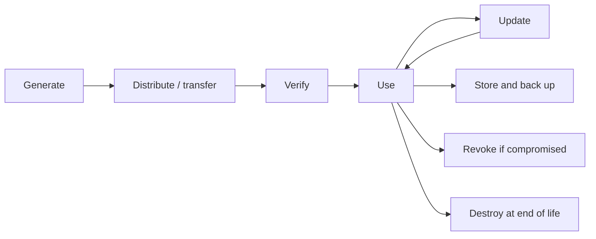
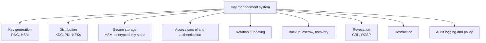

# Unit 4 · Key Management

> **Exam weight:** the most repeated unit. Three Mid-2 questions came back **word for word** in the 2025-26 end-sem: key space (linear vs nonlinear), key management with public-key distribution, and key-selection strategies. Nonlinear key space was also a short note. Learn these four answers completely.

**Prefer to watch first?** [Video lectures for Unit 4 →](#videos/unit4)

Follows Schneier, *Applied Cryptography*, chapter 8, with Stallings for public-key distribution.

## 4.1 Key management  ⭐⭐⭐ (Mid-2 Q2, End Q7b)

**Definition.** <u>Key management is the set of processes and procedures for the generation, distribution, storage, use, updating, backup, revocation and destruction of cryptographic keys throughout their life cycle.</u>

Schneier: "In the real world, key management is the hardest part of cryptography." Designing a secure algorithm is (comparatively) easy; keeping keys secret is hard. Attackers attack the **weakest link**, and that is usually key management: it is cheaper to bribe a clerk than to break AES.

*Fig. 4.1: Life cycle of a cryptographic key.*

## 4.2 Generating keys

### Reduced keyspaces
If the software allows only some characters, the effective keyspace shrinks dramatically. For an 8-character key:

| Characters allowed | Possible keys | Effective bits | Brute force at 106 keys/s |
|---|---|---|---|
| Lowercase letters (26) | 2.1 × 1011 | 37.6 | about 2.4 days |
| Lowercase + digits (36) | 2.8 × 1012 | 41.4 | about 33 days |
| Alphanumeric (62) | 2.2 × 1014 | 47.6 | about 7 years |
| Printable characters (95) | 6.6 × 1015 | 52.6 | about 210 years |
| ASCII (128) | 7.2 × 1016 | 56.0 | about 2,300 years |
| 8-bit bytes (256) | 1.8 × 1019 | 64.0 | about 585,000 years |

A 56-bit DES key typed as 8 lowercase letters is really a 37.6-bit key.

### Poor key choices
People choose names, birthdays, dictionary words. Daniel Klein's dictionary attack guessed about **40%** of passwords on typical computers. A **dictionary attack** tries, in order: user name and initials; words from dictionaries (names, places, famous people, films); permutations (capitals, reversed, letters swapped for digits: "passw0rd"); foreign-language words; word pairs.

### Random keys
The best keys are **random bit strings** from a reliable source: a hardware random generator (thermal noise, radioactive decay) or a **cryptographically secure pseudo-random generator**.

### Pass phrases
A long, memorable sentence is converted to a key by a one-way hash function (**key crunching**). English carries about 1.3 bits of information per character, so a 64-bit key needs a phrase of about 49 characters (about 10 words).

### X9.17 key generation (ANSI)
Generates keys using 3DES (triple-DES) with a key K reserved for key generation, a 64-bit seed V0 and a timestamp Ti:
Ri = EK(EK(Ti) ⊕ Vi), and the next seed Vi+1 = EK(EK(Ti) ⊕ Ri). Ri is the key.

### DoD key generation
The US Department of Defense recommends DES in OFB mode, seeded by system interrupt vectors, status registers, counters and timestamps.

## 4.3 Strategies for key selection; improper key selection  ⭐⭐⭐ (Mid-2 Q6, End Q6b)

**Strategies:**
1. **Use true randomness:** hardware RNG or a cryptographically secure PRNG (OS sources like /dev/urandom), never rand() or the time of day.
2. **Use the full keyspace:** all 256 byte values, not only typed characters.
3. **Adequate length:** at least 128 bits for symmetric keys, 2048 bits for RSA, 256-bit elliptic curve.
4. **Pass phrases with key crunching** (or key-derivation functions such as PBKDF2, bcrypt, scrypt with salt and many iterations) when a human must remember the key.
5. **Standard generators:** ANSI X9.17, NIST SP 800-90.
6. **Avoid weak keys** of the algorithm (DES has 4 weak and 12 semi-weak keys).
7. **Different keys for different purposes** (encryption vs signing vs authentication) and for different users and sessions.
8. **Limit lifetime:** change keys periodically; session keys per session.
9. **Protect the generation process:** in a secure environment (an HSM), with no copies left behind.

**How improper selection compromises security:**
1. **Reduced keyspace:** an 8-lowercase-letter "56-bit" key falls in days, as the table above shows.
2. **Dictionary attacks** on human-chosen keys succeed against a large share of users.
3. **Predictable random generators:** Netscape's early SSL (1995) seeded its generator with the time and process IDs, so session keys could be guessed in minutes; the Debian OpenSSL bug (2008) left only 32,768 possible keys.
4. **Reused keys:** reusing a one-time pad or a stream-cipher key lets the attacker XOR two ciphertexts and cancel the key; reusing DSA's k reveals the private key.
5. **Weak keys** make some algorithms trivially breakable for those keys.
6. **Same key for many purposes** spreads the damage of one compromise.
7. **Keys too short** for the data's lifetime: what is safe today may be brute-forced in 10 years.

**Conclusion line:** an algorithm is only as strong as its key; poor key selection turns a 2128 search into a 230 one.

## 4.4 Key space; linear vs nonlinear key space  ⭐⭐⭐ (Mid-2 Q4, End Q7a, Q8c)

**Definition.** <u>The key space is the set of all possible keys for a cryptographic algorithm; for an n-bit key it has 2n keys. Its size sets the cost of a brute-force attack (on average 2n−1 trials).</u>

**Linear (flat) key space:** <u>every key in the key space is equally strong; any key chosen at random gives full security.</u> Most modern algorithms (AES, DES apart from a few weak keys) aim for this.

**Nonlinear key space (Schneier):** <u>a key space in which keys are not all equally strong: only certain keys (the "strong" ones) make the algorithm work securely, while the rest give weak encryption, and only someone who knows the secret rule can choose strong keys.</u>

**Why nonlinear key spaces are used:** the military wants equipment that is useless to an enemy who captures it. The algorithm is public (or will be captured), but a key that is not of the right form gives weak, easily broken encryption; only someone who knows the secret rule can make strong keys. *Implementation idea:* the key consists of two parts, the real key and a value derived from it with a secret function (for example, encrypted with a secret fixed key); the algorithm checks the relationship, and if it fails it uses a weakened version of itself.

| Basis | Linear key space | Nonlinear key space |
|---|---|---|
| Key strength | All keys equally strong | Only some keys strong |
| Who can generate good keys | Anyone, at random | Only those who know the secret rule |
| Effect of a random key | Full security | Probably weak encryption |
| Use | Commercial and general cryptography | Military equipment that may be captured |
| Analysis | Security = size of key space | Security depends on secrecy of the rule as well |
| Risk | — | The rule may leak; it also gives a trapdoor that may be abused |

**Impact on cryptographic strength:**
- In a linear space, strength is simply log2(key space): 128 bits = 2128 work.
- A nonlinear space **reduces the effective key space** for anyone who does not know the rule (an enemy with captured equipment uses weak keys), while legitimate users keep full strength.
- An accidental nonlinear key space (weak keys, keys with structure) is a **weakness**: algorithms should be checked for it, and keys tested against weak-key lists.

## 4.5 Transferring keys

**Problem:** Alice and Bob need the same symmetric key; sending it in the clear defeats the purpose.

1. **Key-encryption keys (KEKs):** a long-term key is used only to encrypt short-term data keys (session keys) for transfer. The KEK is distributed manually (in person, by courier), rarely.
2. **Split the key:** divide the key into several pieces (secret splitting) and send each by a different channel: one by phone, one by post, one by courier, one by carrier pigeon. An attacker must intercept all channels.
3. **Key distribution centre:** Trent delivers session keys encrypted under each user's KEK.
4. **Public-key cryptography:** encrypt the session key with the receiver's public key.
5. **Key distribution in large networks:** hierarchies of KDCs.

ANSI X9.17 defines two kinds of keys: **key-encryption keys** (to encrypt other keys) and **data keys** (to encrypt traffic).

## 4.6 Verifying keys

When Bob receives a key, how does he know it came from Alice and not from Mallory?
1. **Received in person** (or by a trusted courier).
2. **Signed by Trent:** Trent signs the key; Bob verifies with Trent's public key (this is a certificate).
3. **Key fingerprint:** Alice and Bob compare a one-way hash of the key over the phone (voice is hard to fake).
4. **Error detection:** a key verification value: encrypt a constant (zeros) with the key and send the first bytes of the result; the receiver repeats it to check the key arrived intact.
5. **Verifying during decryption:** add a known header or checksum to messages so a wrong key is noticed.

## 4.7 Using keys

- **Keep keys out of reach:** keys should never appear unencrypted outside a secure device (smart card, HSM).
- **Key-use control:** a key should be usable only for its purpose. **Control vectors (IBM):** a tag attached to each key stating what it may be used for; the key is encrypted with (KEK ⊕ control vector), so it decrypts correctly only for the allowed operation.
- **Different keys** for encryption, signing, key encryption.
- **Updating keys:** derive a new key from the old with a one-way function (both sides do it), so a later compromise does not reveal earlier traffic.
- **Storing keys:** in memory only when needed; encrypted with a KEK on disk; in tamper-resistant hardware; split among several people.
- **Backup keys:** **key escrow** or secret sharing so that a lost key or departed employee does not lose all data.
- **Compromised keys:** revoke immediately, notify everyone, keep a revocation list.
- **Lifetime of keys:** shorter for data-encryption keys and session keys; longer for KEKs and signature keys; a key's lifetime depends on the value of the data and the volume of traffic it protects.
- **Destroying keys:** overwrite securely (several times); destroy paper and media copies; erase temporary files and swap space.

## 4.8 Components of a key management system (KMS)  ⭐ (Mid-2 Q3)

*Fig. 4.2: Components of a key management system.*

1. **Key generation:** secure random generation inside a **hardware security module (HSM)**.
2. **Key distribution:** KDC, PKI and certificates, key wrapping with KEKs.
3. **Secure storage:** HSMs, encrypted key stores; keys never in plaintext on disk.
4. **Access control:** who and which applications can use which keys (roles, authentication, dual control).
5. **Key rotation and updating** on a schedule and on demand.
6. **Backup, escrow and recovery.**
7. **Revocation:** certificate revocation lists (CRL), OCSP.
8. **Destruction** at end of life.
9. **Audit logging, monitoring and policy:** every key operation logged; compliance with standards (NIST SP 800-57, PCI DSS).

*Examples:* AWS KMS, Azure Key Vault, HashiCorp Vault, bank HSMs.

## 4.9 Public-key key management and distribution  ⭐⭐⭐ (End Q7b)

Public keys need **no secrecy**, but they need **authenticity**: Alice must be sure the public key really belongs to Bob (otherwise man-in-the-middle). Stallings gives four methods:

*Fig. 4.3: Methods of public-key distribution, from weakest to strongest.*

1. **Public announcement:** each user broadcasts his public key (on a website, in e-mail signatures, PGP key servers). *Problem:* anyone can forge an announcement and pretend to be Bob.
2. **Publicly available directory:** a trusted organisation maintains a directory of {name, public key}; users register in person or by authenticated means; they can replace keys. *Problems:* the directory is a target; if its private key is compromised, all entries can be forged.
3. **Public-key authority:** a central authority holds the directory and answers requests with signed, timestamped replies:
   (1) A → Authority: request ‖ T1; (2) Authority → A: E(PRauth, [PUB ‖ request ‖ T1]); (3) A → B: E(PUB, [IDA ‖ N1]); (4)–(5) B gets A's key the same way; (6) B → A: E(PUA, [N1 ‖ N2]); (7) A → B: E(PUB, N2). *Problem:* the authority is a bottleneck and must be online.
4. **Public-key certificates:** a **certificate authority (CA)** signs a certificate CA = E(PRCA, [T ‖ IDA ‖ PUA]). Users exchange certificates directly, without contacting the authority; anyone can verify with the CA's public key. **X.509** is the standard; it is the basis of HTTPS (PKI).

**Challenges:**
1. **Trust in the CA:** a compromised or dishonest CA can issue false certificates (DigiNotar 2011).
2. **Revocation:** keys get compromised; CRLs are slow and large, OCSP needs online servers.
3. **Scalability:** billions of users and devices; hierarchies of CAs and cross-certification.
4. **Key binding and identity verification:** CAs must check identities properly before issuing.
5. **Validity and expiry:** clocks must be synchronised; expired certificates break services.
6. **Private-key protection** at both the CA and the user.
7. **Usability:** users ignore certificate warnings.
8. **Distributed key management (PGP web of trust)** avoids a central CA but makes trust harder to judge.

## Exam checklist for Unit 4
- [ ] Definition of key management and the life-cycle diagram
- [ ] Reduced keyspace table, poor key choices, random keys, pass phrases, X9.17
- [ ] Nine key-selection strategies and seven ways bad selection fails
- [ ] Key space definition; linear vs nonlinear table; impact on strength
- [ ] Transferring keys (KEKs, splitting, KDC), verifying keys, using keys (control vectors)
- [ ] KMS components diagram
- [ ] Four methods of public-key distribution with problems; certificate format; challenges
