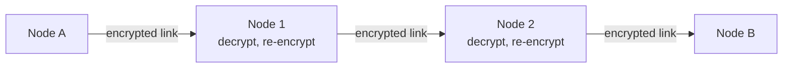
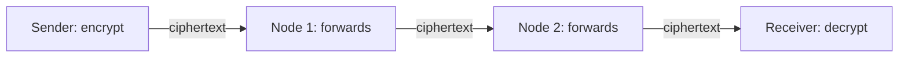
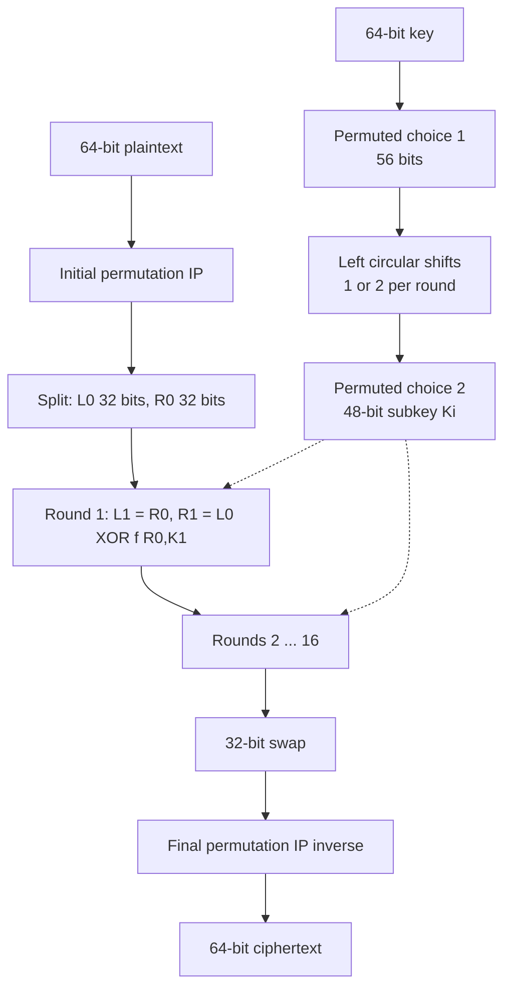
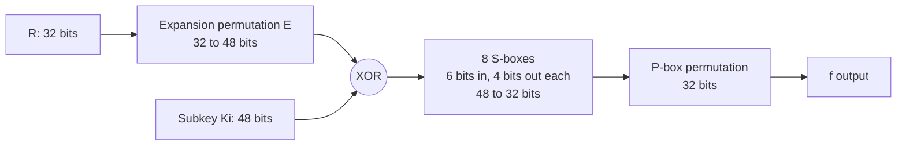
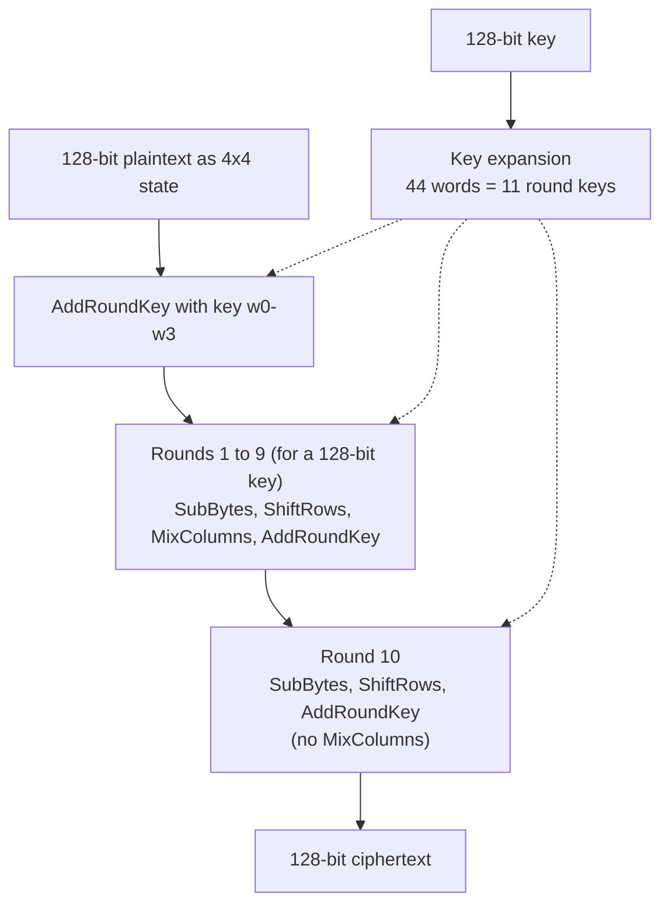

# Unit 5 · Using Algorithms: Choosing, Channels, Storage, DES, AES and RSA

> **Exam weight:** DES was asked in Mid-2 and came back in the end-sem as "AES in detail, and why it beats DES" (AES is not in the syllabus, but it was asked, so learn it). Public key vs symmetric was a short note. RSA has not been asked yet: expect it.

**Prefer to watch first?** [Video lectures for Unit 5 →](#videos/unit5)

Follows Schneier, *Applied Cryptography*, chapter 10, 12 (DES) and 19 (RSA), with Stallings for AES.

## 5.1 Choosing an algorithm

Schneier lists the options when choosing an algorithm:
1. **A published algorithm**, believing that it has been examined by many cryptographers; if nobody has broken it yet, it is probably good. (Best choice.)
2. **Trust a manufacturer**, believing a well-known company will not risk its reputation selling weak equipment.
3. **Trust a private consultant**, believing an impartial expert evaluated the algorithm.
4. **Trust the government**, believing it will not mislead its citizens (but intelligence agencies may want weak algorithms).
5. **Write your own**, believing your ability is second to none. (Usually a mistake: amateurs' algorithms are almost always weak.)

**Criteria:** security (public analysis, key length), speed, cost and licensing (patents), standards compliance (DES, AES, RSA), export rules, availability of implementations, and the value and lifetime of the data.

## 5.2 Public-key cryptography versus symmetric cryptography  ⭐ (End Q8f)

| Basis | Symmetric | Public key |
|---|---|---|
| Keys | One shared secret key | Public + private key pair |
| Speed | Fast (about 1000× faster) | Slow |
| Key distribution | Hard: needs a secure channel | Easy: public key can be published |
| Keys for n users | n(n − 1)/2 | 2n |
| Key length for similar security | 128 bits | 3072-bit RSA (or 256-bit ECC) |
| Services | Confidentiality, MAC | Confidentiality, signatures, key exchange |
| Chosen-plaintext attack on small message sets | Not possible without the key | Possible (encrypt all candidates with the public key) |
| Examples | DES, 3DES, AES | RSA, Diffie–Hellman, DSA, ECC |

**Schneier's conclusion (after Needham and Schroeder):** public-key cryptography is **not a replacement** for symmetric cryptography. Public key is used to **encrypt keys** and to **sign**; symmetric cryptography is used to **encrypt messages** (hybrid cryptosystems). Public key solves the key-management problem, symmetric solves the speed problem.

## 5.3 Encrypting communication channels

### Link-by-link encryption

*Fig. 5.1: Link-by-link encryption: every link has its own key; data is plaintext inside each node.*

Encryption at the **physical / data-link layer**; every bit on the line is encrypted, including headers, so it also gives **traffic-flow security** (an eavesdropper cannot see who talks to whom).

### End-to-end encryption

*Fig. 5.2: End-to-end encryption: data stays encrypted through every intermediate node.*

Encryption at a higher layer (application, transport); headers stay in clear for routing.

| Basis | Link-by-link | End-to-end |
|---|---|---|
| Where | Each link, by node hardware | At the endpoints, by the user's software |
| Data inside nodes | Plaintext (nodes must be trusted) | Encrypted |
| Headers / routing | Encrypted (traffic-flow security) | In clear (traffic analysis possible) |
| Keys | One per link; few keys per node | One per pair of users; many keys |
| Transparent to users | Yes | No |
| Protects against | Line tapping | Line tapping and compromised nodes |

**Combining the two** gives the best protection: end-to-end for the data, link encryption for headers and traffic flow.

## 5.4 Encrypting data for storage

Stored data has different problems from data in transit: it may be kept for years; the key must be kept as long as the data; plaintext copies may remain on disk.

- **Dereferencing keys:** encrypt each file with its own random file key, and store the file key encrypted with a master key. Changing the master key only re-encrypts the small file keys.
- **Driver-level vs file-level encryption:** driver (full-disk) encryption is transparent and encrypts everything, including temporary files and swap; file-level encryption protects chosen files and can follow the file elsewhere.
- **Random access:** use modes that allow decrypting any block independently (counter or XTS mode) so a database can read one record without decrypting the whole disk.
- **Compression before encryption**, never after (ciphertext does not compress).
- **Key backup and escrow** so data is not lost with a key; secure deletion of plaintext originals.

## 5.5 DES (Data Encryption Standard)  ⭐⭐ (Mid-2 Q1)

**Definition.** <u>DES is a symmetric block cipher, adopted as a US federal standard (FIPS 46) in 1977, that encrypts 64-bit blocks of plaintext with a 56-bit key through 16 rounds of a Feistel network.</u> Developed by IBM (Lucifer), modified with the NSA.

**Parameters:** block 64 bits; key 64 bits with 8 parity bits → **56-bit effective key**; **16 rounds**; sixteen 48-bit subkeys.

*Fig. 5.3: Overall structure of DES.*

**Operational phases:**
1. **Initial permutation (IP):** rearranges the 64 bits (no security value; for hardware loading).
2. **16 Feistel rounds:** Li = Ri−1; Ri = Li−1 ⊕ f(Ri−1, Ki).
3. **32-bit swap** of the halves after round 16.
4. **Final permutation (IP−1).**

**The round function f(R, K):**

*Fig. 5.4: The DES f-function.*

1. **Expansion (E):** 32 bits → 48 bits (some bits repeated), so the output can be XORed with the 48-bit subkey and gives the **avalanche effect**.
2. **XOR with subkey Ki.**
3. **S-box substitution:** eight S-boxes, each taking 6 bits and giving 4 bits (the outer two bits choose the row, the inner four the column). The S-boxes are the **only non-linear** part and the heart of DES security.
4. **P-box permutation** of the 32 bits.

**Key schedule:** 64-bit key → **PC-1** drops the parity bits (56 bits) → split into two 28-bit halves C and D → each round, **left circular shift** by 1 or 2 bits → **PC-2** selects 48 bits as Ki.

**Decryption:** the same algorithm with the subkeys in reverse order (K16 … K1), a property of the Feistel structure.

**Security:** 56-bit key is too short: EFF's Deep Crack found a key in 56 hours (1998), and in 22 hours with distributed.net (1999). 4 **weak keys** and 12 semi-weak keys. Differential and linear cryptanalysis need 247 and 243 known/chosen plaintexts. **Triple DES** (two or three keys, EDE) extends it to 112 or 168 bits.

**Modes of operation:** ECB, CBC, CFB, OFB (and CTR).

## 5.6 AES (Advanced Encryption Standard)  ⭐⭐ (End Q3a, beyond the syllabus)

**Definition.** <u>AES is the symmetric block cipher selected by NIST in 2001 (FIPS 197) to replace DES; it is the Rijndael algorithm (Daemen and Rijmen), encrypting 128-bit blocks with 128-, 192- or 256-bit keys in 10, 12 or 14 rounds.</u>

**Data structure:** the 128-bit block is arranged as a **4 × 4 matrix of bytes** called the **state**. AES is a **substitution–permutation network**, not a Feistel cipher: the whole block is processed in every round.

*Fig. 5.5: AES encryption (128-bit key).*

**The four transformations in each round:**
1. **SubBytes:** each byte is replaced using a 16 × 16 S-box (multiplicative inverse in GF(28) followed by an affine transformation). Gives **non-linearity (confusion)**.
2. **ShiftRows:** row 0 unchanged; rows 1, 2, 3 shifted left cyclically by 1, 2, 3 bytes. Spreads bytes across columns.
3. **MixColumns:** each column is multiplied by a fixed matrix over GF(28), mixing the four bytes of the column. Gives **diffusion**. (Omitted in the last round.)
4. **AddRoundKey:** the state is XORed with the 128-bit round key. The only step that uses the key.

**Key expansion:** the key is expanded into 44 words (for 128 bits) using RotWord, SubWord and round constants (Rcon); each round uses 4 words.

**Decryption:** inverse operations (InvSubBytes, InvShiftRows, InvMixColumns) with round keys in reverse order.

### Why AES is more secure and efficient than DES

| Basis | DES | AES |
|---|---|---|
| Key length | 56 bits (broken by brute force) | 128, 192 or 256 bits (2128 work at least) |
| Block size | 64 bits (birthday problems after 232 blocks) | 128 bits |
| Structure | Feistel: half the block per round | SPN: whole block every round, faster diffusion |
| Rounds | 16 | 10 / 12 / 14 |
| Design | S-box design criteria were secret (NSA) | Open, public competition and analysis (1997–2000) |
| Attacks | Differential and linear cryptanalysis, brute force | Designed to resist differential and linear cryptanalysis; no practical attack |
| Efficiency | Bit permutations are slow in software; 3DES is 3× slower | Byte and word operations; fast in software and hardware (AES-NI instructions); fits smart cards |
| Status | Withdrawn as a standard (2005) | Worldwide standard (TLS, Wi-Fi WPA2/3, disk encryption) |

## 5.7 RSA  ⭐ (not yet asked: likely)

**Definition.** <u>RSA (Rivest, Shamir, Adleman, 1978) is a public-key algorithm used for both encryption and digital signatures, whose security rests on the difficulty of factoring the product of two large primes.</u>

**Key generation:**
1. Choose two large random primes p and q.
2. n = p × q.
3. φ(n) = (p − 1)(q − 1).
4. Choose e with gcd(e, φ(n)) = 1 (commonly 65537).
5. d = e−1 mod φ(n).
6. Public key (e, n); private key (d, n); destroy p and q.

**Encryption:** c = me mod n. **Decryption:** m = cd mod n. **Signature:** s = md mod n; verify m = se mod n.

**Worked example:** p = 17, q = 11 → n = 187, φ(n) = 160. e = 7, d = 23 (7 × 23 = 161 ≡ 1 mod 160).
- Encrypt m = 88: 882 mod 187 = 77; 884 = 772 mod 187 = 132; 887 = 132 × 77 × 88 mod 187 = **11**.
- Decrypt c = 11: 1123 mod 187 = **88** ✓.

**Smaller example:** p = 3, q = 11 → n = 33, φ = 20, e = 3, d = 7. m = 4 → c = 64 mod 33 = **31** → 317 mod 33 = **4** ✓.

**Speed:** about 1000 times slower than DES in hardware, 100 times in software; so RSA encrypts keys and signs hashes, not bulk data.

**Security and attacks:** factoring n (use 2048 bits or more); **chosen-ciphertext attacks** (never sign arbitrary data; use padding such as OAEP/PSS); **common modulus attack** (never share n among users); **low encryption exponent** attacks (pad messages); **timing attacks** (blinding).

## Exam checklist for Unit 5
- [ ] Five ways of choosing an algorithm and the criteria
- [ ] Symmetric vs public-key table and Schneier's conclusion (hybrid)
- [ ] Link-by-link vs end-to-end diagrams and table
- [ ] Storage encryption: dereferencing keys, driver vs file level
- [ ] DES: parameters, structure diagram, round function, key schedule, security
- [ ] AES: parameters, state, four transformations, round diagram, AES vs DES table
- [ ] RSA: key generation, both worked examples, attacks
